# Link Lens

A LangGraph agent investigates public business datasets and produces mapping configurations for human approval. One shared engine then extracts observations, links entities and generates profiles with provenance. The submitted pipeline uses **Jev for triage and identity judgments, GPT-6 Luna for ontology evolution and onboarding, and an embedding model for candidate retrieval**.

**Models and code at a glance:**

| Stage | Approach |
|---|---|
| Discovery | **Jev + deterministic code** for relevance ranking, download checks and source selection. |
| Ontology evolution | **LLM proposals and semantic critique + deterministic validation** of evidence, additive definitions, types and subject scope; versioned activation and explicit human promotion. |
| Onboarding | **Agentic LangGraph workflow with an LLM + deterministic code** for dataset investigation, mapping proposals and validation; human approval precedes deterministic extraction. |
| Entity identification | **Deterministic exact ABN/ACN matching** by default. The submitted `enhance` stage adds fuzzy retrieval, an **embedding model and Jev** assessments, with deterministic evidence and cluster checks. |
| Company profiles | **Deterministic evidence selection** by default. The submitted `enhance` stage adds **Jev** claim-equivalence judgments and an **LLM** for conflict annotations; original source values and provenance are retained. |

**Flexible ontology:** Link Lens now supports reusable new concepts instead of a fixed target list. An LLM proposes and critiques additions from discovery evidence and documentation; deterministic code validates types, scope, dependencies and additive compatibility. Mappings pin an immutable ontology hash and still require human approval. The submitted ontology has 59 concepts, with 24 additions contributing to profiles. [How ontology evolution works](#ontology-evolution).

**[Explore the live evidence viewer →](https://tam159.github.io/link-lens/)** Browse business profiles, explore their connections and inspect supporting evidence directly in your browser—no setup required. The viewer presents the saved submission snapshot.

**Choose a starting point:** [How it works](#how-it-works) · [Run locally](#run-locally) · [Local tools and URLs](#local-tools-and-urls) · [Read the write-up](WRITEUP.md) · [Inspect saved results](outputs/README.md) · [Follow the illustrated demo](docs/DEMO.md)

## Inspect saved results without setup

No credentials, Docker or database are needed to read the submitted outputs:

- [Results and evaluation](outputs/README.md): completion status, counts, approvals and measurements.
- [OKF viewer](outputs/okf/viewer.html): open this file in a browser to explore the 60 profiles. It loads CDN libraries; use [Markdown dossiers](outputs/okf/index.md) or [screenshots](docs/DEMO.md) offline.
- [Write-up](WRITEUP.md): design decisions, evaluation, costs, source challenges and scale considerations.

The six mappings and submission promotion are approved. Human dataset/link evidence checks remain pending; historical AI audits have not been reused for the new evidence. Saved files do **not** populate a fresh database or recreate live Inbox threads.

## How it works

[Discovery](#discovery-and-download-gate) · [Ontology evolution](#ontology-evolution) · [Onboarding](#stateful-onboarding) · [Entity identification](#entity-identification) · [Company profiles](#company-profiles) · [Storage and contracts](#storage-and-runtime-contracts) · [Skip to setup](#run-locally)

The overview below follows the five stages of the submitted pipeline. Each column is a stage; the rows separate model judgments, deterministic code, human decisions and stored evidence. Each stage section below opens with a detailed diagram. How the stages run as a product, with Dagster, dbt, the product service and the operations console, is under [Production architecture](#production-architecture).

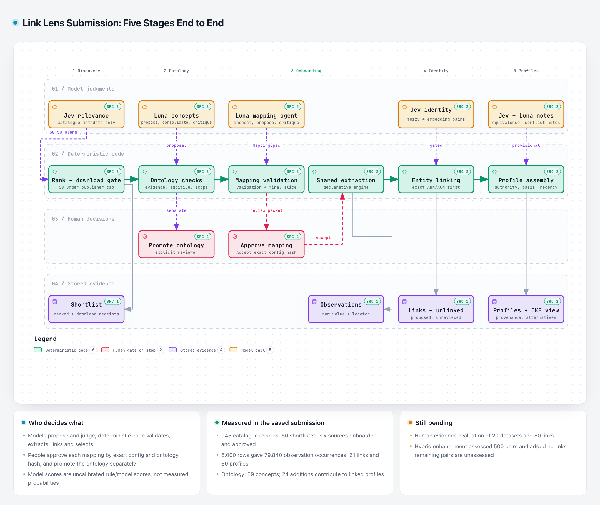

The diagrams in this README were drawn from the source at the commit that added them and saved as static images; boxes marked `SRC` were traced to specific files and line ranges. The counts in the cards are those of the saved submission.

### Discovery and download gate

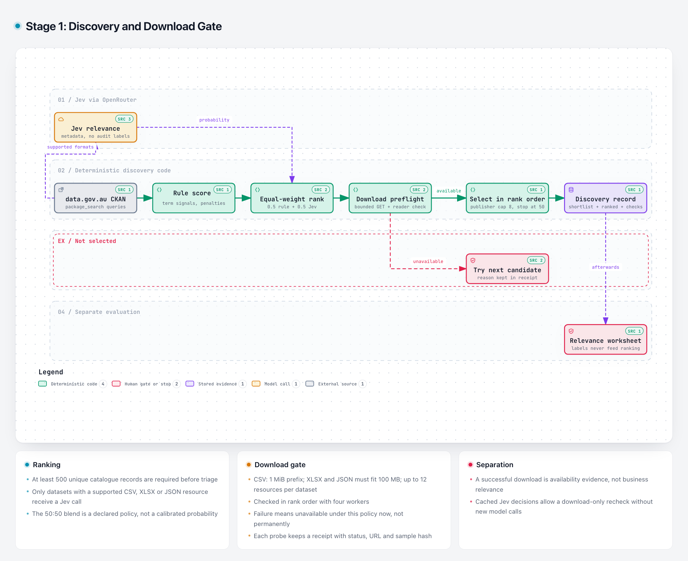

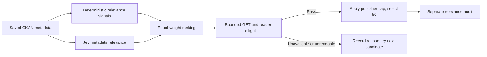

Availability is checked before shortlisting. Semantic relevance is evaluated afterward; those labels do not feed back into the frozen ranking. Cached Jev decisions allow a download-only rerun without extra model calls. The final shortlist retains all six previously onboarded portfolio sources.

`downloadability.py` performs bounded GETs and parser preflights in rank order, with four workers and the existing eight-per-publisher cap. It retains URLs, status/error, sample hashes and reader evidence; tries up to twelve supported resources per dataset; and rejects HTML, empty files, unsupported ZIP payloads and resource-index CSVs. CSV is a 1 MiB prefix; XLSX/JSON must fit 100 MB. Public external publisher hosting is checked as well as government hosting; private destinations are blocked. HTTPS is attempted for legacy HTTP links. Failure means unavailable under this policy at this time, not permanently unavailable. The current-discovery pointer preserves the original discovery record and old evaluation IDs. Semantic evaluation remains separate from download checks.

### Ontology evolution

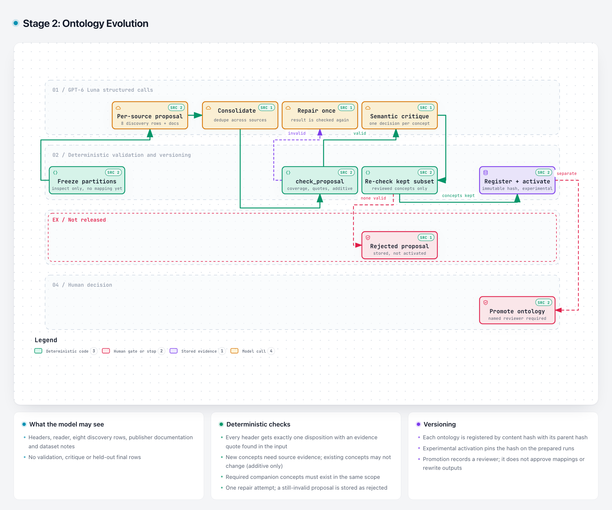

Before any mapping is proposed, the ontology can grow to cover concepts the new sources need. The stage runs once across the prepared source runs:

1. **Freeze evidence.** Each run is inspected and partitioned without starting a mapping. The model later sees only headers, the reader, eight discovery rows, publisher documentation and dataset notes; validation and held-out final rows are excluded.
2. **Propose and consolidate.** GPT-6 Luna gives every source header one disposition: an existing concept, a new concept, insufficient evidence or non-domain metadata. A second call deduplicates the proposals across sources.
3. **Check deterministically.** Code verifies that every header is covered exactly once, each evidence quote appears in the supplied input, new concepts have source evidence, existing concepts are unchanged (additive only) and required companion concepts share the same scope. One repair attempt is allowed.
4. **Critique.** A separate Luna call decides on each new concept independently; only the kept subset is re-checked and released.
5. **Register and activate.** The ontology is stored under its content hash with its parent hash and activated experimentally, and the prepared runs pin that hash. A proposal with no valid concepts is stored as rejected.

Promotion is a separate, explicit human action that records a reviewer; it does not approve mappings or rewrite outputs. See [scope, commands and budget](#experimental-ontology-evolution).

### Stateful onboarding

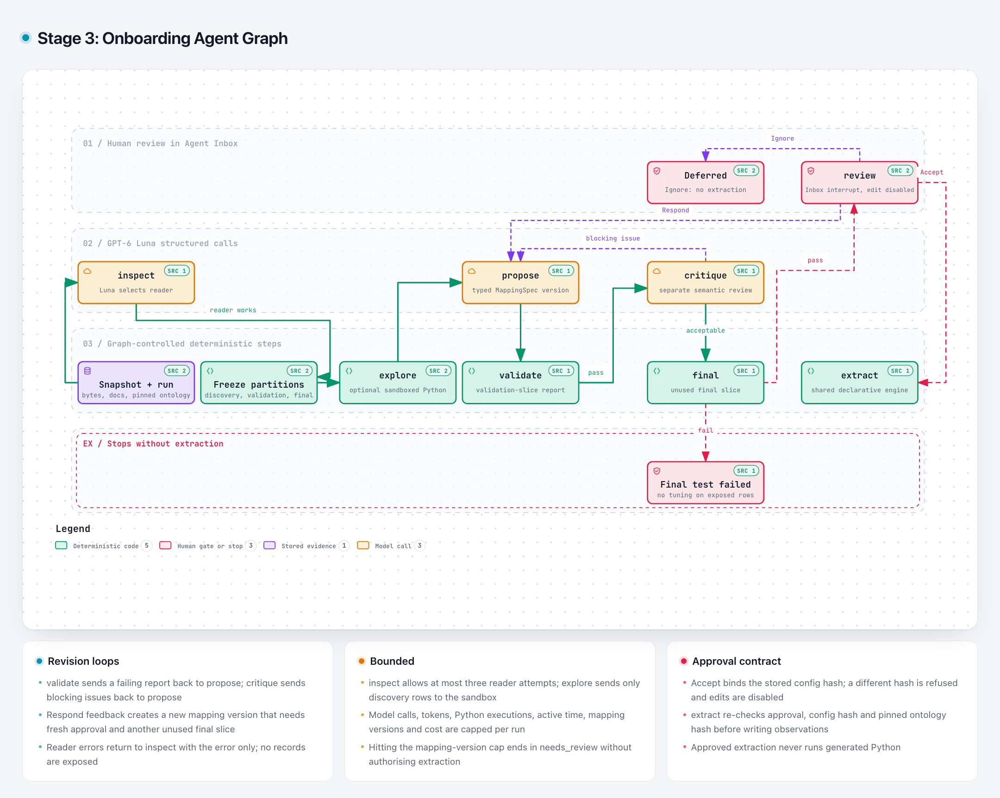

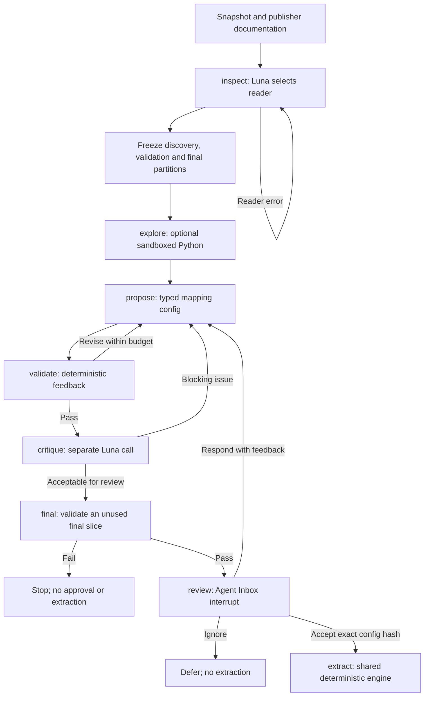

The node names match [agent.py](src/link_lens/agent.py). The partition box represents work inside `inspect`; it is not a separate graph node. All automatic revision paths are bounded by model-call, mapping-version, Python, time and cost budgets. Exhaustion retains a reviewable run record without authorising extraction. Feedback-driven changes require a fresh approval and another unused final slice; final-test failure does not loop against the exposed test data.

Agent Inbox makes the human review step visible. The queue lists source mappings awaiting a decision; opening one shows the proposed fields, confidence, evidence and review controls.

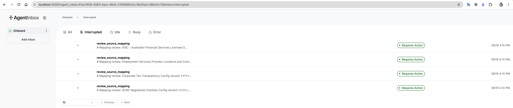

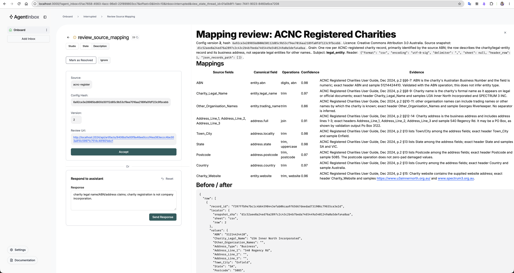

**Accept** approves the exact config and ontology hash, **Respond** requests a revision, and **Ignore** defers extraction. These screenshots show an earlier review session; their queue state and mapping versions are historical. All six submitted mappings are now approved. See [current approvals](outputs/approval-manifest.json) and the [illustrated demo](docs/DEMO.md).

For the eight-node transition diagram, node responsibilities, checkpointed state and tool interfaces, open [the engineering guide](docs/ENGINEERING.md), section **Part 2: LangGraph agent design**. It distinguishes structured model calls from graph-controlled execution and shows where evidence is stored.

### Entity identification

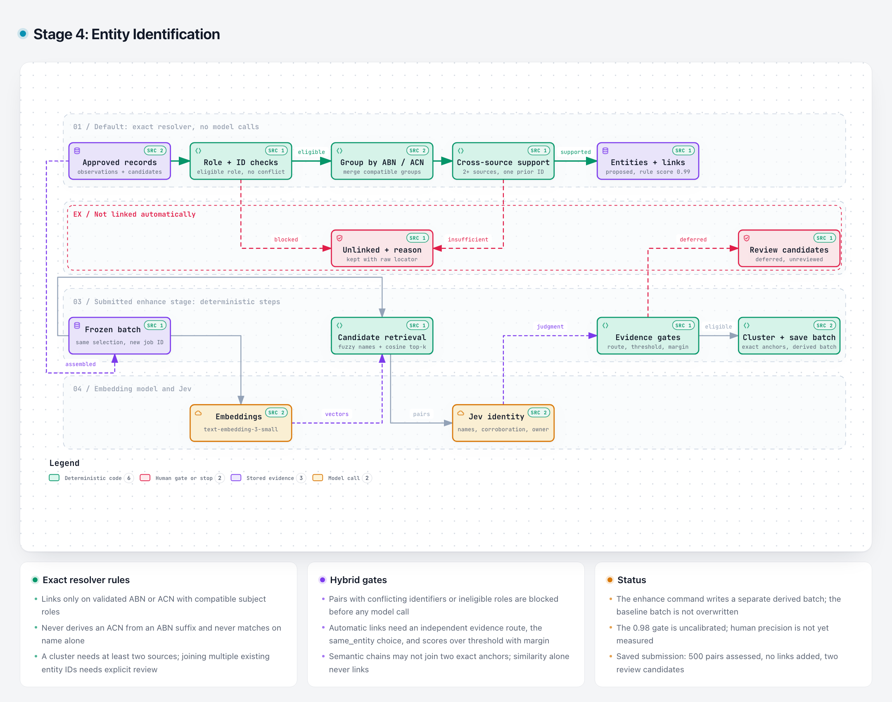

The default `assemble` path uses [the exact resolver](src/link_lens/resolution.py) to link source records using exact, validated ABN or ACN values and compatible subject roles. This stage is deterministic Python: it makes no LLM calls and does not match on names alone or derive an ACN from an ABN suffix.

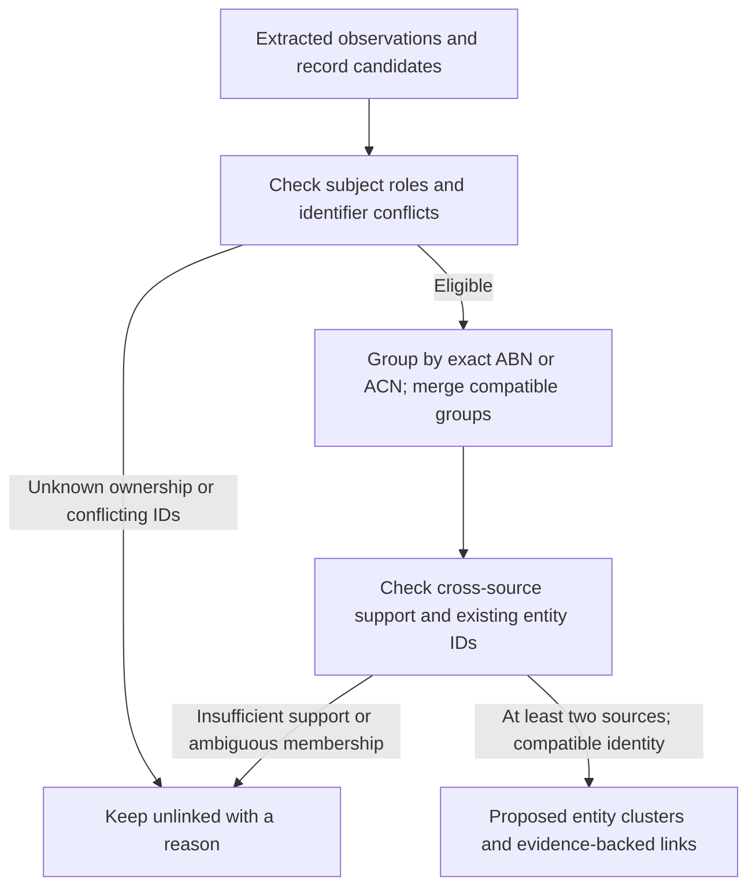

For example, an ASIC record and an ACNC record with the same validated ABN can support one entity cluster. Conflicting identifiers block linking; joining multiple existing entity IDs requires explicit membership review. Each link preserves the matched identifier, subject roles and exact source locators. Links remain proposed and unreviewed; their rule scores are not measured probabilities. Inspect [links](outputs/links.jsonl) and [unlinked records](outputs/unlinked.jsonl).

The submitted **bounded hybrid resolver** adds fuzzy-name and `text-embedding-3-small` candidate retrieval, followed by Jev identity judgments. It assesses sparse candidates for review, while automatic links require compatible names, independent corroboration, clear ownership, and consistent cluster membership. Supported corroboration includes full addresses, website domains, and constrained combinations of distinctive names and location evidence; service locations require additional ownership checks. It can create provisional companies without ABN/ACN. Conflicting identifiers and ambiguous joins remain deferred; similarity alone cannot create a link. Its initial 0.98 model-score gate is uncalibrated and human precision is not yet measured.

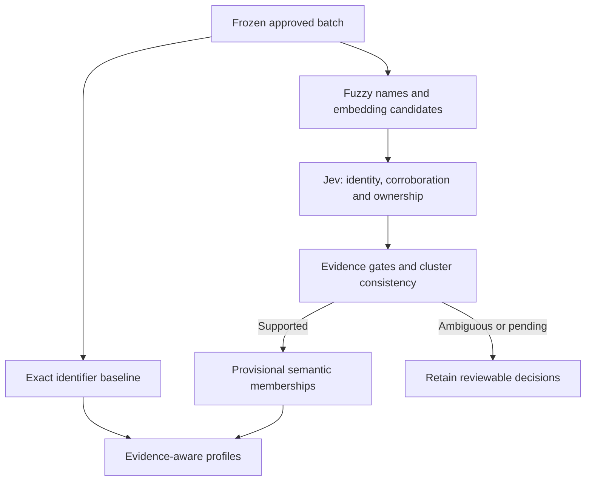

Run `uv run link-lens enhance --batch-id BATCH_ID` to create a separate derived batch and export to `outputs/local-run/enhanced-v2/`. Use `--preflight-only` for a free evidence-coverage check, or `--max-pairs 50` for a bounded first assessment. Progress appears on stderr and deferred review candidates are exported separately. This command makes paid calls; it preserves the original selection and submission. See [experimental enhancement operations](docs/ENGINEERING.md#experimental-hybrid-enhancement) for configuration, caching, budget recovery and evaluation.

### Company profiles

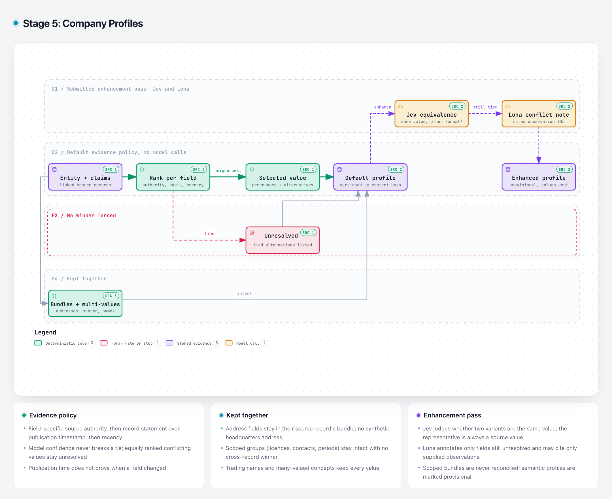

Default [profile assembly](src/link_lens/profiles.py) gathers claims from each entity's linked records and applies a fixed evidence policy, with no LLM calls. Competing values are ranked by field-specific source authority, then record-statement versus publication timestamp evidence, then recency. For example, the policy gives a company register priority over a charity register for legal names.

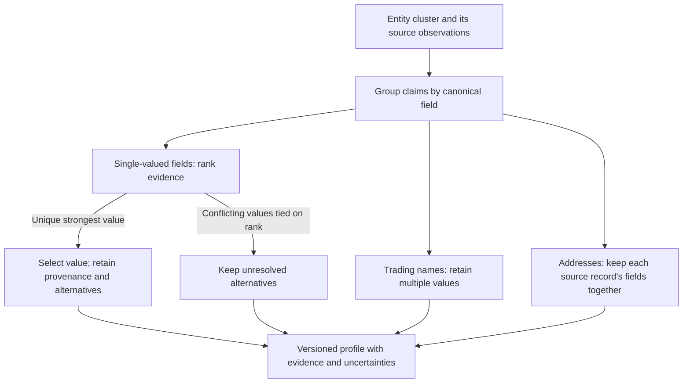

Address components stay together rather than forming a synthetic address from different sources. Publication dates do not prove when a field changed, and profiles retain the uncertainty of their proposed identity links. [The pipeline](src/link_lens/pipeline.py) connects resolution and profile assembly; inspect the resulting [profiles](outputs/profiles.jsonl) or [readable dossiers](outputs/okf/index.md).

The optional enhancement pass uses Jev to identify equivalent representations while preserving every source value. A representative comes from an existing observation under the authority/time policy. The configured LLM can annotate unresolved conflicts with validated observation citations; possible renames or moves remain inferences. Address bundles are retained intact. Semantic profiles and all model scores remain explicitly provisional. General narrative company summaries are not generated.

## Run locally

### 1. Install prerequisites

Use Docker with Compose v2, `uv`, and an internet connection for dependency builds, source downloads and live inference. Commands below run from the repository root in a POSIX shell. `uv` uses Python 3.13 from `.python-version` and creates `.venv`.

```sh
uv sync --frozen
# Create the configuration without overwriting an existing .env:
if [ ! -f .env ]; then cp .env.example .env; fi
```

A first Docker build may exceed ten minutes; subsequent starts reuse images. Every service listens on this machine only, on a port in the block 18700 to 18740, chosen so it does not clash with other local apps. Each port is a setting in `.env`; see [Local tools and URLs](#local-tools-and-urls).

### 2. Fill in `.env`

Edit the copied [.env.example](.env.example) values in **`.env`**, which is ignored by Git.

| Variable | Needed for | What to supply |
|---|---|---|
| `OPENROUTER_API_KEY` | Part 1 live Jev triage | Your OpenRouter API key with access to `typesafe/jev-1.13` |
| `OPENAI_API_BASE` | Part 2 live onboarding | Your Azure/OpenAI-compatible v1 endpoint, e.g. `https://YOUR-RESOURCE.openai.azure.com/openai/v1/` |
| `OPENAI_API_KEY` | Part 2 live onboarding | The key for that endpoint |
| `LINK_LENS_MODEL` | Part 2 live onboarding | Model/deployment name accepted by your endpoint; defaults to `gpt-6-luna` |
| `LANGCHAIN_API_KEY` | Optional LangSmith traces | Your LangSmith key; set `LANGCHAIN_TRACING_V2=true` to enable tracing |
| `LANGCHAIN_ENDPOINT`, `LANGCHAIN_PROJECT` | Optional LangSmith traces | Your workspace endpoint and desired project name |

The code reads the exact `OPENAI_API_BASE` and `OPENAI_API_KEY` names above. A model name in the example does not provision a deployment or grant access: configure an available compatible deployment and confirm structured tool calling with the smoke test below. Use the documented model for a comparable rerun.

Local ports are set in the example, and the database, sandbox and API addresses follow them. Docker Compose overrides their hostnames inside containers. No API key is needed for CKAN catalogue access or the local Agent Inbox connection. Keep provider keys in `.env`, not in browser settings. If you change `.env` after starting services, recreate the backend with `docker compose up -d --force-recreate backend`.

Onboarding budget defaults are 50 model calls, 10 Python executions, 9,000,000 cumulative input tokens and 2,000,000 cumulative output tokens per attempt. Configure them with `LINK_LENS_MAX_MODEL_CALLS`, `LINK_LENS_MAX_PYTHON_CALLS`, `LINK_LENS_MAX_INPUT_TOKENS` and `LINK_LENS_MAX_OUTPUT_TOKENS` in `.env`. Existing environment values override code defaults; settings are cached in each process. Mounted Python changes reload automatically; recreate the backend after changing environment settings. Mapping proposals reserve up to 16,000 output tokens (`LINK_LENS_MAPPING_MAX_OUTPUT_TOKENS`); other onboarding calls retain 7,000. Ontology proposal calls reserve up to 24,000. Cumulative token, mapping-version, time and cost limits still apply. Input reservations include the next prompt plus overhead, so a call can be blocked before recorded usage reaches the limit. Changing configuration does not automatically resume an exhausted run; preserve prior usage and recovery lineage as described in [the engineering guide](docs/ENGINEERING.md#recovering-a-requested-revision-after-its-attempt-budget-is-exhausted).

### 3. Build and start services

```sh
# Build the fixed image used for temporary Python executions:
docker compose --profile build-sandbox build sandbox-image
# Start PostgreSQL, backend, Agent Inbox, sandbox controller and product service:
docker compose up -d --build
docker compose ps
curl --fail http://localhost:18701/api/health
uv run link-lens --help
# Build the views the product service reads (the backend creates the tables):
uv run link-lens dbt build
```

The backend applies Alembic migrations at startup. Migrations create tables, not the `serving` views: those are dbt models, built by `link-lens dbt build` on a new database and again after a model changes. Back up an existing database before starting a backend that carries newer migrations ([engineering guide](docs/ENGINEERING.md), **Database layout, migrations and the baseline**). Run `docker compose` from the repository root: it runs the code of the folder it is started from. All published ports bind to loopback; this is a local development setup.

### Local tools and URLs

Open these in a browser to explore. Each port is a setting in `.env` (from [.env.example](.env.example)); change it there and recreate the service with `docker compose up -d`. The CLI, the console's links, alert links and the dashboards' links follow the same settings.

| Tool | Local address | Port setting | Started by |
|---|---|---|---|
| Agent Inbox: review mappings | [http://localhost:18700](http://localhost:18700) | `LINK_LENS_INBOX_PORT` | `docker compose up -d` |
| LangGraph backend and application API | [http://localhost:18701/api/health](http://localhost:18701/api/health) | `LINK_LENS_BACKEND_PORT` | `docker compose up -d` |
| PostgreSQL | `postgresql://linklens@localhost:18702/linklens` | `LINK_LENS_POSTGRES_PORT` | `docker compose up -d` |
| Sandbox controller, called by the workflow | [http://localhost:18703/health](http://localhost:18703/health) | `LINK_LENS_SANDBOX_PORT` | `docker compose up -d` |
| Product service: REST and MCP for clients | [http://localhost:18710/health](http://localhost:18710/health), [REST /v1](http://localhost:18710/v1/entities), MCP at `http://localhost:18710/mcp` | `LINK_LENS_PRODUCT_PORT` | `docker compose up -d` |
| Operations console | [http://localhost:18720](http://localhost:18720) | `LINK_LENS_CONSOLE_PORT` | `docker compose --profile console up -d admin` |
| Dagster UI | [http://localhost:18730](http://localhost:18730) | `LINK_LENS_DAGSTER_PORT` | `docker compose --profile orchestration up -d` |
| dbt documentation | [http://localhost:18731](http://localhost:18731) | `LINK_LENS_DBT_DOCS_PORT` | `docker compose --profile orchestration up -d` |
| Grafana dashboards | [http://localhost:18740](http://localhost:18740) | `LINK_LENS_GRAFANA_PORT` | `docker compose --profile dashboards up -d` |

- **The product service** refuses every data call until a release and an API key exist; see [Serve a release to clients](#serve-a-release-to-clients). `/health` needs no key.
- **The console** signs in only people listed in `LINK_LENS_ADMIN_USERS`; see [Operations console](#operations-console).
- **Grafana:** sign in as `admin`; the password is `LINK_LENS_GRAFANA_ADMIN_PASSWORD`, `admin` when unset. Its dashboards link to the product service, Dagster and the Inbox at the default ports; type another address into the box at the top of a dashboard if you changed one.
- **dbt documentation** is written by each build of the models through Dagster, and generated when its service starts and finds none.

Open Agent Inbox and add a connection:

| Setting | Value |
|---|---|
| Graph ID | `onboard` |
| Deployment URL | `http://localhost:18701` |
| Name | `Link Lens` (or your choice) |
| API key | Leave blank for this local deployment |

An empty inbox on a fresh installation is expected. Run onboarding to create a review. If the Inbox already has a connection to an earlier port, edit its deployment URL.

## Run the six-source pipeline

These steps download public data and make **paid model calls**. The saved submission outputs stay in `outputs/`; export your rerun to `outputs/local-run/` for comparison.

### 1. Discover and start onboarding

```sh
uv run link-lens smoke-model     # one metered structured-output call
uv run link-lens discover        # catalogue + Jev ranking + download checks
uv run link-lens portfolio       # register six sources from the new shortlist
uv run link-lens runs            # list the source run IDs
uv run link-lens onboard RUN_ID  # replace RUN_ID; repeat for each of the six
uv run link-lens runs --run-id RUN_ID
```

`onboard` runs asynchronously and pauses for review. The source portfolio must be present in the generated shortlist; public catalogue changes may require a documented substitution. Existing runs in the same experiment are reused by `portfolio`; for an independent run, set a new `LINK_LENS_EXPERIMENT_ID` in `.env` and recreate the backend **before** discovery and registration.

### 2. Review each mapping

In Inbox, inspect source semantics, field evidence, validation, before/after samples and unmapped fields. **Accept** approves the exact stored config and allows extraction; **Respond** requests a revision; **Ignore** defers the source. Use Accept rather than treating “Mark as Resolved” as application approval.

CLI alternatives:

```sh
uv run link-lens review RUN_ID accept
# Alternatively, request a revision instead of accepting:
uv run link-lens review RUN_ID respond --feedback "Explain the evidence for this field's subject role."
```

Wait for all six selected runs to report `completed`. For UI examples and review behaviour, use [the demo guide](docs/DEMO.md). For budget failures or stopped attempts, use [engineering guide](docs/ENGINEERING.md), section **Operations and recovery**.

### 3. Assemble and export

Replace `RUN_1` through `RUN_6` with your completed run IDs. Replace `BATCH_ID` with the ID returned by `assemble`.

```sh
uv run link-lens assemble RUN_1 RUN_2 RUN_3 RUN_4 RUN_5 RUN_6 --cohort-pool-size 25000
uv run link-lens export --batch-id BATCH_ID --output outputs/local-run
uv run link-lens usage
```

Open `outputs/local-run/okf/viewer.html`. The export also contains JSONL observations, links, unlinked records and profiles. Assembly requires at least 50 cross-source entities in the sampled pools and reports a failure if overlap is insufficient; it does not invent matches to meet the count. [Write-up](WRITEUP.md), section **Identity, conflicts and provenance**.

#### Publish the saved viewer with GitHub Pages

The [Pages workflow](.github/workflows/pages.yml) publishes `outputs/okf/viewer.html` as the site's `index.html`, preserving its embedded data and attribution. The interactive viewer shows the committed evidence snapshot and loads its JavaScript libraries from a CDN. It does not run onboarding, mapping approvals or database updates.

1. In the repository's **Settings → Pages → Build and deployment**, set **Source** to **GitHub Actions**.
2. Commit and push the workflow to `main`. Changes to the workflow or `outputs/okf/viewer.html` on `main` trigger deployment automatically.
3. Wait for **Actions → Deploy evidence viewer to Pages** to succeed, then open <https://tam159.github.io/link-lens/>. To redeploy manually, select **Run workflow** on `main`.

Only the viewer is included in the deployment artifact. No services, model calls or additional secrets are required; deployment uses the workflow's `GITHUB_TOKEN` permissions. Refresh the saved export and push the changed viewer to update the hosted snapshot.

### 4. Create evaluation worksheets

```sh
uv run link-lens worksheet triage --output outputs/local-run/triage-review.json
uv run link-lens worksheet links --batch-id BATCH_ID --output outputs/local-run/link-review.json
```

Open the matching `.html` files, inspect the evidence, and save completed responses. Import the **completed downloaded JSON**, not the blank worksheet:

```sh
uv run link-lens import-labels PATH_TO_COMPLETED_TRIAGE_JSON
uv run link-lens import-labels PATH_TO_COMPLETED_LINKS_JSON
```

Human labels and AI audit labels are stored separately. [Results guide](outputs/README.md), section **9. Complete the human evaluation**.

## Serve a release to clients

The steps above produce a batch of profiles. A client sees nothing until a person records a release of a batch and creates a key. Neither needs a model call. Replace the upper-case values; the batch ID is the one `assemble` or `enhance` printed, and for the submission it is in [the submission manifest](outputs/submission-manifest.json).

```sh
# Record what clients see. A release never changes; a later one does not touch it.
uv run link-lens release create --batch-id BATCH_ID --reviewer YOUR_NAME
# Who may call, and how much. A tier is a row; names and numbers are yours to set.
uv run link-lens access tier set starter --rate-per-minute 60 --monthly-quota 10000 \
  --interface rest --interface mcp --toolset data --toolset files
uv run link-lens access client create "Example client" --tier starter
uv run link-lens access key create CLIENT_ID --label first   # prints the key once
curl -H "Authorization: Bearer KEY" http://localhost:18710/v1/entities
```

| Interface | Address | Contract |
|---|---|---|
| REST | `http://localhost:18710/v1` | [docs/api/openapi.json](docs/api/openapi.json), also served at `/openapi.json` |
| MCP, data and file tools | `http://localhost:18710/mcp` (or `/mcp/data`, `/mcp/files`) with the header `Authorization: Bearer KEY` | [docs/api/mcp-tools.json](docs/api/mcp-tools.json) |
| Graph viewer of one entity | `http://localhost:18710/v1/entities/ENTITY_ID/viewer` | Same key |

Every answer carries the status of a value, the observations behind it, the alternatives, the kind of score, the basis of its timestamp and the licence of its source. Bundles of a release, usage reports and running more than one instance are covered in the [engineering guide](docs/ENGINEERING.md). The [production plan](docs/PRODUCTION_PLAN.md) records what was built and measured and what is still open, including hosting, reviewer sign-in and retiring the earlier tables.

### Explore the MCP server with MCP Inspector

[MCP Inspector](https://github.com/modelcontextprotocol/inspector) is the MCP project's tool for trying a server by hand. It runs with `npx` and needs Node.js 22 or 24 (a recent minor version; `npm` warns when yours is older). You need a release and an API key from the commands above.

In the browser:

```sh
npx @modelcontextprotocol/inspector
```

1. It prints an address with a session token, `http://localhost:6274/?MCP_INSPECTOR_API_TOKEN=...`, and opens it.
2. Add a server: transport **Streamable HTTP**, URL `http://localhost:18710/mcp`. Use `/mcp/data` or `/mcp/files` to see one toolset only.
3. In the server's settings, add the header `Authorization` with the value `Bearer KEY`.
4. Connect, open **Tools**, list them, and call one, for example `search_entities`.

From the terminal, without a browser:

```sh
export LINK_LENS_KEY=KEY   # the key printed by `link-lens access key create`
npx @modelcontextprotocol/inspector --cli http://localhost:18710/mcp --transport http \
  --header "Authorization: Bearer $LINK_LENS_KEY" --method tools/list
```

An `auth_required` error means the key is missing, wrong or revoked: the server answers `401` and offers no other sign-in. The tools and their arguments are listed in [docs/api/mcp-tools.json](docs/api/mcp-tools.json).

## Run it day to day

The two sections above are how the submission was produced and how a first release is recorded by hand. Day to day, the product runs without a terminal: Dagster refreshes the sources and builds the views, and people decide in three places.

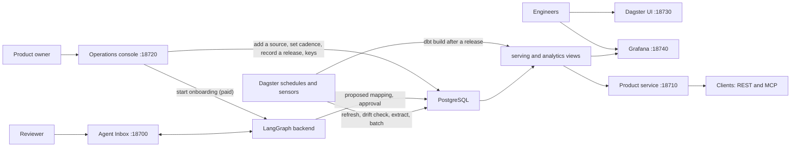

| Who | Where | Does |
|---|---|---|
| Product owner | [Operations console](#operations-console) | Adds sources, sets how often each is checked, compares a batch with the current release and records a release, manages clients, tiers and keys |
| Reviewer | Agent Inbox | Accepts or answers each proposed mapping |
| Dagster, by itself | Schedules and sensors | Checks due sources for a new file, checks drift, extracts under the approved mapping, rebuilds the views after a release |
| Engineers | Dagster UI and Grafana | Assemble a batch, start a paid onboarding run after drift, watch freshness, failures and cost; fix what the [runbooks](docs/RUNBOOKS.md) describe |

The command line stays for one-off work, recovery, promoting an ontology and bundle scopes. Which routine runs where, and what each command is still for, is in the [engineering guide](docs/ENGINEERING.md), section **Routine operation**. How to change a model, an asset or the console is in [CONTRIBUTING.md](CONTRIBUTING.md).

## Other run paths

Open the linked file, then use the named section. These direct file links also work in editors that do not support jumping to a heading in another Markdown file.

| Task | Open this guide | Section and prerequisites |
|---|---|---|
| Present saved results with screenshots | [Demo guide](docs/DEMO.md) | Start at the top; no model credentials needed. |
| Onboard a seventh source and check its contribution | [Demo guide](docs/DEMO.md) | **Live seventh-source demo** — requires the six-source database evidence and live model credentials. |
| Recheck downloads using saved Jev decisions | [Part 1 report](experiments/jev-luna-v1-submission/outputs/part1-downloadable/REPORT.md) | **Repeat the Part 1 operation** — requires the saved discovery record in the database. |
| Export or restore a database archive | [Demo guide](docs/DEMO.md) | **Optional: restore a frozen demo** — restoration requires an existing local ZIP and a separate empty database. ZIPs are not included in Git. |

The demo guide covers presentation and optional workflows; the setup and six-source pipeline commands remain above.

## Storage and runtime contracts

### Production architecture

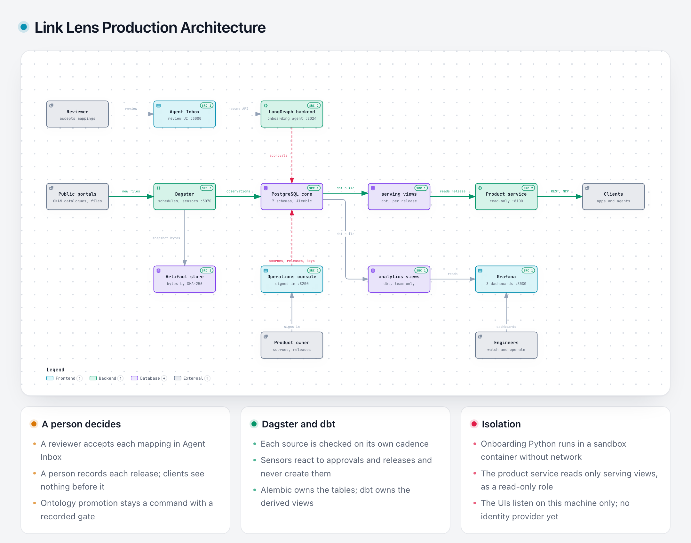

- **Three writers fill the core schemas.** Dagster refreshes sources and extracts observations, the LangGraph backend records mapping approvals from Agent Inbox, and the operations console records sources, releases and keys.
- **dbt builds two sets of views from them.** `serving` is what clients read through the product service; `analytics` is what the team reads in Grafana.
- **A person decides what clients see.** Approvals and releases are human actions. Dagster reacts to them and never creates them.

Who does what day to day is under [Run it day to day](#run-it-day-to-day); the details are in [Interfaces](#interfaces), [Dagster and dbt](#dagster-and-dbt) and [Operations console](#operations-console).

### Evidence and presentation

The diagram below shows the onboarding runtime that produced the submission: the CLI, the LangGraph backend, the sandbox and the stores.

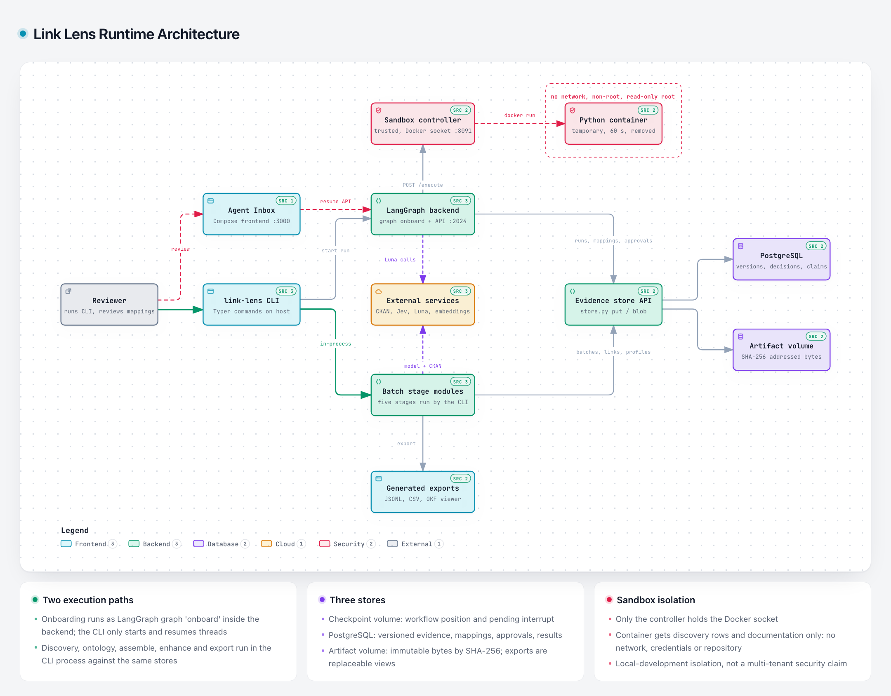

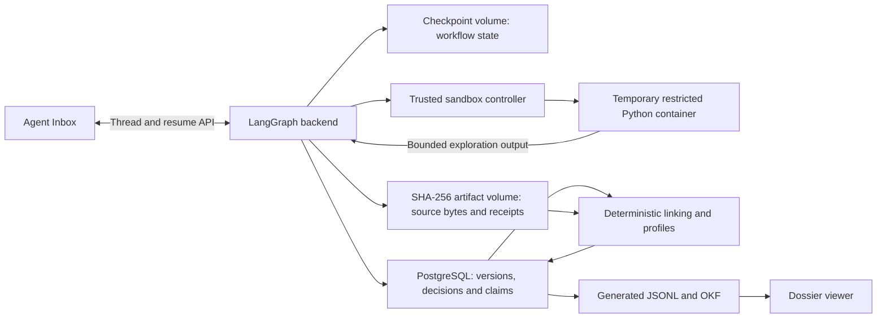

The sandbox receives supplied discovery samples and documentation, not access to these stores. PostgreSQL is authoritative for structured results; the artifact volume is authoritative for referenced bytes. OKF is a generated presentation. LangSmith supplies execution traces; local usage receipts retain the measurement evidence.

### Three stores

- LangGraph development checkpointer: `run_id`, `route`, `feedback`, execution position and pending interrupt; Compose volume `checkpoints`.
- PostgreSQL: independently versioned application evidence, mappings, decisions and results. Alembic manages tables. Since the [production plan](docs/PRODUCTION_PLAN.md) the records live in typed tables in the schemas `ontology`, `catalog`, `onboarding`, `evidence`, `identity`, `ops` and `access`, behind the same store functions, and read back exactly as written. The earlier generic tables remain, read-only, in the `legacy` schema until they are archived. What a client sees is read from views in the `serving` schema, each defined by one SQL file.
- SHA-256 artifact volume: immutable bytes, referenced by registered IDs. Exports are replaceable presentations, not the authoritative store.

A snapshot identifies its exact downloaded bytes, resource ID, licence and retrieval metadata. A source record locator is the snapshot hash, sheet or JSON array path, and logical row index. A CSV locator counts CSV records, not physical newline characters inside quoted text. A mapping hash covers its entire typed configuration. New mappings also pin an immutable ontology hash; legacy mappings resolve against packaged v0.1 without changing their approval hashes. An observation includes its config/engine version, raw value, locator and required ontology envelope.

### Review contract

The stock Inbox receives a list with one `HumanInterrupt`. `allow_edit` is false. Accept uses the immutable config at the paused node; CLI Accept may additionally supply its hash. Respond is model feedback, never a hand-edited config. Ignore creates a durable deferred decision. Decisions include configured reviewer identity, timestamp and hash. This local identity is not multi-user authentication.

Human feedback that changes a mapping consumes the same bounded version budget and invalidates any previous approval. Another unused slice from the final partition is required. A final-test failure stops the run. Automatic mapping revision has no access to final-test diagnostics.

### Sandbox isolation

Execution containers have no network, repository, credentials or Docker socket. Input is discovery JSON and documentation only. Python may inspect these supplied data and print results. It cannot install dependencies or configure container privileges. The controller runs fixed images with non-root UID, read-only root, bounded tmpfs, memory/CPU/PID/output limits and timeout cleanup. The controller itself is trusted and Docker-privileged; this is not a hostile multi-tenant service.

### Interfaces

`langgraph.json` exposes graph ID `onboard` and the standard thread/run/resume API. Application routes: `POST /api/sources`, `GET /api/runs`, `GET /api/runs/{id}`, `GET /api/profiles?batch_id=…`, `POST /api/evaluations`, `GET /api/artifacts/{registered_sha256}`. See `uv run link-lens --help` for reproducible commands. There is no arbitrary path serving endpoint.

A second, read-only service answers clients: the product service on port 18710 (`docker compose up -d product`). It reads only the `serving` views of a release that a person recorded with `link-lens release create`, and needs an API key created with `link-lens access`. It offers REST under `/v1`, an MCP server at `/mcp` with data tools and file tools over the same release, bundle downloads and a graph viewer per entity. The contracts are in [docs/api](docs/api/); the [production plan](docs/PRODUCTION_PLAN.md) and the [engineering guide](docs/ENGINEERING.md) describe how it is built and run. None of this changes the submitted results below `outputs/`.

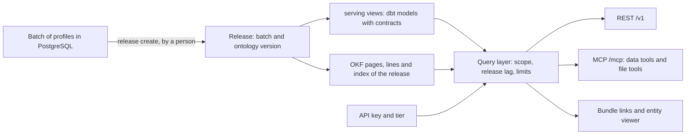

### Dagster and dbt

Two tools run the product with many sources and a small team: Dagster for the deterministic data flow and dbt Core for derived SQL. The [orchestration plan](docs/ORCHESTRATION_PLAN.md) has the phases, and all eight are built: the seventh is the [operations console](#operations-console) below, and the last moved routine operation off the terminal (see [Run it day to day](#run-it-day-to-day)). On 2026-11-15 the owner cut the local stack over: each source is checked every 7 days (the four ASIC and ACNC registers) or 30 days (Corporate Tax Transparency and the employment services list); alerts go to no channel, because the owner watches the Dagster UI and the dashboards; the backup service keeps the newest 3 daily dumps of each database; and scheduled and manual results are watched side by side until 2026-11-29. The decisions and how to change them are in the engineering guide under **Routine operation**. dbt owns the twelve `serving` views that the product service reads: each is a model in `transform/models/serving/` with an enforced contract, tests and documentation, built as the `linklens_transform` database role. dbt also builds sixteen reporting models in the `analytics` schema, for the team only: usage, source health, coverage, onboarding, identity, cost, release quality and review labels. Grafana shows three dashboards over them: product overview, data quality and source health. Dagster holds the deterministic data flow as assets in `orchestration/`: per source, a `snapshot` (new only when the publisher's bytes changed) with a check that it still fits the approved mapping, then `observations` extracted under that mapping; beside them a batch of entities and profiles, the dbt models, and two requests that spend on model calls and never start by themselves. Sensors react to what a person recorded: a newly approved mapping requests extraction, and a new release requests the dbt build. Dagster works as a database role that cannot record an approval, a promotion or a release. When a source's bytes change and still fit its approved mapping, the refresh is recorded as a run that carries that approval, and the next batch is assembled from it; nothing reaches a client until a person records a release. A batch is still a bounded sample, so two batches across a refresh differ by more than what the publisher changed ([orchestration plan](docs/ORCHESTRATION_PLAN.md), phase D3a). One schedule refreshes each source by the cadence set for it (`link-lens source cadence SOURCE --days N`), asking a publisher only for something newer and backing off when it does not answer; no source has a cadence until you set one. Sensors alert on failed runs and checks, drift, overdue sources and the model budget, to the webhook in `LINK_LENS_ALERT_WEBHOOK_URL`; without one they only log. The commands above still work as before.

Both tools are the open-source editions, in one image, `link-lens-dagster:local`, and run in local Docker. `docker compose --profile orchestration up -d` runs them for development, with the checkout mounted. Adding `-f deploy/compose.deploy.yaml` runs them as a deployment: from the image alone, restarting when they stop, with no default password, and logged in to the database as a login that can only become the orchestrator's or dbt's role. Where Dagster runs, it builds the views after a migration and after a release, so `link-lens dbt build` is needed only where it does not. [docs/RUNBOOKS.md](docs/RUNBOOKS.md) says what to do when a refresh fails, a source drifts, a review is stuck, a build fails or the budget is spent.

dbt is part of the default installation, because the serving views and the tests need it. Dagster is optional and is not in the default installation or the default Compose stack:

```sh
uv run link-lens dbt debug     # dbt connects to the configured database as linklens_transform
uv run link-lens dbt build     # builds the serving views and runs their tests
uv run link-lens dbt docs generate   # model and column documentation, in transform/target/
# To change a read model: build a candidate beside the live views, compare, then build.
uv run link-lens serving-compare --build
# Dashboards over the reporting models, with their own login to the database:
docker compose --profile dashboards up -d
# The same refresh steps Dagster runs, by hand:
uv run link-lens source check SOURCE_ID
uv run link-lens source extract SOURCE_ID
# What the schedule would do now, and what extraction is outstanding:
uv run link-lens source due
uv run link-lens source backfill
uv sync --frozen --group orchestration
uv run dagster definitions validate --workspace orchestration/workspace.yaml
# Dagster webserver and daemon, with their own image and their own `dagster` database:
docker compose --profile orchestration up -d --build
```

`link-lens dbt` passes its arguments to dbt and takes the connection from `LINK_LENS_DATABASE_URL`, so dbt and the pipeline use the same database. The Dagster UI has no sign-in of its own and is bound to this machine. Grafana asks for a sign-in and reads the database as a role that can see the reporting models and nothing else. On the dashboards, a figure a person measured on a sample is shown apart from AI audits and from uncalibrated scores. Alembic owns every table that holds state; dbt owns only derived relations, and the two never manage the same one. The backend image contains neither tool, so `link-lens dbt` runs on the host.

### Operations console

A small console lets the people who run the product work without a terminal: find a dataset in the saved catalogue, preview it, add it as a source, set how often it is refreshed or pause it, compare a batch with the current release and record a release, manage clients, tiers and API keys, and read an audit log of every change. Reviewing a mapping stays in the Agent Inbox, running and scheduling in the Dagster UI and the numbers on the dashboards; the console links to them.

```sh
# In .env: who may sign in, as JSON. A token is a secret; choose long random ones.
# LINK_LENS_ADMIN_USERS={"A_LONG_RANDOM_TOKEN":{"name":"Your Name","role":"admin"}}
docker compose --profile console up -d admin
```

Open [http://localhost:18720](http://localhost:18720) and sign in with the token. There are three roles, each including the one before: `engineer` reads, `product_owner` also adds and manages sources and records releases, `admin` also manages clients, tiers and keys and reads the audit log. With nobody listed, nobody can sign in.

Adding a source starts onboarding, which makes paid model calls: the console shows an estimate, the budget cap and what remains before the confirm button, and refuses when the estimate would exceed the cap. Recording a release there is the same human decision as `link-lens release create`, stored in the signed-in person's name. This sign-in is for development and one machine: there is no identity provider, so the console is published on this machine only. Details are in the [engineering guide](docs/ENGINEERING.md), section **Operations console**.

### Experiment and model boundaries

`jev-gpt6-luna-ontology-v1` is the final submission configuration; its exact batch and ontology are recorded in [the submission manifest](outputs/submission-manifest.json). Jev calls OpenRouter's `/api/alpha/decisions` through a LangChain RunnableLambda. Only supported-format catalogue candidates receive calls; state includes bounded metadata, never audit labels or held-out source records. The equal-weight blend is a declared ranking policy, not a calibrated probability. A separate deterministic GET/reader gate verifies bounded downloadability before selection. Jev responses, request hashes, timing, usage and cost are saved; a matching successful request within an experiment is reused on discovery retry.

Part 2 pins the configured model (default `gpt-6-luna`) on each new run. Previous submission runs retain `gpt-5.6-luna` and are preserved in [the earlier submission](experiments/jev-luna-v1-submission/outputs/README.md). Fresh configs require fresh Inbox approval. Existing Terra evidence is preserved in `experiments/terra-baseline/`, with checksummed comparison artifacts; optional database archives are retained locally. Scoped reports do not sum old and new costs. The comparison records catalogue and snapshot differences and avoids claiming a controlled model-only benchmark.

## Troubleshooting and shutdown

| Symptom | Check |
|---|---|
| Backend not ready | Run `docker compose logs --tail=100 backend postgres`; check migrations and port conflicts. |
| Model call returns 401/403 or model-not-found | Check the endpoint, matching key and model/deployment name in `.env`; recreate the backend after changes. |
| Sandbox image not found | Run the separate `build-sandbox` build command above. |
| Jev discovery fails | Check the OpenRouter key and provider access; successful metadata decisions are cached for retry. |
| “Requires Action” returns after Respond | This is a new mapping review, not acceptance; inspect and Accept the revised config when appropriate. |
| Viewer is empty or cannot load libraries | Check CDN/network access; use the Markdown dossiers or screenshots. |

```sh
docker compose stop             # preserves database and checkpoint volumes
# Later:
docker compose up -d
```

`docker compose down -v` removes persistent service volumes. Source bytes live separately in `artifacts/`; database records reference their hashes. Preserve both when retaining evidence. Do not share logs containing credentials.

## Verification

```sh
uv run pytest -q                 # deterministic; no model credentials; database tests need Docker
uv run ruff check src/link_lens tests --exclude _vendor --select F
# Requires Docker, the built sandbox image and running sandbox controller:
RUN_DOCKER_TESTS=1 uv run pytest tests/test_sandbox_integration.py -q
```

The LinkML, SHACL and JSON Schema tests need the optional `ontology` dependency group (`uv sync --frozen --group ontology`) and are skipped without it. The Dagster tests (`tests/test_orchestration.py`) need the `orchestration` group and are skipped without it; CI runs them in a job of their own. dbt is in the `dev` group, since the test database gets its serving views from it.

Database tests run on PostgreSQL built by `alembic upgrade head`, in a throwaway `pgvector/pgvector:pg17-trixie` container that the test session starts on first use and removes afterwards. Set `LINK_LENS_TEST_DATABASE_URL` to use an existing server instead; the tests create and drop their own `linklens_test_*` databases there and never use the database named in the URL. Tests that do not touch the store need neither.

The suite result on 15 November 2026, with the production data model, the product service, dbt-built serving views and reporting models, the dashboards, the Dagster assets and the operations console, is **297 passed, four integration tests skipped** with the `orchestration` group installed, and 277 passed with the Dagster tests skipped as well without it. The result recorded for the promoted submission was 106 passed, four skipped; it and the earlier Docker checks are documented in the [engineering guide](docs/ENGINEERING.md), section **Verification evidence**. A live smoke test is separate and metered.

## Documentation and code

| Read | Purpose |
|---|---|
| [WRITEUP.md](WRITEUP.md) | Self-contained explanation of decisions, results, costs and future work |
| [outputs/README.md](outputs/README.md) | Detailed output inventory, approvals and evaluation status |
| [docs/DEMO.md](docs/DEMO.md) | Screenshots and demonstration steps, including the seventh source |
| [Workflow and architecture](#how-it-works) | Discovery, agent loop, storage and runtime contracts in this README |
| [docs/ENGINEERING.md](docs/ENGINEERING.md) | Implementation evidence, verification and recovery |
| [docs/PRODUCTION_PLAN.md](docs/PRODUCTION_PLAN.md) | The production data model and product service, phase by phase: what was built, measured and left open |
| [docs/ORCHESTRATION_PLAN.md](docs/ORCHESTRATION_PLAN.md) | Dagster and dbt, phase by phase: ownership, what each phase must settle, what is built |
| [CONTRIBUTING.md](CONTRIBUTING.md) | Who owns what, and how to add a dbt model, a Dagster asset or a console action |
| [docs/RUNBOOKS.md](docs/RUNBOOKS.md) | What to do when the data flow needs a person, and how to back up and restore |
| [docs/api/](docs/api/) | Published REST and MCP contracts of the product service |
| [outputs/COMPARISON.md](outputs/COMPARISON.md) | Preserved baseline versus the final approach |
| [docs/THIRD_PARTY.md](docs/THIRD_PARTY.md) | Component and data attribution |

Implementation is in `src/link_lens/`: `agent.py` orchestrates onboarding; `ingestion.py`, `triage.py` and `downloadability.py` handle discovery/acquisition; `contracts.py`, `readers.py` and `extraction.py` implement shared mapping execution; `resolution.py` and `profiles.py` build entities; `store.py`, `evaluation.py` and `exports.py` retain and present evidence; `db/` holds the typed tables behind the store; `releases.py`, `serving.py` and `okf/` turn a batch into what clients see, through the views that dbt builds from `transform/models/serving/`; `product/` and `interfaces/` are the read-only product service with its REST routes and MCP tools; `bundles.py` builds release bundles. Service definitions are in `compose.yaml` and `deploy/`; database migrations are in `migrations/`. Beside `src/`, `transform/` is the dbt project and `orchestration/` the Dagster code location.


### Experimental ontology evolution

For the stage diagram and a short walkthrough, see [Ontology evolution](#ontology-evolution) above. This section covers scope, commands and budget.

New source concepts are proposed by the configured LLM, checked deterministically,
then critiqued before experimental activation. An explicit cross-source job separates
missing concepts from missed existing mappings, unsupported meanings and export noise.
It reads discovery data and documentation only. Source contacts, licences, registrations
and financial periods remain scoped groups, including their provenance and required
companion values. Mapping approval remains a separate human action.

See [ontology workflow and experiment budget](docs/ENGINEERING.md#experimental-ontology-evolution)
for commands. The shared `LINK_LENS_MAX_COST_USD` cap covers discovery, ontology,
onboarding and enhancement together; the enhancement job limit is an additional cap.
New GPT-6 Luna structured-output calls use Responses. Existing model records and
previous submission outputs remain preserved under `experiments/jev-luna-v1-submission/`. The promoted `firmable_ontology.yaml` seeds new experiments; existing runs keep their pinned versions.

The [six-source ontology experiment report](experiments/jev-gpt6-luna-ontology-v1/README.md)
preserves separate baseline/enhanced exports and measured concept contributions. The promoted results are in `outputs/`, including costs and pending human evaluations. Large evidence JSONL files use checksummed lossless gzip; the viewer remains a standalone HTML page.
