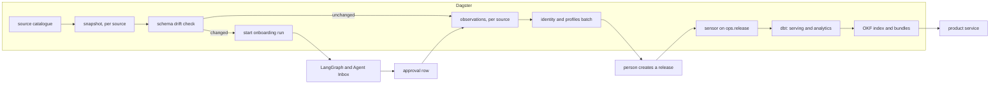

# Orchestration and transformation plan: Dagster and dbt

Status: **Phases D0 to D2 are implemented and applied to the local database (2026-11-15). D3 to D7 are planned, not built.** This is the follow-on to the [production implementation plan](PRODUCTION_PLAN.md). That plan's phases 0 to 6 and 8 are implemented; phase 7 is deferred and phase 9 is done only as far as one machine allows (no hosting, no reviewer sign-in, `legacy` not dropped). Names, layouts and SQL in the phases not yet built are sketches to confirm while building. Sizes are rough estimates for one engineer.

This plan was written before phases 2 to 9 of the first plan were built. It was compared with the code on 2026-11-15, before any of it was built. Where the code differs, the text below says so: section 5 gives the state of each seam, and each phase has a **Reconciled with the code** list of what to settle when that phase starts.

Library versions and licences were checked on PyPI on 2026-11-15 and installed on Python 3.13: Dagster 1.13.30 with dagster-webserver 1.13.30, dagster-postgres 0.29.30 and dagster-dbt 0.29.30 (Apache-2.0; dagster-dbt needs Python below 3.14 and accepts dbt-core from 1.7 to below 1.13), dbt-core 1.12.7 (Apache-2.0) and dbt-postgres 1.11.0 (Apache-2.0; accepts dbt-core from 1.8 to below 2.0, and both need dbt-adapters 1.24). dbt version 2 is now what a new installation gets by default; this plan stays on dbt Core 1.12, see the risk table. Read the current documentation for the versions you install before coding; both tools change often.

## Contents

1. [Why and when](#1-why-and-when)
2. [Decisions](#2-decisions)
3. [Who owns what](#3-who-owns-what)
4. [Target architecture](#4-target-architecture)
5. [Seams the first plan kept](#5-seams-the-first-plan-kept)
6. [Phase overview](#6-phase-overview)
7. [Phase D0: Foundations](#phase-d0-foundations)
8. [Phase D1: dbt for the serving layer](#phase-d1-dbt-for-the-serving-layer)
9. [Phase D2: dbt analytics models](#phase-d2-dbt-analytics-models)
10. [Phase D3: Dagster assets for the data flow](#phase-d3-dagster-assets-for-the-data-flow)
11. [Phase D4: Schedules, freshness and alerts](#phase-d4-schedules-freshness-and-alerts)
12. [Phase D5: Deployment and operations](#phase-d5-deployment-and-operations)
13. [Phase D6: Operations console](#phase-d6-operations-console)
14. [Phase D7: Cutover](#phase-d7-cutover)
15. [Verification strategy](#15-verification-strategy)
16. [Risks and open decisions](#16-risks-and-open-decisions)

## 1. Why and when

Three facts about the product make both tools worth adopting:

- **Sources will number in the hundreds or thousands**, each with its own refresh cadence. Someone has to see which sources are stale, failed or drifting, without running commands by hand.
- **The team has two engineering roles.** An AI engineer owns the pipeline and agents. An analytics engineer owns data engineering and analytics, and needs a standard way to write, test and document SQL.
- **The serving layer is a contract with paying clients.** It deserves declared tests and documentation.
- **The engineers and one product owner need to run the product without a terminal.** They operate it in the Dagster UI, watch it on dashboards, and make product decisions in a small admin console.

Timing: this plan begins after the first plan is complete. The earliest technical dependencies are noted per phase, so the start can move earlier if the team wants.

## 2. Decisions

| Area | Decision |
|---|---|
| Orchestrator | Dagster, for the deterministic data flow: snapshot refresh, drift check, extraction, identity and profiles, post-release builds. |
| Agent and review flow | Stays in LangGraph. Dagster starts an onboarding run and does not wait for it. |
| Human gates | Mapping approval, ontology promotion and release creation remain human actions recorded as rows. Dagster reacts to those rows; it never creates them. |
| SQL transformation | dbt Core with the PostgreSQL adapter, for derived relations only: the `serving` read models and a new `analytics` schema. |
| Stateful tables | Alembic keeps owning every table that holds state, with its constraints, triggers and roles. |
| Pipeline logic | Stays in the `link_lens` library and CLI. Dagster calls it; it does not reimplement it. |
| State | Stays in PostgreSQL (`onboarding.run`, `ops.batch`, `ops.release`). Dagster's own run history lives in a separate database. |
| Cost control | The application budget ledger stays authoritative. Dagster never retries a paid model call on its own. |
| Operating UI | The Dagster UI: trigger a stage, schedule, retry, backfill, see what is stale or failed. Not rebuilt elsewhere. |
| Dashboards | Grafana over the `analytics` models, chosen by the owner in D2. |
| Admin console | A small console for the product owner and engineers: add and manage sources, create releases, manage clients, tiers and keys. |
| Review screen | Agent Inbox stays the review tool. A custom review screen is out of scope until review volume outgrows it. |

## 3. Who owns what

| Object | Owner | Tool |
|---|---|---|
| Core schemas: `ontology`, `catalog`, `onboarding`, `evidence`, `identity`, `ops`, `access`; the `legacy` history; the helpers in `public` (`sha256`, `forbid_update`) | AI engineer and analytics engineer together | Alembic |
| Extraction, identity resolution, profile policy, ontology workflow | AI engineer | Python library |
| Onboarding and review flow | AI engineer | LangGraph |
| `serving` read models that are set-based SQL: the twelve views `release`, `current_release`, `entity`, `profile`, `profile_field`, `profile_address`, `observation`, `evidence`, `link`, `source`, `concept`, `bundle` | Analytics engineer | dbt, since D1: models in `transform/models/serving`, views owned by `linklens_transform` |
| `serving` tables built by algorithm: `okf_page`, `okf_line`, `okf_index`, and the functions `serving.iso_utc`, `serving.json_float`, `serving.create_release_partitions` | AI engineer | Alembic owns the tables and functions; `releases.create` fills the tables in the transaction that records the release |
| `analytics` schema | Analytics engineer | dbt creates the relations; Alembic owns the schema and its grants |
| Schedules, sensors, freshness, alerts | Analytics engineer, with the AI engineer for model-calling steps | Dagster |
| Product service, REST, MCP | AI engineer | Python |
| Dashboards | Analytics engineer | Grafana, as JSON files in `deploy/grafana/dashboards` |
| Admin API and console | AI engineer builds; product owner is the main user | Python API, small web UI |

The rule that prevents conflicts: **Alembic and dbt never manage the same relation.** When dbt takes over a `serving` relation, the old definition is removed in the same change.

*As built in D1:* the serving views were never defined in migrations; a hook created each from a SQL file after every upgrade. D1 removed that mechanism and added migration `0024`, which drops the views the migrator owned. `serving` is now a schema with two owners of relations: dbt for the twelve views, Alembic for the three `okf_*` tables and the three functions. A test fails if a migration creates a view there or if dbt owns anything outside `analytics`, `serving` and `serving_next`.

## 4. Target architecture



Arrows inside the box are Dagster dependencies. The three places where a person decides are outside it: mapping approval, ontology promotion (not drawn) and release creation.

*Reconciled with the code:* the right-hand part of the diagram is not how a release works today. The serving read models are views that carry `release_id`, so nothing is built for them when a release is recorded. `release create` builds the OKF page, line and index rows in the transaction that inserts the release, and then builds the bundle of every scope marked `on_release` in the same command. What is left for a sensor on `ops.release` is the `analytics` models, the dbt tests against the new release, and bundles if that step is handed over. D3 decides this; see its list.

Layout (D0 creates it; the files fill in from D1 and D3):

```text
orchestration/                Dagster code location
  workspace.yaml  dagster.yaml
  link_lens_dagster/
    assets/                   catalogue.py, snapshots.py, extraction.py, identity.py, release.py
    sensors.py  schedules.py  checks.py  resources.py  definitions.py
transform/                    dbt project
  dbt_project.yml  profiles.yml
  models/
    sources/                  core tables declared as dbt sources
    staging/                  thin, one-to-one views over sources
    serving/                  client-facing read models, with contracts
    analytics/                internal reporting models
  tests/  macros/  seeds/
```

## 5. Seams the first plan kept

These were requests to the first plan, made before its phases 2 to 9 were built. The owner added them to that plan's rules on 2026-11-14 and each was built. This is where each stands in the code on 2026-11-15, and what an orchestrator still has to work around.

| Seam | State in the code | Left for this plan |
|---|---|---|
| A pipeline step is a function with explicit parameters that returns a small result record | Holds for the steps added by the first plan: `sources.record_check(source_id)`, `sources.set_cadence(source_id, days)`, `drift.detect(snapshot_id, config_hash)`, `ontology_gate.run(hash)`, `releases.create(batch_id, reviewer)`, `bundles.build(release_id, scope)`. Older steps take their IDs but also read settings: `ingestion.register(request)` and `pipeline.assemble(run_ids, ...)` read `settings().experiment_id`. | Extraction of an approved mapping exists only inside the onboarding graph (`agent.extract_node`) and in `pipeline.approved_result(run)`, and a run belongs to one snapshot. There is no step yet that extracts a *new* snapshot of a source under its approved `config_hash`. D3 adds it. |
| A step is idempotent | Holds: content-hash IDs, `ON CONFLICT DO NOTHING` loads through `store.put_many` and `store.put_observations`, and updates that are skipped when nothing changes. | Nothing. |
| Serving SQL in one directory, one file per read model, each a single `SELECT` | Done: twelve files in `src/link_lens/serving/`. Each names its tables with their schema (`ops.release`, `identity.profile`) and calls `sha256_hex()`, `serving.iso_utc()` and `serving.json_float()`. | Becoming a dbt model takes more than a rename: table names become `source()` or `ref()` calls, or stay as they are and lose dbt's lineage. D1 decides. |
| The source registry carries refresh facts | Done as one table and one view. `catalog.source_refresh` stores the cadence (an `interval`) and `last_checked_at`. The view `catalog.source_state` adds `next_check_due_at`, the latest snapshot, `last_changed_at` and the approved mapping in force, derived from snapshots and approvals so they cannot drift. `sources.state()` and `link-lens source state` read it. | There is no "paused" fact. D4 or D6 adds one when pausing a source is built. No cadence is set on any local source yet. |
| Drift detection is a library function | Done: `drift.compare(config, format, headers)` and `drift.detect(snapshot_id, config_hash)` return `unchanged` or `changed`, with reasons each marked `blocking` or not. `link-lens source drift` exits 3 on a blocking result. | The result is returned, not stored. D2's "drift events" need it recorded somewhere dbt can read; D3 decides where. |
| Partitioning suits thousands of sources | Done: `evidence.source_record` and `evidence.observation` are 32 hash partitions on `source_id` (migration `0013`). No table has one partition per source. | Nothing. Dagster uses the source as its only partition dimension, as planned. |
| Structured logs and clear exit codes | Done: one JSON line on standard error per command (`logs.py`), results on standard output, exit codes 0 done, 1 failed, 2 called wrongly, 3 ran and found something that blocks the next step. | Dagster calls library functions, not the CLI, so it reports exceptions and result records directly. The exit codes matter for the `link-lens dbt` command and for CI. |

## 6. Phase overview

| Phase | Outcome | Earliest dependency in the first plan | Size |
|---|---|---|---|
| D0 | Project skeletons, databases, roles, CI. **Done 2026-11-15** | Phase 0 | S |
| D1 | dbt owns the set-based `serving` read models, with tests and contracts. **Done 2026-11-15** | Phases 4 and 5 | M |
| D2 | `analytics` schema: usage, freshness, coverage, cost, quality. **Done 2026-11-15, with open points** | Phase 5 | M |
| D3 | Dagster assets, checks and sensors for the data flow | Phases 3 and 4 | L |
| D4 | Per-source schedules, freshness policies, alerts, backfills | D3 | M |
| D5 | Production deployment of Dagster and dbt | Phase 9, D3 | M |
| D6 | Operations console for sources, releases and clients | Phases 5 and 9, D3 | M |
| D7 | Cutover from manual runs; documentation | D1 to D6 | S |

D1 and D2 (analytics engineer) can run in parallel with D3 (AI engineer). The team gets a usable UI in this order: Dagster UI (D3, D4), dashboards (D2), admin console (D6).

## Phase D0: Foundations

**Goal:** both tools run locally and in CI against a throwaway database, with nothing in production changed.

Reconciled with the code on 2026-11-15, before building:

- **Roles are `NOLOGIN` groups.** Migration `0008` made `linklens_migrator`, `linklens_pipeline` and `linklens_product` groups without passwords; a deployment creates logins and grants one group to each, and the local stack connects as the `linklens` superuser and sets a role. `linklens_transform` follows the same pattern. dbt's PostgreSQL profile has a `role` setting that runs `SET ROLE` on every connection, which is how dbt gets that role locally, as the product service gets its own with `SET LOCAL ROLE`.
- **"Read on core schemas" stops short of secrets and history.** The transform role does not read `legacy`, which is read-only history that no new code should depend on, nor `access.api_key.key_hash` or `access.rate_bucket`. It reads the other columns of `access.api_key`, which the usage models need to join a key to its client.
- **`CREATE` on `serving` waits for D1.** Until the ownership switch dbt builds nothing in `serving`: D1 first builds into `serving_next`. Granting `CREATE` there now would let a mistaken dbt target make relations that `serving.apply` then tries to drop as the migrator. D0 gives the role `USAGE` and `SELECT` on `serving`, for the D1 comparison, and `CREATE` only on `analytics`.
- **dbt's grant on `serving` models covers two roles, not one.** `linklens_product` reads the views, and so does `linklens_pipeline`: the OKF tree, the bundle builder and `release digest` read `serving` as the pipeline. Both get `SELECT` today from the migrator's default privileges, which do not apply to relations dbt owns. This is a D1 task; it is noted here because the D0 task below names only the product role.
- **The stack has one image for three services.** The backend, sandbox controller and product service share `link-lens-backend:local`, built with `uv sync --frozen --no-dev`, which installs no dependency group. Dagster and dbt get their own image, so the plan's "keep them out of the product service and sandbox images" holds without changing that Dockerfile.
- **One lock file serves every group.** `uv.lock` is resolved for all groups together, so adding these two groups can hold a runtime package back. It did for one: `pathspec` goes from 1.1.1 to 1.0.4 in the backend image at its next rebuild, because dbt-core needs it below 1.1. Only `langgraph-cli` uses it there.
- **Port 3000 is the Agent Inbox.** The Dagster UI gets its own local port, 3070.
- **CI is one workflow with one job** ([tests.yml](../.github/workflows/tests.yml)). The new checks are a second job, so the existing job installs and runs exactly what it did.

Tasks:

- [x] **Add dependency groups** `orchestration` (dagster, dagster-webserver, dagster-postgres, dagster-dbt) and `transform` (dbt-core, dbt-postgres). Keep them out of the product service and sandbox images. Pin versions and confirm the dbt-core and dbt-postgres pair is compatible.
  - *As built:* `dagster>=1.13.30,<1.14`, `dagster-webserver` the same, `dagster-postgres` and `dagster-dbt` `>=0.29.30,<0.30`, `dbt-core>=1.12.7,<1.13`, `dbt-postgres>=1.11,<1.12`; `uv.lock` holds the exact versions. The pair is compatible by both packages' own metadata and by running: `dbt debug` reports core 1.12.7 with the postgres adapter 1.11.0. A plain `uv sync` installs neither group. A CI step fails if a Dagster or dbt package appears in what the runtime image installs.
- [x] **Create the two skeletons** in `orchestration/` and `transform/` as laid out above.
  - *As built:* the dbt project has no model yet; its four model folders, `tests/` and `seeds/` are empty. The Dagster package has `definitions.py` with an empty `Definitions` and modules for assets, resources, sensors, schedules and checks that hold only a description of what goes there. Neither project was made with the tools' scaffolding commands, which generate more than the plan's layout.
  - *Changed while building:* the workspace loads the code location with `python_file`, not `python_module`. Dagster resolves a `python_file` entry's paths against the workspace file and a `python_module` entry's working directory against wherever the command is run, so only the first loads from any directory.
  - *Added:* `link-lens dbt ARGS` ([transform.py](../src/link_lens/transform.py)) runs dbt with its connection taken from `LINK_LENS_DATABASE_URL`. dbt's profile cannot read a database URL, and without this dbt and the pipeline could be pointed at different databases. The module does not import dbt.
- [x] **Add a `dagster` database** on the same PostgreSQL server for Dagster's run, event and schedule storage. It never shares a schema with application data.
  - *As built:* [deploy/dagster-db.sql](../deploy/dagster-db.sql) creates a login `dagster` and a database `dagster` that it owns, only when they are missing. A login of its own, not the application's, so that Dagster's credentials open nothing in `linklens`: it has no `USAGE` on any application schema. Alembic does not create them: a migration works inside one database and holds no passwords.
- [x] **Add a database role `linklens_transform`:** read on core schemas, owner of dbt-managed relations in `serving` and `analytics`. dbt grants `SELECT` on `serving` models to `linklens_product`.
  - *As built (migration `0022`):* a `NOLOGIN` group. It reads `ontology`, `catalog`, `onboarding`, `evidence`, `identity`, `ops` and `serving`, with default privileges for tables the migrator creates later; in `access` it reads `tier`, `client`, `api_usage` and the columns of `api_key` other than `key_hash`. It owns what it creates in `analytics`. The `serving` half of this task, `CREATE` there and dbt's grants to the product and pipeline roles, is deferred to D1 for the reasons in the list above.
- [x] **Add an `analytics` schema** through Alembic. dbt creates relations inside it; Alembic owns only the schema and its grants.
  - *As built (migration `0022`):* owned by `linklens_migrator`; `USAGE` and `CREATE` for `linklens_transform` and nobody else. The downgrade runs `DROP OWNED BY linklens_transform`, so relations dbt built do not block it, and then drops the schema without `CASCADE`, so anything else found there stops it.
- [x] **Compose services** for the Dagster webserver and daemon, under a compose profile so the default stack stays small.
  - *As built:* profile `orchestration` with three services: `dagster-db` runs the script above and exits, `dagster-webserver` serves the UI on port 3070, and `dagster-daemon` starts once the webserver is healthy, so the two do not both create Dagster's tables. They share the image `link-lens-dagster:local` ([Dockerfile.dagster](../deploy/Dockerfile.dagster)) and mount `orchestration/`, `transform/` and `src/` read-only. They are given no connection to `linklens`; D3 adds one with the first asset that needs it.
  - *Added:* telemetry and the first-run dialog that asks for an email address are off in [dagster.yaml](../orchestration/dagster.yaml), and dbt's usage statistics in `dbt_project.yml`.
- [x] **CI jobs:** `dbt parse` and `dbt build` against a migrated throwaway database with fixture data; Dagster definitions load without error.
  - *As built:* a second job, `orchestration`, in [tests.yml](../.github/workflows/tests.yml): it checks the runtime dependencies, installs the two groups, lints `orchestration/`, migrates the CI database, runs `dbt debug`, `parse` and `build` and `dagster definitions validate`, then [tests/test_transform.py](../tests/test_transform.py), [tests/test_orchestration.py](../tests/test_orchestration.py) and the migration tests. The first job is unchanged.
  - *Not done, on purpose:* no fixture data is loaded for dbt, because there is no model to read it. The tests run dbt on the migrated test database that the other tests fill through the store; D1's first models get their fixture rows there.
  - *Not run:* the workflow itself has not run on GitHub, since nothing was pushed. Each of its steps was run locally against a throwaway database.

Done when:

- `dbt debug` and an empty `dbt build` succeed locally and in CI. **Met locally; CI not run, because nothing was pushed.**
- The Dagster UI opens locally and shows an empty code location. **Met.**
- The existing test suite and services are unaffected. **Met.**

Results on 2026-11-15:

- **dbt.** On the local database, `link-lens dbt debug` reported "All checks passed" with the role `linklens_transform`, and `link-lens dbt build` exited 0 with "Nothing to do". A test asks dbt for `current_user` and gets `linklens_transform`. Another runs `parse` and `build` on the migrated test database and compares every relation and its owner before and after: nothing outside `analytics` changed.
- **Role.** Tests expect a permission error when `linklens_transform` selects from `legacy`, reads `key_hash` or `access.rate_bucket`, writes a core table, or creates anything in `serving`, `ops` or a new schema; and when the product or pipeline role reads `analytics`.
- **Dagster.** `dagster definitions validate` passes from any directory. With the profile started, the UI at `http://localhost:3070` lists one code location, `link_lens`, loaded, with no assets, jobs, schedules or sensors, and all six daemons report healthy. Dagster's 22 tables are in the `dagster` database and none is in `linklens`. Logged in as `dagster`, a select from `ops.batch` in `linklens` is refused.
- **Local database.** Backed up to `/Users/may/link-lens-backups/linklens-pre-d0-20261115T022532.dump`, rehearsed on a restored copy in a throwaway container (upgrade, both baseline checks, dbt, the Dagster script twice, one step down and up again), then backed up again with the backend stopped (`linklens-pre-d0-cutover-20261115T023349.dump`) and migrated from `0021` to `0022` in under a second. Both baseline checks reported zero differences before and after. No row was changed: the migration adds a schema, a role and grants.
- **Existing services.** The backend image was rebuilt from the new lock file and contains neither Dagster nor dbt; `pathspec` is 1.0.4 in it. Backend (73 runs listed), Agent Inbox, sandbox controller and product service answered their health checks, and the product service still refuses a call without a key.
- **Tests.** 240 passed, 4 skipped with the two groups installed; 229 passed, 4 skipped before. The 11 new tests are two for the role and the downgrade, five for dbt and four for Dagster. In a clean environment without the groups, as the existing CI job installs it, 233 passed and 8 skipped: the four sandbox integration tests as before, and the dbt and Dagster tests. Lint passes on `src/link_lens`, `tests` and `orchestration`.
- **Not verified:** the CI workflow on GitHub; the Dagster image and the `dagster-db` script on a managed PostgreSQL service, where the administrator is not a superuser; a run launched from the UI, since there is nothing to run.

## Phase D1: dbt for the serving layer

**Goal:** the client-facing read models are dbt models with declared tests, contracts and documentation, and return exactly what the hand-written versions returned.

Reconciled with the code on 2026-11-15, before the phase was built. The tasks below say how each point was settled.

- **The read models are views, twelve of them.** The list below lacks `current_release` and `bundle`, and names `okf_page` and `okf_line`, which are not set-based models (next point). A view has no rows of its own, so "a second `dbt build` changes zero rows" becomes: the view definitions do not change, and `link-lens release digest` gives the same digest before and after.
- **The `okf_*` tables stay with Python and Alembic.** `okf_page`, `okf_line` and `okf_index` are built by `releases.build` inside the transaction that inserts the release, into one list partition per release created by `serving.create_release_partitions`, and reject updates by trigger. An incremental dbt model would build them after the release is committed, which would leave a window in which a release exists without its tree, and would make dbt and Alembic manage the same relation. The "insert-only incremental models" task is therefore withdrawn, not ported.
- **The views read exact stored records.** `serving.profile` and `serving.observation` carry a `document` column that rebuilds the stored record, using `serving.iso_utc` and `serving.json_float`. Parity must compare that column too, not only counts.
- **Grants.** dbt grants `SELECT` on each model to `linklens_product` and to `linklens_pipeline` (see D0).
- **The tests depend on the views.** `tests/conftest.py` builds its database with `alembic upgrade head`, and `migrations/env.py` applies the views. Once dbt owns them, every test that reads `serving` needs dbt to have run, so the `transform` group stops being optional for the test suite and dbt enters the product service's test path. The alternative is to keep `serving.apply` as the way tests and a fresh database get the views and have dbt compile to the same SQL, which is two definitions again. Decide before porting.
- **There is no release on the local database.** "Counts and digests match for every release" needs a release to exist. Run the comparison on a restored copy with a rehearsal release, as the first plan did, or after the owner records the first release.
- **Parity checks that already exist:** `link-lens release digest`, the REST and MCP tests (`tests/test_product_rest.py`, `tests/test_product_mcp.py`), the published contracts (`tests/test_production.py`) and the kept bundle (`tests/test_fixture_bundle.py`).
- **Enum values** for the accepted-values tests come from `ontology.concept_value`.
- **`serving_next`** is a new schema and needs an Alembic migration, with `CREATE` on it and then on `serving` for `linklens_transform`.

Tasks:

- [x] **Declare core tables as dbt sources** with descriptions. Add source freshness on `catalog.snapshot` and `ops.release`.
  - *As built:* the twenty tables the serving models read, in six sources named after their schemas ([sources.yml](../transform/models/sources/sources.yml)). A table is declared when a model needs it; D2 adds the `access` and the remaining `ops` tables. Freshness warns when the newest snapshot or release is older than 45 days and never fails. Forty-five days is a placeholder: no source has a cadence yet and no release cadence is agreed.
- [ ] **Staging models:** thin views that rename and cast only, one per source table that serving needs.
  - *Not built, moved to D2.* The serving models read their sources directly. They rebuild stored records exactly and are written for the indexes that exist, and they had to answer row for row as the hand-written views did. A layer of renamed columns under them would have meant rewriting twelve working queries for no result a test could show. The `analytics` models are new SQL and are where staging views earn their place; they also need a schema to live in, which D2 decides.
- [x] **Serving models:** port each set-based read model from the first plan (`entity`, `profile`, `profile_field`, `profile_address`, `observation`, `evidence`, `link`, `source`, `concept`, `release`, `okf_page`, `okf_line`). Every model keeps the `release_id` column.
  - *As built:* twelve models in [transform/models/serving](../transform/models/serving/): the ten views named here, `current_release` and `bundle`, and not the two `okf_*` tables (next task). Each file is the SQL it was, with table names replaced by `source()` calls and nothing else changed. They are views owned by `linklens_transform`, and dbt grants `SELECT` on each to `linklens_product` and `linklens_pipeline`. No model reads another, so there is no `ref()` among them yet.
- [x] **Per-release tables are insert-only.** `okf_page` and `okf_line` use incremental models keyed on `release_id`, with full refresh disabled and schema change set to fail. A release's rows are never rewritten.
  - *Withdrawn, as reconciled above.* The three `okf_*` tables stay tables that Alembic owns and `releases.create` fills inside the release transaction. They were insert-only before and still are, by trigger.
- [x] **Keep algorithmic builds in Python.** The nested OKF index stays a Python step. Rule for future models: set-based SQL goes to dbt, algorithms stay in the library.
- [x] **Model contracts** on every serving model, so a column or type change fails the build instead of reaching clients.
  - *As built:* every column of every model has a declared type in [_serving.yml](../transform/models/serving/_serving.yml), 148 in all, and the contract is enforced for the whole folder in `dbt_project.yml`. A view's contract checks names and types; dbt has no constraints on views, so not-null and uniqueness are tests.
- [x] **Tests:** uniqueness and not-null on keys; relationships from profile fields to observations and from observations to records, snapshots and sources; accepted values for status fields; accepted values for enum concepts generated from the ontology registry; a test that no row lacks licence or timestamp basis.
  - *As built:* 96 tests. Keys are a release and one or two more columns, which the built-in tests cannot express, so two small generic tests were added: [unique_combination](../transform/tests/generic/unique_combination.sql) and [exists_in](../transform/tests/generic/exists_in.sql). Enum values are checked against the `allowed_values` of the `concept` model, which reads the registry, so a new ontology version changes what the test accepts with no edit. Licence and timestamp basis are not-null tests on `observation`, `evidence` and `source`.
  - *Found while building:* `exists_in` was first a correlated lookup. Between `observation` and `evidence`, 188,000 rows each on the copy, it had not finished after ten minutes. As a set difference it takes seconds, and all 96 tests run in 23 seconds.
  - *A choice to revisit:* the accepted values for `link.status` and the profile statuses are the ones the code writes today. When link review adds a status, the test fails until the value is added, which is the point of it.
- [x] **Build in parallel first.** dbt writes to a `serving_next` schema. A comparison job checks row counts and digests against the existing `serving` relations for every release.
  - *As built:* migration `0023` creates `serving_next`. `link-lens serving-compare` ([serving.py](../src/link_lens/serving.py)) compares two schemas view by view: the columns with their types, and per release the row count and a digest over every row, document columns included. It exits 3 on a difference.
  - *Kept after the switch:* the schema and the command stay as the way to change a read model. `link-lens serving-compare --build` builds the candidate and compares it; then build into `serving`. (D2 added `--build`, which selects the serving models only; see its results.)
- [x] **Switch ownership.** One change set points dbt at `serving` and adds the Alembic migration that drops the hand-written definitions. The product service is unchanged.
  - *As built:* migration `0024` drops the views `linklens_migrator` owns and grants `CREATE` on `serving` to `linklens_transform`. The same commit removes the SQL files from `src/link_lens/serving/`, `serving.apply`, its hook in `migrations/env.py` and the `serving-apply` command. No file under `product/`, `interfaces/` or `okf/` changed.
  - *Consequence, decided here:* migrations no longer create a view, so **a database needs `link-lens dbt build` after `alembic upgrade head`**. This applies to a new local database, a restore, and the test database. The backend image has no dbt, so the backend's start still migrates but does not build views; that is a command on the host until Dagster runs dbt in D3. `release create` refuses, saying what to run, when the views are missing.
  - *Tests need dbt:* `tests/conftest.py` builds the views with dbt after migrating, once per session, about three seconds. The `dev` dependency group therefore includes the `transform` group. The runtime image installs no group and still contains neither tool; the CI guard from D0 checks that.
  - *Left in place:* the downgrades of `0018` to `0020` still contain a block that drops every serving view. A downgrade passes `0024` first, which drops dbt's views, so those blocks find nothing. Applied migrations are not edited.
- [x] **Documentation:** descriptions on models and columns, generated dbt docs, and exposures naming REST, MCP and bundles as consumers.
  - *As built:* a description on every model, column and source table, and three exposures ([_exposures.yml](../transform/models/serving/_exposures.yml)): the REST interface, the MCP server, and the OKF tree with the bundles. `link-lens dbt docs generate` writes the site to `transform/target/`, which is not committed and not published anywhere yet; publishing is a D5 task.

Done when:

- Counts and digests match between `serving_next` and `serving` for every release before the switch. **Met on a restored copy with two rehearsal releases. The local database has no release, so there only the columns could be compared.**
- The first plan's interface parity tests pass unchanged after the switch. **Met: the REST, MCP, contract, bundle and fixture-bundle test files are the same bytes as before the phase.**
- `dbt build` passes all tests on the promoted release. **Met on the copy, on a rehearsal release of the promoted batch.**
- A second `dbt build` for an existing release changes zero rows. **Met in the sense a view allows: after a second build every view answers the same rows, and the release digests are unchanged.**

Results on 2026-11-15:

- **Parity before the switch.** On a restored copy of the local database, two rehearsal releases were recorded: the earlier enhancement batch under the packaged ontology (52 entities, 15 concepts) and the promoted batch (60 entities, 59 concepts). dbt built the twelve models into `serving_next` in under a second. `serving-compare` reported no difference in any view for either release: same columns and types, same row counts, same digests. The largest are `observation` and `evidence` with 38,302 and 149,349 rows; the comparison took 29 seconds.
- **Parity after the switch.** A fingerprint of each hand-written view per release (21 lines: count and digest) was saved before the switch. After `0024` and `dbt build`, the same query on the dbt-built views gave the same 21 lines. `link-lens release digest` gave the same digest for both releases before and after.
- **Tests on real data.** `dbt build` on the copy: 12 models and 96 tests passed, none warned, in 23 seconds.
- **Second build and step down.** A second `dbt build` left the fingerprint and digests unchanged. One step down removed dbt's twelve views and left the 2,289 OKF page rows alone; up again and a build gave the same fingerprint.
- **The product service on dbt's views.** Run against the copy as it runs in Compose, with a rehearsal key: all 60 profiles of the promoted batch came back with an `ETag` equal to the stored `profile_version`, and `scripts/mcp_agent_eval.py` completed its ten tasks with each toolset in agreement, 12 and 22 calls, the same counts as when the MCP server was built.
- **Local database.** Backed up to `/Users/may/link-lens-backups/linklens-pre-d1-cutover-20261115T031524.dump` with the backend and product service stopped, then moved from `0022` to `0023`, built into `serving_next` and compared (no difference; there is no release, so no rows), then to `0024` and built: twelve views owned by `linklens_transform`, the `okf_*` tables still owned by `linklens_migrator`. Both baseline checks reported zero differences before and after. Backend, Agent Inbox, sandbox controller, product service and the Dagster UI answered afterwards.
- **Tests.** 242 passed, 4 skipped with the `orchestration` group installed; 238 passed, 5 skipped in a clean default environment, as the first CI job installs it. Each step of both CI jobs was run locally against a fresh database. New or rewritten: dbt builds the views and Alembic none, with owners and grants checked; a candidate build is compared and a tampered view is reported; each model file is one commented `SELECT` over declared sources; a release is refused until the views exist.
- **Docs.** `dbt docs generate` ran on the copy: 12 models, 148 of 148 columns described, 20 source tables, 3 exposures. `dbt source freshness` runs and warns, as it should: the newest snapshot is from September.
- **Not verified:** the comparison on a database with a real release, since none is recorded; query times under the dbt-built views beyond the evaluation run, though the SQL is unchanged; the CI workflow on GitHub.

## Phase D2: dbt analytics models

**Goal:** the team can answer operating and commercial questions from tested models instead of ad hoc queries. Nothing here is served to clients.

| Model group | Answers |
|---|---|
| Usage | Calls per client, tier, interface and day; quota consumption; top tools and routes |
| Source health | Last check and last change per source; refresh lag against cadence; drift events |
| Coverage | Records, observations and concepts per source; unmapped fields; concepts never used |
| Onboarding | Runs by status; mapping versions per run; time from proposal to approval; revision rate |
| Identity | Links by rule and review status; entities by number of supporting sources; unlinked records by reason |
| Cost | Model calls and charges per stage, model and experiment; priced-call coverage; unknown-usage attempts kept separate |
| Release quality | Profiles added, removed and changed between consecutive releases; unresolved fields per concept |

Reconciled with the code on 2026-11-15, before the phase was built. The tasks below say how each point was settled.

- **Usage is counted per key, day and interface only.** `access.api_usage` has no route and no tool, so "top tools and routes" cannot come from the database. Those counts exist in the request logs and in `/metrics` (per interface, tier and status). Either drop that metric from the usage models, read it from the metrics store in the dashboard, or add a usage table with a route column, which is a change to what the product service writes.
- **Drift events are not stored.** `drift.detect` returns its result and writes nothing. The source health models can report last check, last change and lag from `catalog.source_state`; drift history needs D3 to record each check where dbt can read it.
- **Cost** comes from `ops.model_call` and `ops.event`; the report to reconcile with is `link-lens usage`.
- **Labels** are in `ops.evaluation`, with human and AI labels under separate kinds.
- **No dashboard tool runs in this stack.** The repository has Prometheus alert rules (`deploy/alerts.yml`) that have not been loaded anywhere, and no Grafana or Superset service. "The lab already runs it" is not true of this repository's compose file.
- **No team read role exists.** "Readable by the team, not by the product role" needs a role for people and for the dashboard tool; the product role already cannot read `analytics`.
- **Signing in to dashboards** depends on the reviewer sign-in the first plan left open.

Tasks:

- [x] **Build the model groups above** in `transform/models/analytics`, each with tests on keys and on totals that must reconcile with the source tables.
  - *As built:* sixteen models, all views in `analytics`, described column by column in [_analytics.yml](../transform/models/analytics/_analytics.yml). Usage: `usage_daily`, `usage_monthly`. Source health: `source_health`. Coverage: `source_coverage`, `concept_usage`. Onboarding: `onboarding_run`. Identity: `identity_link_summary`, `identity_entity_support`, `batch_overview`. Cost: `model_cost`, `budget_ledger`. Release quality: `release_overview`, `release_profile_changes`, `release_field_status`. Review: `evaluation_summary`. Validity: `observation_validity`. Each has a key test, and six tests compare totals with the tables: calls with `access.api_usage`, calls, tokens and cost with `ops.event`, the ledger with `ops.model_call`, observations with `evidence.observation`, labels per kind with `ops.evaluation`, and links, runs and profiles with theirs.
  - *Staging, moved here from D1:* 21 thin views, one per core table the models read, named `stg_<schema>__<table>`. They live in `analytics` and are granted to nobody but dbt.
  - *Views, not tables.* Every figure is current when it is read and none can be stale, and the largest model answers in a tenth of a second on the local data. Make the heavy ones tables when D3 has Dagster refresh them and the data is larger.
  - *Not built, because the data does not exist:* top tools and routes (usage has no route or tool column); drift events (a drift check stores nothing); unlinked records by reason (only a count per batch is stored); checksum-valid identifiers and records set aside for a missing timestamp (extraction does not store them as rows; the size of each run's validation sample is in `onboarding_run`). Each is named in the model that would hold it. The first two are decisions about what the product service and D3 should record.
- [x] **Keep human and AI evaluation separate** in every model that touches labels. A model never combines them into one accuracy figure.
  - *As built:* `evaluation_summary` is the only model that reads labels. `review_kind` is part of its key, and a test checks that the labels counted per kind equal the stored labels of that kind and that no row has another kind. The dashboard shows the two kinds in two panels.
- [ ] **Cost models reproduce the existing reports.** Totals and priced-call coverage must equal `link-lens usage` output.
  - *Met for calls, not for the estimate.* `model_cost` counts exactly the calls `link-lens usage` counts, per stage, for the three experiments that have calls: 1,002, 6,001 and 52. That includes the attempts that reserved budget and left no usage receipt, which the report keeps as unknown usage. `budget_ledger` equals `budget.summary`: 1,002 attempts and USD 0.643798 charged for the current experiment.
  - *Cannot be reproduced in SQL:* the report's `priced_calls` and `measured_subtotal_usd`. It prices each call in Python from the saved response file, which holds the cache-read and cache-write split, with the rates in `pricing_rates.json`. Neither is in the database. `model_cost` therefore reports the cost recorded when each call ran and what the budget was charged, and says so in its description. To close this, the estimate per call would have to be stored as rows when the report runs; that is an open decision in the risk table.
- [x] **Choose Grafana or Superset** and declare each dashboard as a dbt exposure. Grafana is stronger for operational panels and alerting, and the lab already runs it. Superset is stronger for slicing relational metrics and for a product owner exploring numbers. Pick one for the first dashboards; do not run both until there is a clear need.
  - *Decided by the owner on 2026-11-15: Grafana.* Version 13.0.2 (`grafana/grafana-oss`, AGPL-3.0, run unmodified as its own service). It runs only with the Compose profile `dashboards`, on port 3080 bound to this machine. Dashboards are JSON files in [deploy/grafana/dashboards](../deploy/grafana/dashboards/), loaded at start, and each is an exposure in [_exposures.yml](../transform/models/analytics/_exposures.yml). A test fails when a dashboard reads a model its exposure does not name.
- [x] **First dashboards:** a product overview (sources, records, observations, entities, links, profiles per release), a data quality board, and a source health board. Use the quality definitions below.
  - *As built:* three dashboards, 38 queries. The data quality board follows the table below except for the rows whose data does not exist: there is no "drifted" count, and validity shows enum values and the validation samples only.
- [ ] **Every number links to evidence.** A dashboard row for a source, entity or release links to its OKF page or its Dagster asset.
  - *Partly met.* A source links to its dataset on the publisher's portal and to its OKF page; a concept and a release link to their OKF pages; a source waiting for review links to the Agent Inbox. The OKF links point at the product service, which answers only with an API key, so they open for someone who has one and not from a plain browser click. There is no Dagster asset to link to until D3; the link goes to the Dagster UI. This closes when sign-in exists (D6) and assets exist (D3).
- [x] **Restrict access.** The `analytics` schema is readable by the team, not by the product role.
  - *As built (migration `0025`):* `linklens_analyst`, a `NOLOGIN` group with `USAGE` on `analytics`; dbt grants it `SELECT` on the sixteen models and not on the staging views. Grafana reads as `linklens_grafana`, a login that is only a member of that group, created by [deploy/grafana-db.sql](../deploy/grafana-db.sql). Tests expect a permission error when the analyst reads a core table, a serving view, a staging view or a key, and when the product role reads `analytics`.

Quality definitions for the data quality board:

| Area | Metrics |
|---|---|
| Sources | Fresh, stale, drifted, and waiting for review, with waiting time |
| Coverage | Records and observations per source; concepts used; share of unmapped fields |
| Validity | Checksum-valid identifiers; enum violations; records quarantined for missing timestamps |
| Identity | Entities; links by rule and review status; share of records linked; conflicts and deferred candidates |
| Profiles | Fields selected versus unresolved; completeness per concept |
| Releases | Profiles added, changed and removed since the previous release |
| Evaluation | Human-reviewed precision with sample size and date, shown apart from AI audits |

Measured quality (a person checked a sample) is always shown apart from proxy numbers such as model scores, which are labelled uncalibrated.

Done when:

- Usage totals reconcile with `access.api_usage`, and cost totals with the existing cost report. **Usage: met. Cost: calls and budget charges equal the reports; the list-price estimate does not exist in the database (see the cost task).**
- The analytics engineer can add a model with tests and docs without touching Alembic or Python. **Met: a model is a SQL file and an entry in `_analytics.yml`; the folder's configuration gives it its schema, its grant and its place in the build.**
- The product owner can open the three first dashboards after signing in and follow a number to its evidence. **Met locally with Grafana's own sign-in. Following a number works to the publisher's dataset; the OKF pages need an API key until sign-in exists.**

Results on 2026-11-15:

- **Build.** On a restored copy with two rehearsal releases, `dbt build` built 49 models (12 serving, 21 staging, 16 analytics) and passed 147 tests in 21 seconds.
- **Reconciliation.** The six reconciliation tests pass on the copy. Against the reports: calls per stage equal `link-lens usage` for `jev-gpt6-luna-ontology-v1` (1,002), `jev-luna-v1` (6,001) and `terra-baseline` (52); the first comparison was one call short, which is how the attempts without a receipt were found. After 47 real calls to the product service on the copy, `usage_daily` and `usage_monthly` each total 47.
- **What the models show on the local data.** Six registered sources, none with a cadence, none waiting for review; 77,573 observations of enum concepts with none outside the allowed values; 2 of 59 concepts mapped by no config; 70 human labels in two worksheets and 322 AI labels in seven, never in one row.
- **Dashboards.** Through Grafana's own query API, all 38 panel queries answered, on the copy and on the local database. Opened in a browser on the copy, the product overview showed the latest release's 6 sources, 11,282 records, 149,349 observations, 60 entities, 61 links and 60 profiles, and the source health board its six sources and the onboarding runs by status. An unsigned request is refused, and the Grafana login is refused when it selects from `serving` or `ops`.
- **Found while building:** a candidate build of the serving models with the whole project selected rebuilt the analytics models too and pointed them at `serving_next`. `link-lens serving-compare --build` and `transform.candidate` now select the serving models only, and a test checks that nothing in `analytics` is rebuilt.
- **Local database.** Backed up to `/Users/may/link-lens-backups/linklens-pre-d2-cutover-20261115T033829.dump` with the backend and product service stopped, moved from `0024` to `0025`, and built: 49 models and 147 tests passed. Both baseline checks reported zero differences before and after. The local server also has the `linklens_grafana` login now.
- **Tests.** 250 passed, 4 skipped with the `orchestration` group installed; 246 passed, 5 skipped in a clean default environment. Lint passes. New: the analyst role's rights; every dbt test on a fixture release; and four dashboard tests.
- **Not verified:** the dashboards with a real release, since none is recorded locally (their release panels are empty there); Grafana behind real sign-in; the CI workflow on GitHub.

## Phase D3: Dagster assets for the data flow

**Goal:** the deterministic pipeline runs as Dagster assets that call the existing library, with human gates respected.

Asset design:

| Asset | Partitioning | Calls | Notes |
|---|---|---|---|
| `source_catalogue` | None | Discovery and download gate | Makes paid triage calls; limited concurrency; cached decisions reused |
| `snapshot` | Dynamic, by source | Bounded download and registration | Materialises only when the downloaded bytes have a new hash |
| `schema_drift` | By source | Drift function | An asset check: unchanged, or changed with reasons |
| `onboarding_request` | By source | Starts a LangGraph onboarding thread | Returns at once; a person reviews in the Inbox |
| `observations` | By source | Shared extraction engine with the approved `config_hash` | Runs only when an approval exists for the snapshot's mapping; bulk load |
| `identity_batch` | None | Resolution and profile assembly | Creates an `ops.batch`; deterministic path only by default |
| `serving_models` | By release | dbt build for one release | Loaded through the dbt integration |
| `okf_index` | By release | Python index builder | Depends on `serving_models` |
| `release_bundles` | By release | Bundle job | Configured scopes only |

Reconciled with the code on 2026-11-15. Settle these when the phase starts.

- **`snapshot`** calls `ingestion.register(SourceRequest)`. It already records the check with `sources.record_check` whether or not the bytes changed, and returns the existing snapshot when the hash is known, so "materialises only on a new hash" is a comparison of the returned snapshot ID with the last one.
- **`observations` has no library step yet for a refreshed source.** Extraction runs inside the onboarding graph for the run's own snapshot. Extracting a new snapshot under the mapping already approved for the source is new code in the library, with the drift check as its guard.
- **`serving_models`, `okf_index` and `release_bundles` are already done by `release create`** (see section 4). The views need no build per release, the index is built in the release transaction, and bundles of `on_release` scopes are built by the same command. Choose: the sensor only runs dbt tests and the `analytics` models for the new release, or the bundle step moves from the command to the asset. `bundles.build(release_id, scope)` is ready to be called either way.
- **Guarding the human gates in the database, not only by a test.** `linklens_pipeline` may insert into every core table, including `ops.release`, `onboarding.approval` and `ontology.activation`, because the CLI records human decisions with the same role. A role for Dagster that lacks `INSERT` on those tables would make "no asset creates a release, an approval or a promotion" a database rule.
- **`onboarding_request`** starts a thread on the LangGraph server (graph `onboard`) through `langgraph-sdk`. That server is still the development server; its production licence is an open decision of the first plan.
- **`source_catalogue`** calls `ingestion.discover()`, which makes paid triage calls through `triage.py`. The budget functions are `budget.reserve` and `budget.settle` over `ops.model_call`.
- **Drift results** need a place to be recorded (see D2).

Tasks:

- [ ] **Resources:** database engine per role, object storage client, LangGraph API client, settings. No resource holds secrets in code.
- [ ] **Assets** as in the table. Each is a few lines that call a library function and attach metadata: row counts, hashes, batch or release IDs.
- [ ] **Use the source as the partition key** and record the snapshot hash as materialisation metadata. Do not create a second partition dimension for snapshots.
- [ ] **Sensors on human decisions:** a new approval row requests `observations` for that source; a new promoted ontology version is reported but triggers nothing by itself; a new `ops.release` row requests `serving_models`, `okf_index` and `release_bundles` for that release.
- [ ] **No asset creates a release, an approval or a promotion.** A test fails if orchestration code writes to those tables.
- [ ] **Asset checks:** baseline-style counts after extraction; no observation without a record; no profile field without evidence; dbt tests surfaced as checks.
- [ ] **Retries** only on deterministic steps. Paid steps rely on the application's bounded retry and budget reservation; Dagster does not retry them.
- [ ] **Concurrency limits:** a small pool for model-calling steps, a pool for downloads per publisher host, and a pool for database-heavy steps.
- [ ] **Enhancement stays opt-in.** The hybrid identity pass makes paid calls and is launched deliberately, not on a schedule.

Done when:

- Materialising the assets for the promoted batch's sources on a restored database reproduces the same observation IDs and the same `profile_version` values.
- A source whose snapshot is unchanged does no work.
- A drifted fixture source stops at the drift check, starts an onboarding run, and resumes extraction only after an approval row exists.
- Creating a release by CLI leads to serving models, index and bundles being built with no manual command.

## Phase D4: Schedules, freshness and alerts

**Goal:** hundreds or thousands of sources refresh on their own cadence, and the team hears about problems without watching a screen.

Reconciled with the code on 2026-11-15. Settle these when the phase starts.

- **What is due** is `catalog.source_state.next_check_due_at`, which is `last_checked_at + cadence`. A source with no cadence is never due.
- **"The existing publisher cap" is not a request limit.** It caps the discovery shortlist at eight datasets per publisher. `ingestion.download` makes plain bounded requests, with no conditional request and no per-host limit; both are new code.
- **There is no team channel configured** anywhere in the repository. Alerts need a destination chosen by the owner.

Tasks:

- [ ] **Per-source cadence** read from the source registry. One schedule evaluates which sources are due, instead of one schedule per source.
- [ ] **Freshness policies** on `snapshot` and `observations` per source, derived from cadence. Lateness appears in the UI and in the source health model from D2.
- [ ] **Be polite to publishers.** Conditional requests where supported, per-host concurrency limits, backoff on errors, and the existing publisher cap.
- [ ] **Alerts** to the team channel for failed runs, failed checks, drift, stale sources, and budget nearing its cap. Each alert links to the run and names the source.
- [ ] **Review queue visibility.** Report sources waiting on a person and for how long. At this scale review throughput is the likely bottleneck, not compute.
- [ ] **Identity cadence.** Start with a scheduled full batch. Move to incremental recomputation only when batch time requires it, as a separate design.
- [ ] **Backfill procedure** for re-extracting a source after a mapping change, with a dry run that reports the affected partitions first.
- [ ] **Run retention** for Dagster's own storage.

Done when:

- A simulated set of several hundred fixture sources with mixed cadences refreshes over a simulated week with no manual action except reviews.
- Every alert type has been triggered once in a test environment and reached the channel.
- The team can answer "which sources are stale and why" from one screen.

## Phase D5: Deployment and operations

**Goal:** Dagster and dbt run in production with the same care as the product service.

Reconciled with the code on 2026-11-15: this phase depends on two things the first plan left open in its phase 9, a hosting provider and reviewer sign-in. Neither exists. When this phase is reached, say what is missing and agree how to proceed before building.

Tasks:

- [ ] **Deploy** the Dagster webserver, daemon and code location. Choose the run launcher to match the hosting decided in the first plan.
- [ ] **Protect the Dagster UI.** Confirm what the open-source edition provides for sign-in; if it has none, place it behind the organisation's single sign-on proxy or private network.
- [ ] **Decide open source versus the hosted Dagster offering**, weighing sign-in, roles and operations effort against cost.
- [ ] **Secrets** from the deployment's secret store. Nothing in the repository.
- [ ] **dbt in production** runs only through Dagster, as the `linklens_transform` role. Publish dbt docs internally.
- [ ] **CI for changes:** dbt build of modified models and their children against a migrated database; Dagster definitions load; the ownership test from D3.
- [ ] **Backups** include the `dagster` database, with a shorter retention than application data.
- [ ] **Runbooks:** failed source, drifted source, stuck review, failed release build, budget cap reached, restoring a release build.

Done when:

- A release created in production is served to clients with no manual step after the release command.
- A failed deterministic step retries and recovers without duplicate rows.
- A person without database access can see pipeline state in the UI after signing in.

## Phase D6: Operations console

**Goal:** the product owner can add and manage sources, create releases and manage clients without a terminal, with every action signed in, previewed and recorded.

What the console is, and is not:

| In the console | Elsewhere |
|---|---|
| Sources: find, preview, add, set cadence, pause, see status | Triggering and scheduling stages: Dagster UI |
| Releases: compare with the previous one, create | Counts, quality and usage charts: dashboards |
| Clients, tiers and keys | Reviewing a mapping: Agent Inbox |
| Ontology versions and gate reports, read-only | Promoting an ontology: CLI, for now |
| Audit log of every action | |

The console links out to the Dagster UI, the dashboards and the Agent Inbox item for a source. It does not copy their features.

```sql
CREATE TABLE ops.admin_action (                      -- append-only
  id bigint GENERATED ALWAYS AS IDENTITY PRIMARY KEY,
  actor text NOT NULL, role text NOT NULL,
  action text NOT NULL,                              -- source.register, release.create, key.issue, ...
  target text NOT NULL, request jsonb NOT NULL,      -- never contains a key or secret
  result text NOT NULL, at timestamptz NOT NULL DEFAULT now()
);
```

Admin API, internal only and separate from the product service:

| Route | Does | Role |
|---|---|---|
| `GET /admin/catalogue?q=` | Searches the saved catalogue for candidate datasets | Product owner |
| `POST /admin/sources/preview` | Runs the download and reader checks; returns licence, size, format, header sample, and an estimated onboarding cost against the remaining budget. Writes nothing. | Product owner |
| `POST /admin/sources` | Registers the source and snapshot and requests onboarding | Product owner |
| `PATCH /admin/sources/{id}` | Sets cadence; pauses or resumes | Product owner |
| `GET /admin/sources`, `GET /admin/sources/{id}` | Status (fresh, stale, drifted, waiting for review), history, links to Inbox, Dagster and OKF | Any signed-in user |
| `GET /admin/releases/preview?batch_id=` | Profiles added, changed and removed against the current release; check results | Product owner |
| `POST /admin/releases` | Creates the release | Product owner |
| `GET /admin/ontology/versions` | Versions, activations and gate reports | Any signed-in user |
| `POST /admin/clients`, `PATCH /admin/clients/{id}` | Creates a client; sets its tier and status | Admin |
| `POST /admin/clients/{id}/keys`, `DELETE /admin/keys/{id}` | Issues a key, shown once; revokes a key | Admin |
| `PUT /admin/tiers/{id}` | Edits a tier row | Admin |
| `GET /admin/actions` | Audit log | Admin |

Reconciled with the code on 2026-11-15. Settle these when the phase starts.

- **Reviewer sign-in does not exist.** Approvals, promotions, releases and bundle scopes record a configured name (`LINK_LENS_REVIEWER`) or one passed on the command line. The roles in this phase need an identity to attach to. A sign-in step with a list of resolvers, as `product/auth.py` has for API keys, and a local development resolver would let the console be built before an identity provider is chosen; propose that before building.
- **Library functions the routes can call today:** `ingestion.register`, `sources.set_cadence` and `sources.state`, `releases.create`, `releases.listing` and `releases.show`, the `access` commands behind `link-lens access` (tier set, client create, key create, key revoke, usage), and the registry and `ontology.gate_report` for ontology versions.
- **Functions that do not exist yet:** a preview of a source that writes nothing (`ingestion.register` stores the source and snapshot as it goes), an estimate of onboarding cost, a comparison of a batch with the current release, pausing a source, and setting a client's status.
- **`DELETE /admin/keys/{id}` revokes.** A key row is kept and gets `revoked_at`; nothing is deleted.
- **An internal API already exists.** `api.py` is mounted beside the LangGraph server and has no sign-in. The admin API is a separate app from it and from the product service, which only reads.

Tasks:

- [ ] **Build the admin API first**, on the same library functions the CLI calls. Each route is a few lines; no rule lives only in the API.
- [ ] **Sign-in and roles** through the reviewer sign-in from the first plan. Roles: engineer, product owner, admin. The role is checked in the API, not in the UI.
- [ ] **Record every action** in `ops.admin_action` in the same transaction as the change. Keys and secrets never enter the log.
- [ ] **Preview before commit.** Adding a source and creating a release each have a preview route that writes nothing, and the UI shows it before the confirm button.
- [ ] **Show the budget on paid actions.** Registering a source starts onboarding, which makes model calls. The confirmation shows the estimate, the cap and what remains, and the API refuses when the cap would be exceeded.
- [ ] **Cadence is data.** The console edits the source registry. Dagster reads it. The console has no scheduler of its own.
- [ ] **Releases stay a human decision.** The console is a second way to make it, with the same record as the CLI. Nothing creates a release automatically.
- [ ] **Decide the UI technology at the start of the phase:** a low-code admin tool or a small custom web app. Either way the UI calls the admin API only and holds no database credentials.
- [ ] **Screens:** source list with status filters; add-source flow (search, preview, confirm); source detail; release list and create flow with comparison; clients, tiers and keys; ontology versions; audit log. A home screen shows what needs attention and links to the dashboards.
- [ ] **Keep CLI parity.** Every console action has a CLI equivalent that writes the same records.
- [ ] **Leave review to Agent Inbox.** A source waiting for review shows how long it has waited and a link to its Inbox item.

Done when:

- The product owner adds a new source end to end without a terminal: search, preview, confirm, see it waiting for review, and after approval see it fresh.
- Every console action appears in the audit log with actor, role and target, and a test confirms no key material is logged.
- A product owner cannot issue keys or edit tiers, and an unsigned request is refused, checked by tests against the API.
- The UI works with no direct database connection.
- A release created in the console is identical in its records to one created by CLI, and triggers the same builds.

## Phase D7: Cutover

Tasks:

- [ ] **Run scheduled and manual operation side by side** for an agreed period and compare outputs.
- [ ] **Retire manual routines.** The CLI stays for one-off and recovery work; routine runs go through Dagster, and routine product decisions through the console.
- [ ] **Update the owning documents:** architecture and commands in [README.md](../README.md), operations in [ENGINEERING.md](ENGINEERING.md). Add a short guide for writing a dbt model and a Dagster asset in this project.
- [ ] **Record the ownership table** from section 3 where both engineers will see it.

Done when:

- No routine run needs a person at a terminal. The three human decisions are made in Agent Inbox, the console or the CLI.
- Both engineers have each shipped one change through the new path.

## 15. Verification strategy

| Check | Applies to | Method |
|---|---|---|
| Serving parity | D1 | Counts and digests equal between dbt-built and hand-written read models for every release |
| Interface parity | D1 | The first plan's REST and MCP tests pass unchanged |
| Immutability | D1 | A rebuild for an existing release changes zero rows |
| Reconciliation | D2 | Usage and cost totals equal the source tables and existing reports |
| Deterministic replay | D3 | Asset materialisation reproduces observation IDs and profile versions |
| Idempotency | D3 | Re-materialising an unchanged source writes nothing |
| Human gates | D3 | Orchestration code cannot write approvals, promotions or releases |
| Budget | D3, D4 | Paid steps reserve budget, respect the cap, and are never retried by Dagster |
| Scale | D4 | Several hundred fixture sources refresh on mixed cadences without manual action |
| Console roles and audit | D6 | API tests for each role; every action logged; no key material in logs |
| Console and CLI parity | D6 | The same action through either path writes identical records |

No verification step needs a paid model call.

## 16. Risks and open decisions

| Topic | Risk or question | Proposed handling |
|---|---|---|
| Two tools owning DDL | Alembic and dbt could both define a relation | The ownership rule in section 3, enforced by a CI check on schema ownership |
| One lock file for every dependency group | Adding or upgrading Dagster or dbt can move a package the runtime image uses, without touching the runtime's own dependencies. D0 moved `pathspec` from 1.1.1 to 1.0.4. | Compare `uv export --no-dev` before and after any change to these groups, and say what moved. Split the tools into their own project only if a real conflict appears. |
| The backend migrates on start, and work happens on branches | A migration on a branch reaches the local database when the backend next starts from that checkout. Once applied, a checkout without that migration file (for example `main` before the merge) cannot start the backend: Alembic does not know the revision. | Apply each migration on purpose with the procedure in [ENGINEERING.md](ENGINEERING.md). Keep the branch checked out until it is merged, or downgrade first. |
| Views need dbt after a migration | Since D1 `alembic upgrade head` creates no serving view. A new or restored database, or one stepped down and up again, serves nothing until `link-lens dbt build` runs, and the backend image cannot run it. | Documented in every procedure that migrates; `release create` refuses with the command to run. D3 makes Dagster run dbt. Until then it is a step on the host. |
| dbt recreates a view on every build | A dbt run replaces each view, taking a brief exclusive lock, and drops dependent relations it then rebuilds | Run dbt when a model changed, not on a timer. D3 runs it on a release and on a change. |
| Tests need dbt | The test database gets its views from dbt, so `dbt-core` and `dbt-postgres` are in the `dev` group | Accepted in D1. The runtime image installs no group; a CI step checks that. |
| dbt version 2 | dbt Core 1.x prints that version 2 is the default for new installations. dagster-dbt 0.29 supports dbt-core below 1.13, and version 2 only through a separate `dbt` package. Version 2's terms and behaviour were not examined. | Stay on dbt Core 1.12, pinned below 1.13. Treat a move to version 2 as its own decision, with its licence checked first. |
| dbt reads `.env` | dbt 1.12 loads a `.env` file found from the working directory upward, so a `dbt` command run in this repository sees the provider keys in `.env` | dbt needs only the database settings. Anonymous usage statistics are switched off in `dbt_project.yml`, and Dagster's telemetry in `dagster.yaml`. |
| Immutable release tables in dbt | A full refresh would rewrite published rows | Full refresh disabled on those models; schema change fails; parity test on rebuild |
| Partition count | Thousands of sources as database partitions or as orchestrator partitions | Hash partitions in PostgreSQL; source as the only Dagster partition dimension; test at ten thousand sources |
| Review throughput | New and drifted sources wait on people | Make the queue visible in D4; consider review prioritisation as separate work |
| Model cost on a schedule | Scheduled discovery or onboarding could spend without notice | Budget cap stays authoritative; alerts before the cap; paid steps in a small pool |
| Publisher load | Frequent checks across many hosts | Conditional requests, per-host limits, cadence from the registry |
| Dagster sign-in | The open-source UI may lack built-in authentication | Confirm in D5; proxy or hosted offering |
| dbt engine and licence | dbt Core is Apache-2.0; other dbt engines may carry different terms | Stay on dbt Core unless there is a reason to change; check terms before switching |
| Version pairing | dbt adapter and core versions, and Dagster's Python range, move independently | Pin and upgrade deliberately |
| Incremental identity | Full batches may become slow at scale | Out of scope here; design separately when measured |
| Alternatives | Airflow, Prefect, Temporal, SQLMesh | Not chosen: Dagster's asset and partition model fits per-source data; dbt is the tool the analytics role knows. Revisit only if a hosting constraint forces it. |
| Dashboard tool | Grafana or Superset | Decided in D2: Grafana. Revisit Superset only if the product owner needs to slice numbers in ways fixed panels cannot give. |
| List-price cost estimate is not in the database | `link-lens usage` prices calls from saved response files and a rates file, so dbt cannot reproduce `priced_calls` or the estimated subtotal | Owner decides whether the estimate per call is stored as rows when the report runs. Until then the dashboards show recorded cost and budget charges, labelled as such. |
| Usage has no route or tool | "Top tools and routes" cannot be reported from `access.api_usage` | Decide whether the product service should count per route and tool; it is one more key column and a change to what the service writes. Request logs and `/metrics` have it per interface and status today. |
| A partial dbt build drops dependent views | Replacing a serving view drops the analytics views that read it; a build of only the serving models into `serving` would leave four reporting models missing until the next full build | Build the whole project into `serving` (`link-lens dbt build`). Use `serving-compare --build` for a candidate, which writes to `serving_next` and touches nothing else. |
| Grafana's licence and sign-in | Grafana OSS is AGPL-3.0. It is run unmodified as a separate service, which the licence allows; modifying it would carry obligations. Its local sign-in is one shared admin account. | Keep it unmodified. Real accounts or single sign-on come with D5. |
| Low-code console tools | Many connect straight to the database and bypass roles and audit | The UI may call the admin API only; no database credentials in the UI |
| Review volume | Agent Inbox has no prioritisation or batching | Out of scope now. Revisit a custom review screen when waiting time or queue length on the source health board stays high |
| Console scope growth | Operating and charting features creep into the console | Keep the three-tool split: Dagster to operate, dashboards to observe, console to decide and configure |
