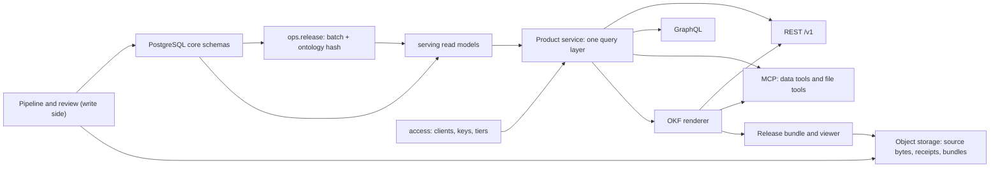

# Production implementation plan

Status: **Phases 0 to 3 are implemented and applied to the local database (2026-11-14). Phases 4 to 9 are planned.** This document turns the agreed production design into ordered work. SQL, endpoint names, tool names, folder layout and tier values are sketches to be confirmed while building. Sizes are rough estimates for one engineer.

Facts about the current store were measured on the local database on 2026-11-14 (experiment `jev-gpt6-luna-ontology-v1` plus earlier experiments in the same database).

## Contents

1. [Decisions](#1-decisions)
2. [Where the code is today](#2-where-the-code-is-today)
3. [Target architecture](#3-target-architecture)
4. [Rules that every phase must keep](#4-rules-that-every-phase-must-keep)
5. [Phase overview](#5-phase-overview)
6. [Phase 0: Foundations](#phase-0-foundations)
7. [Phase 1: Ontology registry and gate](#phase-1-ontology-registry-and-gate)
8. [Phase 2: Catalog, onboarding and evidence](#phase-2-catalog-onboarding-and-evidence)
9. [Phase 3: Identity, profiles and operations](#phase-3-identity-profiles-and-operations)
10. [Phase 4: Releases, serving views and the OKF tree](#phase-4-releases-serving-views-and-the-okf-tree)
11. [Phase 5: Access, product service and REST](#phase-5-access-product-service-and-rest)
12. [Phase 6: MCP server](#phase-6-mcp-server)
13. [Phase 7: GraphQL](#phase-7-graphql)
14. [Phase 8: Bundles and the graph viewer](#phase-8-bundles-and-the-graph-viewer)
15. [Phase 9: Production infrastructure and cutover](#phase-9-production-infrastructure-and-cutover)
16. [Verification strategy](#16-verification-strategy)
17. [Risks and open decisions](#17-risks-and-open-decisions)

## 1. Decisions

| Area | Decision |
|---|---|
| System of record | PostgreSQL with typed tables in seven schemas, plus a `serving` schema of read models. JSONB only for the long tail. |
| Blobs | Content-addressed bytes move from the local artifact volume to object storage. IDs stay SHA-256. |
| OKF | A rendered output of PostgreSQL, never a source. Delivered three ways: one page on request, a virtual file tree, and a file bundle built once per release. Generated pages are no longer committed for new runs. |
| Ontology | PostgreSQL registry is the source of truth. Each version is exported to LinkML, which generates SHACL, JSON Schema and docs. |
| Open Ontologies | Optional, pinned check at promotion time. Not the store and not required. |
| Interfaces | REST, GraphQL and a remote MCP server, as thin adapters over one product service and one query layer. |
| MCP tools | Two toolsets: data tools (structured JSON) and file tools (`okf_ls`, `okf_read`, `okf_find`, `okf_grep`). |
| Access | API keys stored in the application, one key valid on all three interfaces. Tiers are rows. OAuth for MCP is added later. |
| Licences | The owner confirmed that each source licence allows resale. Attribution still travels with every answer. |
| Build order | Ontology registry, evidence spine, identity, releases and OKF tree, access and REST, MCP, GraphQL, bundles, infrastructure. |

## 2. Where the code is today

| Fact | Detail |
|---|---|
| Tables | 17 tables with one shape: `id, owner_id, kind, payload json, created_at`. No foreign keys. Indexes on `owner_id` and `kind` only. Defined in a loop in [store.py](../src/link_lens/store.py). Phase 0 moves them to the `legacy` schema with `payload jsonb`. |
| Store API | `put`, `get`, `require`, `listing`, `blob`, `read_json`, `event`. About 300 references in 20 modules. `runs` and `batches` are the most used. |
| Observations | 374,335 rows, 703 MB. 23,101 source records, 56 fields. They use 39 of the 107 stored mapping configs, and every one of those 39 has a mapping row. The pipeline writes them one statement at a time and never reads them back from the table; it reads extraction artifacts. `owner_id` is a run ID for the 201,632 rows stored by extraction and a source ID for the 172,703 rows stored by assembly, so an observation's run is found through its `config_hash`. |
| Ontology | Before Phase 1: 59 concepts in a JSON blob referenced from `ontologies`, with activation and proposals as `ontology_events` rows. Since Phase 1 the `ontology` schema holds them as rows; the legacy rows stay as history and the model cache stays in `legacy.ontology_events`. |
| Uniqueness checked | `config_hash` is unique across the 107 mappings. A membership is unique per batch and record. A profile is unique per batch and entity. No source record appears in more than one snapshot. Entity IDs are not all UUIDs, so they stay `text`. |
| Tests | Before Phase 0, deterministic tests ran on SQLite through `store.metadata.create_all` and did not exercise Alembic. Since Phase 0 they run on PostgreSQL built by `alembic upgrade head` in [conftest.py](../tests/conftest.py). |
| API | [api.py](../src/link_lens/api.py) is a small FastAPI app mounted beside the LangGraph development server. It is an internal API, not a product API. |
| OKF | [exports.py](../src/link_lens/exports.py) writes a folder of pages and one standalone `viewer.html` with a flat index. |

## 3. Target architecture



| Schema | Tables | Replaces |
|---|---|---|
| `ontology` | `ontology_version`, `concept`, `concept_value`, `concept_requires`, `version_concept`, `version_evidence`, `proposal`, `proposal_run`, `disposition`, `concept_decision`, `activation`, `gate_report` | `ontologies`, `ontology_events`, the JSON blob |
| `catalog` | `source`, `snapshot`, `artifact`, `source_refresh`, view `source_state` | `sources`, `snapshots`, `artifacts` |
| `onboarding` | `run`, `mapping_config`, `mapping`, `mapping_field`, `approval` | `runs`, `mappings`, `approvals` |
| `evidence` | `source_record`, `observation` | `observations` |
| `identity` | `entity`, view `entity_identifier`, `membership`, `link`, `profile`, `profile_field`, `profile_address` | `entities`, `memberships`, `links`, `profiles` |
| `ops` | `batch`, `release` (phase 4), `event`, `model_call`, `model_cache`, `triage_decision`, `evaluation`, `embedding` | `batches`, `events`, `budget_reservations`, `evaluations`, cached responses in `ontology_events` |
| `access` | `tier`, `client`, `api_key`, `api_usage` | New |
| `serving` | Read models only (views and per-release tables) | New |
| `legacy` | The 17 current tables, read-only after each cutover | — |

Proposed package layout:

```text
src/link_lens/
  db/            engine, types (sha256), one repository module per schema
  product/       query layer, response models, auth, limits, ASGI app
  interfaces/    rest.py, graphql.py, mcp_server.py
  okf/           render.py, tree.py, bundle.py
  ontology_export.py   registry rows to LinkML, SHACL, JSON Schema
```

## 4. Rules that every phase must keep

These come from the contracts in [AGENTS.md](../AGENTS.md).

- **IDs and hashes do not change.** Ontology digests, mapping `config_hash`, observation IDs, record IDs and `profile_version` keep their current values, so existing approvals stay valid.
- **History is not rewritten.** `outputs/`, `experiments/` and the legacy tables stay as evidence. Backfills copy; they never edit the source rows.
- **Append-only stays append-only.** Observations, approvals, ontology versions, activations and evaluations reject updates in the database.
- **Human and AI activity stay separate.** AI labels, human labels, mapping approvals, ontology promotion and release creation are different records with different kinds. None substitutes for another.
- **Scores stay labelled.** Uncalibrated scores are exposed as rule or model scores, never as probabilities. Identity links stay `proposed_unreviewed` until reviewed.
- **Evidence is never tiered or hidden.** Status, provenance, alternatives, timestamp basis and licence attribution are in every response.
- **No paid reruns for migration.** Every phase is verified with deterministic checks against stored data.
- **Experimental output goes to `outputs/local-run/`.** Submission artifacts are replaced only when a task calls for it.
- **One Alembic migration per step**, each with a working downgrade until the legacy tables are retired.

The owner added these on 2026-11-14. They keep the later Dagster and dbt work ([orchestration plan](ORCHESTRATION_PLAN.md), section 5) cheap, and suit hundreds or thousands of sources run by two engineers.

- **A pipeline step is a function with explicit parameters** (`source_id`, `snapshot_id`, `run_id`, `batch_id`, `release_id`) that returns a small result record. No step depends on process-wide state other than settings.
- **A step is idempotent.** A retry or a re-run writes nothing new. Content-hash IDs and `ON CONFLICT DO NOTHING` loads already give this; new code keeps it.
- **Serving SQL lives in one directory, one file per read model, each a single `SELECT`** (phase 4), so a file can become a dbt model with little change.
- **The source registry carries refresh facts:** intended cadence, last checked, last changed, and the approved mapping in force. An orchestrator reads them and keeps no copy.
- **Drift detection is a library function** that compares a new snapshot's reader and headers with what the approved mapping expects and returns unchanged, or changed with reasons.
- **Partitioning must suit thousands of sources.** No table gets one partition per source.
- **CLI commands write structured logs and return clear exit codes**, so an orchestrator can report a failure usefully.

## 5. Phase overview

| Phase | Outcome | Depends on | Size |
|---|---|---|---|
| 0 | PostgreSQL-based tests, schemas, typed helpers, migration baseline | — | M |
| 1 | Ontology as rows, LinkML export, promotion gate | 0 | M |
| 2 | Typed sources, mappings, approvals, records, observations | 1 | L |
| 3 | Typed entities, links, profiles, usage and evaluations | 2 | L |
| 4 | Releases, serving read models, OKF renderer and virtual tree | 3 | L |
| 5 | Keys, tiers, product service, REST | 4 | L |
| 6 | MCP server with two toolsets | 5 | M |
| 7 | GraphQL (deferred until a client asks) | 5 | M |
| 8 | Release bundles and per-entity viewer | 4 | S |
| 9 | Production infrastructure, cutover, legacy retirement | 5 | L |

Phases 6, 7 and 8 can run in parallel once phase 5 is done. Phase 9 preparation can start alongside phase 2.

Migration approach: `store.py` stays as a facade while each domain moves. Because Link Lens is a batch system, each cutover is: stop the pipeline, migrate, backfill, verify against the baseline, switch reads and writes for that domain, continue. No long dual-write period is needed.

## Phase 0: Foundations

**Goal:** make typed, PostgreSQL-only schemas safe to build and test.

Tasks:

- [x] **Move database tests to PostgreSQL.** Replace the SQLite fixture with a session database created by `alembic upgrade head`, so migrations are tested. The session uses `testcontainers` with the pgvector image, or an existing server named by `LINK_LENS_TEST_DATABASE_URL`, on which it creates and drops its own `linklens_test_*` databases. The server starts when a test first calls the store, so tests that need no database stay free of it.
  - *Changed while building:* tests are not wrapped in a rolled-back transaction. `store.py` commits on its own connection per call, takes the budget advisory lock on a separate autocommit connection, freezes under `REPEATABLE READ` and is called from worker threads, so one shared transaction would change the behaviour under test. Tables are truncated after each test that used the database instead. Repositories added in later phases can take a connection and be tested inside a transaction.
- [x] **Change the compose image** to `pgvector/pgvector:pg17-trixie` and enable `vector` and `pg_trgm` in the first new migration (`0003`).
  - *Changed while building:* the plain `pg17` tag is the Debian bookworm build (glibc 2.36). The local data volume was created by `postgres:17` on Debian trixie (glibc 2.41, collation version 2.41), so the bookworm build would report a collation version mismatch on every text index. The `-trixie` tag has the same glibc and PostgreSQL 17.12.
- [x] **Create the schemas** `ontology`, `catalog`, `onboarding`, `evidence`, `identity`, `ops`, `access`, `serving`, `legacy` (`0004`).
- [x] **Move the 17 tables to `legacy`** with `ALTER TABLE … SET SCHEMA legacy` and point `store.TABLES` at that schema (`0005`). The SQLite branches in `store.py` and `frozen.py` are removed; nothing else changes.
- [x] **Convert `payload` to `jsonb`** in the legacy tables so backfill queries can use JSON operators and indexes (`0006`).
  - *Found while building:* `jsonb` reorders object keys. Hashes use sorted keys and are unaffected, and no stored value changes, but JSON files regenerated from payloads list keys in a different order. See the risks table.
- [x] **Add shared database helpers** in `db/`: a `sha256` domain (`bytea`, 32 bytes) with a SQLAlchemy type that presents hex strings to Python (`db/types.py`); the `forbid_update()` trigger function; a bulk loader using `COPY` into a staging table followed by `INSERT … ON CONFLICT DO NOTHING` (`db/bulk.py`). The domain, `sha256_hex()`, `sha256_from_hex()` and `forbid_update()` are created in `0007`. The engine stays in `store.py` until a repository needs it.
- [x] **Write migrations as explicit SQL** (`op.execute`), not derived from generic metadata. `migrations/env.py` has no metadata and runs one transaction per migration. `alembic upgrade head` on an empty database and a downgrade round trip run in the test suite and as a step in [the CI workflow](../.github/workflows/tests.yml).
- [x] **Record the migration baseline.** [scripts/migration_baseline.py](../scripts/migration_baseline.py) writes `outputs/local-run/migration-baseline.json`: row counts and ID digests per table, kind and owner, counts per experiment and batch, plus digests over ordered ID lists (ontology hashes, config hashes, observation IDs, record IDs, profile versions). It is read-only, works on the old and new layout, refuses to replace an existing baseline without `--force`, and `--check` compares the database with a saved baseline.
- [x] **Define database roles** (`0008`): `linklens_migrator`, `linklens_pipeline` (read and write on core schemas), `linklens_product` (read on `serving`, limited write on `access.api_usage`).
  - *Decided while building:* the roles are `NOLOGIN` groups with no passwords; a deployment creates login roles and grants one of these to each. `linklens_migrator` owns the nine schemas and the legacy tables. Table privileges are default privileges of `linklens_migrator`, so a migration from Phase 1 onward creates its objects after `SET LOCAL ROLE linklens_migrator`. `DELETE` is not granted by default; a table that needs it grants it explicitly. `linklens_pipeline` also reads and writes `legacy` until Phase 3. `linklens_product` has `USAGE` on `access`; its write on `access.api_usage` is granted with that table in Phase 5.

Done when:

- `uv run pytest -q` passes against PostgreSQL with the same test count as before.
- The baseline file exists and a second run produces identical digests.
- The running application works unchanged against `legacy`.

Results on 2026-11-14:

- **Tests.** 123 passed, 4 skipped, 1 failed on PostgreSQL. Before Phase 0 the suite was 105 passed, 4 skipped, 1 failed on SQLite; the 18 new tests cover the migrations, roles, helpers and the baseline. The one failure, `test_triage.py::test_decision_cached_with_receipt_and_experiment_isolation`, also fails on `main`: it expects the experiment `jev-luna-v1`, and the default experiment is now `jev-gpt6-luna-ontology-v1`. It is not a database failure and is left for a separate fix.
- **Baseline.** Written from the local database before migration; a second run reported zero differences. Totals: 374,335 observations, 23,101 source records, 107 mapping config hashes, 2 ontology hashes, 614 profile versions.
- **Application against `legacy`, rehearsal.** Verified first on a restored copy of the local database. After `alembic upgrade head` the baseline check reported zero differences; all 434,994 rows read identically through the old and new `store.py`; six read-only CLI commands gave identical output; an export of the submission batch produced the same 1,747 files with the same values. A downgrade to `0002` and a second upgrade also left zero differences.
- **Local database cutover.** After the owner's approval, the local `linklens` database was migrated with the steps in the [engineering guide](ENGINEERING.md), section **Database layout, migrations and the baseline**: backend stopped with no runs active, fresh `pg_dump` taken, PostgreSQL recreated on `pgvector/pgvector:pg17-trixie` with the same volume (17.7 to 17.12, collation version 2.41 unchanged), `alembic upgrade head` from `0002` to `0008` in 8 seconds. The baseline check reported zero differences before and after the backend restarted. The backend, Agent Inbox and sandbox controller answered their health checks, and the backend returned the 73 runs and the 60 profiles of the submission baseline batch from `legacy`.

## Phase 1: Ontology registry and gate

**Goal:** the ontology is rows that other tables can reference, and each change passes a recorded gate before promotion.

Schema as built (migration `0009`; the full DDL is in [0009_ontology_registry.py](../migrations/versions/0009_ontology_registry.py)):

```sql
CREATE TABLE ontology.ontology_version (
  hash sha256 PRIMARY KEY,                         -- existing digest(document)
  parent_hash sha256 REFERENCES ontology.ontology_version,
  label text NOT NULL,                             -- e.g. experimental-939e8c69596c
  document_artifact sha256 NOT NULL,               -- original JSON, kept for digest checks
  created_at timestamptz NOT NULL DEFAULT now()
);
CREATE TABLE ontology.concept (
  id bigint GENERATED ALWAYS AS IDENTITY PRIMARY KEY,
  name text NOT NULL, content_hash sha256 NOT NULL,   -- digest of this definition
  scope text NOT NULL, datatype text NOT NULL,
  cardinality text NOT NULL CHECK (cardinality IN ('one', 'many')),
  definition text NOT NULL,
  minimum text, maximum text,                      -- exact text; valid numerics
  introduced_in sha256 NOT NULL REFERENCES ontology.ontology_version,
  UNIQUE (name, content_hash), UNIQUE (id, name)
);
CREATE TABLE ontology.concept_value   (concept_id, value, position, PRIMARY KEY (concept_id, value));
CREATE TABLE ontology.concept_requires(concept_id, required_concept_id, position, PRIMARY KEY (concept_id, required_concept_id));
CREATE TABLE ontology.version_concept (
  version_hash sha256 REFERENCES ontology.ontology_version, concept_id bigint, name text, position int,
  PRIMARY KEY (version_hash, concept_id), UNIQUE (version_hash, name), UNIQUE (version_hash, position),
  FOREIGN KEY (concept_id, name) REFERENCES ontology.concept (id, name)
);
CREATE TABLE ontology.version_evidence (version_hash, evidence_artifact sha256, created_at, PRIMARY KEY (version_hash, evidence_artifact));

CREATE TABLE ontology.proposal (
  id text PRIMARY KEY, experiment_id text NOT NULL,
  parent_hash sha256 NOT NULL REFERENCES ontology.ontology_version,
  ontology_hash sha256 REFERENCES ontology.ontology_version,   -- null when rejected
  job_run_id text, status text NOT NULL CHECK (status IN ('validated', 'rejected')),
  model text, prompt_version text, proposal_artifact sha256 NOT NULL,
  accepted_concepts int, rejected_concepts int, supersedes_proposal_ids text[],
  created_at timestamptz NOT NULL
);
CREATE TABLE ontology.proposal_run     (proposal_id, position, run_id text NOT NULL, alias text, PRIMARY KEY (proposal_id, position));
CREATE TABLE ontology.disposition (
  proposal_id text REFERENCES ontology.proposal, position int,
  source_ref text NOT NULL,                        -- the run reference as the model wrote it
  source_field text NOT NULL, run_id text,         -- resolved run, null when the reference names none
  disposition text NOT NULL, target_concept text, evidence_quote text NOT NULL, reason text NOT NULL,
  PRIMARY KEY (proposal_id, position)
);
CREATE TABLE ontology.concept_decision (proposal_id, position, concept_name text NOT NULL, acceptable boolean NOT NULL, reason text NOT NULL, PRIMARY KEY (proposal_id, position));

CREATE TABLE ontology.activation (            -- append-only; current = latest per experiment
  id bigint GENERATED ALWAYS AS IDENTITY PRIMARY KEY,
  experiment_id text NOT NULL, version_hash sha256 NOT NULL REFERENCES ontology.ontology_version,
  status text NOT NULL CHECK (status IN ('experimental', 'promoted')),
  reviewer text, created_at timestamptz NOT NULL,
  gate_run_at timestamptz, gate_results jsonb,     -- the gate run a promotion relied on
  CHECK ((status = 'promoted') = (reviewer IS NOT NULL)),
  UNIQUE (experiment_id, version_hash, status, created_at)
);
CREATE TABLE ontology.gate_report (
  version_hash sha256 REFERENCES ontology.ontology_version, check_name text,
  result text NOT NULL CHECK (result IN ('pass', 'fail', 'unknown')),
  detail jsonb NOT NULL, created_at timestamptz NOT NULL,
  PRIMARY KEY (version_hash, check_name, created_at)
);
```

Differences from the first sketch, each found while building against the stored data:

- **Order is stored.** `version_concept`, `concept_requires`, `disposition` and `concept_decision` carry a `position`, so a rebuilt document has its concepts, values and companions in the original order and `ontology show` prints the same bytes.
- **Bounds are text.** A version's hash is computed from the bound's text (`"-90"`), which `numeric` would not always return unchanged. A check keeps them valid numerics.
- **No `linkml_artifact` column.** `ontology_version` rejects updates, so a file generated later cannot be attached to it. The gate report of the LinkML check records the hash of the export it linted.
- **`version_evidence`** holds the proposal artifact a version was registered with; the sketch had no place for the legacy `proposal_evidence` rows.
- **`proposal`** also records the experiment, the resulting version and the counts and superseded proposals of the legacy record, and **`proposal_run`** lists its runs with their aliases, so a proposal reads back exactly as it was stored. Optional columns are null where the older records had no such key.
- **Dispositions and decisions are keyed by position.** A rejected proposal may repeat a source field or a concept, which is one reason it was rejected. `source_ref` keeps the run reference as the model wrote it; two references in the oldest stored proposal name no run.
- **`activation`** records the gate run a promotion relied on and has a natural unique key, so the backfill is idempotent.
- **All twelve tables reject updates,** not only the five the sketch listed.

`version_concept` lists a version's members so reads do not walk ancestors. It also allows a later version to drop or replace a concept without changing the model, although the current rule remains additive only.

Tasks:

- [x] **Migration** `0009` for the tables above, with `forbid_update()` on all twelve, and a deferred constraint trigger that rejects a version missing or redefining a concept of its parent. The tables are created as `linklens_migrator`.
- [x] **Backfill.** `link-lens backfill ontology` ([backfill.py](../src/link_lens/backfill.py)) copies the packaged v0.1 ontology, every row in `legacy.ontologies`, and the proposal, evidence, activation and promotion rows from `legacy.ontology_events`. It is idempotent and verifies before committing: each version rebuilds its document, each experiment's latest activation equals its legacy `active` pointer, and each proposal reads back as its legacy record. `model_cache` rows move to `ops.model_cache` in phase 3 and stay in `legacy` until then.
- [x] **Rewrite [ontology.py](../src/link_lens/ontology.py)** over the registry ([db/ontology.py](../src/link_lens/db/ontology.py)): `resolve()` builds the same document from rows; `register()` inserts version, concepts and members in one transaction; `activate()` appends an activation row; `active_hash()` reads the latest activation. Public signatures do not change.
  - *Changed behaviour:* `register()` refuses a document that is not in canonical form (every concept with all nine fields; only `version`, `parent_hash` and `concepts` at the top level), because its rows could not rebuild its hash. Both stored versions and `firmable_ontology.yaml` are canonical.
- [x] **Keep the digest invariant.** `digest(resolve(hash)) == hash` for every stored version, checked on every `resolve()` and at registration. The original JSON artifact stays as an independent check, used by the gate.
- [x] **Update [ontology_workflow.py](../src/link_lens/ontology_workflow.py)** to write `proposal`, `proposal_run`, `disposition` and `concept_decision` rows instead of an event payload. Rows hold the released dispositions, or the proposed ones when nothing was released; the full packet stays in the proposal artifact.
- [x] **LinkML export.** [ontology_export.py](../src/link_lens/ontology_export.py) maps scope to class, concept to attribute, enum to enum, `many` to `multivalued`, bounds to `minimum_value` and `maximum_value`, definition to `description`. It adds a `ConceptName` enum of every concept and an `Observation` class, and keeps `requires` as an annotation. `linkml` and `pyshacl` are in a separate `ontology` dependency group, so the runtime image does not need them.
- [x] **CLI:** `link-lens ontology export HASH --format linkml|shacl|jsonschema` and `link-lens ontology gate HASH`.
- [x] **Promotion gate.** `ontology gate` ([ontology_gate.py](../src/link_lens/ontology_gate.py)) records one `gate_report` row per check:
  1. LinkML export and lint succeed, and SHACL and JSON Schema generate. `unknown` when the `ontology` group is not installed.
  2. The version is additive against its parent.
  3. A sample of stored observations validates against the generated SHACL shapes (after phase 2; `unknown` until then).
  4. Impact report: mappings and observation counts per changed concept (after phase 2; `unknown` until then).
  5. Optional Open Ontologies `plan` on the generated Turtle with existing IRIs locked, at a pinned version. Recorded as `unknown`: the integration is not built and no version is pinned.
  6. Added while building: the rows rebuild the hash and equal the original JSON artifact.
- [x] **`ontology promote` requires a gate report** with no `fail` in the latest run. The rule is in `activate()`, so no caller can promote around it. `unknown` results are returned to the reviewer and stored with the promotion.
- [x] **Commit the promoted LinkML file** next to `firmable_ontology.yaml` as [firmable_ontology.linkml.yaml](../firmable_ontology.linkml.yaml), so a promotion shows up as a reviewable diff. A test fails when the two drift apart.
- [x] **Archive format 2** (brought forward from phase 2 for the ontology tables): `freeze` adds the registry rows, and `thaw` still reads format 1 and runs the backfill after it. Without this, new ontology records would be missing from archives.

Done when:

- All existing ontology tests pass, plus new tests for digest parity, additive enforcement in the database, and gate blocking on `fail`.
- `link-lens ontology show` and `ontology diff` give the same output as before for both stored versions.
- Generated LinkML passes `linkml-lint`, and the JSON Schema enum of concept names equals the 59 registered names.

Results on 2026-11-14:

- **Tests.** 144 passed, 4 skipped, none failed. All existing ontology tests pass; two were adapted because they reached into the legacy tables (tampering is now refused by the database, and the archive test now clears the registry too). The 20 new tests cover digest and order parity, the canonical-form rule, additive enforcement in the database, append-only triggers, activation history, gate blocking and unknown results, export mapping, lint, JSON Schema, SHACL validation with `pyshacl`, proposal rows, the backfill, both archive formats and the CLI. The stale triage test from Phase 0 is fixed.
- **Local database.** Migrated from `0008` to `0009` and backfilled after a fresh backup and a rehearsal on a restored copy: 2 versions, 59 concepts, 128 enum values, 74 members, 3 proposals with 18 runs, 393 dispositions and 45 concept decisions, 1 evidence row, 2 activations. The digest over the two ontology hashes equals the baseline, and the baseline check on `legacy` reported zero differences before and after.
- **Same output.** `ontology show` for both versions and `ontology diff` between them printed the same bytes as before the migration, on the copy and on the local database.
- **LinkML.** `linkml-lint firmable_ontology.linkml.yaml` reports no problems with the repository's `.linkmllint.yaml`, which exempts permissible values from naming conventions because they are data. The JSON Schema `ConceptName` enum equals the 59 names registered for the promoted version.
- **Not done:** no gate run is recorded on the local database, and the promotion of 2026-09-25 predates the gate. Gate checks 3 to 5 are placeholders that record `unknown`.

## Phase 2: Catalog, onboarding and evidence

**Goal:** the evidence spine exists with foreign keys: concept, observation, source record, snapshot, source.

Schema as built (migrations [0010](../migrations/versions/0010_catalog.py), [0011](../migrations/versions/0011_onboarding.py) and [0012](../migrations/versions/0012_evidence.py) hold the full DDL):

```sql
CREATE TABLE catalog.artifact (
  sha256 sha256 PRIMARY KEY, uri text NOT NULL, media_type text NOT NULL,
  size bigint NOT NULL, name text NOT NULL, created_at timestamptz NOT NULL
);
CREATE TABLE catalog.source (
  id text PRIMARY KEY, owner_id text, kind text,     -- catalogue | registered
  portal text, slug text, metadata jsonb,
  title text GENERATED ALWAYS AS (metadata ->> 'title') STORED,
  publisher text GENERATED ALWAYS AS (metadata -> 'organization' ->> 'title') STORED,
  extra jsonb NOT NULL, created_at timestamptz NOT NULL
);
CREATE TABLE catalog.snapshot (                      -- append-only
  id text PRIMARY KEY, owner_id text, kind text,
  source_id text REFERENCES catalog.source, resource_id text,
  artifact_sha sha256 REFERENCES catalog.artifact, format text,
  licence text, licence_url text,
  observed_at timestamptz, observed_at_basis text, retrieved_at timestamptz,
  documentation jsonb, dataset_notes text, receipt jsonb, inspection jsonb,
  extra jsonb NOT NULL, created_at timestamptz NOT NULL
);

CREATE TABLE onboarding.run (
  id text PRIMARY KEY, owner_id text, kind text, experiment_id text,
  source_id text REFERENCES catalog.source, snapshot_id text REFERENCES catalog.snapshot,
  ontology_hash sha256 REFERENCES ontology.ontology_version,
  supersedes_run_id text REFERENCES onboarding.run,
  status text, model text, prompt_version text, thread_id text,
  model_calls int, python_calls int, input_tokens bigint, output_tokens bigint,
  active_seconds double precision, calculated_cost_usd double precision,
  started_at timestamptz, completed_at timestamptz,
  state jsonb NOT NULL,                              -- validation, critique, artifacts, recovery lineage
  created_at timestamptz NOT NULL
);
CREATE TABLE onboarding.mapping_config (             -- append-only; one row per distinct config
  config_hash sha256 PRIMARY KEY, config jsonb NOT NULL,
  ontology_hash sha256 REFERENCES ontology.ontology_version,   -- null = packaged v0.1
  subject_role text NOT NULL, source_kind text NOT NULL, address_role text NOT NULL,
  source_reliability double precision NOT NULL, created_at timestamptz NOT NULL
);
CREATE TABLE onboarding.mapping_field (              -- derived from config, for impact queries
  config_hash sha256 REFERENCES onboarding.mapping_config, position int,
  concept_id bigint NOT NULL REFERENCES ontology.concept,
  group_name text NOT NULL DEFAULT '', source_fields text[] NOT NULL,
  PRIMARY KEY (config_hash, position)
);
CREATE TABLE onboarding.mapping (                    -- append-only; a config proposed in a run
  id text PRIMARY KEY, owner_id text, kind text,     -- existing "<run>:<version>" id
  run_id text REFERENCES onboarding.run, version int,
  config_hash sha256 REFERENCES onboarding.mapping_config,
  model text, status text, generated_by text, proposed_at timestamptz,
  extra jsonb NOT NULL, created_at timestamptz NOT NULL
);
CREATE TABLE onboarding.approval (                   -- append-only
  id text PRIMARY KEY, owner_id text, kind text,
  run_id text REFERENCES onboarding.run, mapping_id text REFERENCES onboarding.mapping,
  config_hash sha256 REFERENCES onboarding.mapping_config,
  decision text, reviewer text, feedback text, identity_basis text, decided_at timestamptz,
  extra jsonb NOT NULL, created_at timestamptz NOT NULL
);

CREATE TABLE evidence.source_record (                -- append-only
  source_id text NOT NULL REFERENCES catalog.source, id sha256 NOT NULL,
  snapshot_id text NOT NULL REFERENCES catalog.snapshot,
  sheet text, row_no bigint, locator jsonb NOT NULL,
  PRIMARY KEY (source_id, id)
) PARTITION BY HASH (source_id);                     -- 32 partitions
CREATE TABLE evidence.observation (                  -- append-only
  source_id text NOT NULL, id sha256 NOT NULL, record_id sha256 NOT NULL,
  concept_id bigint NOT NULL REFERENCES ontology.concept,
  config_hash sha256 NOT NULL REFERENCES onboarding.mapping_config,
  group_name text, group_id sha256,
  value text NOT NULL, raw_value jsonb NOT NULL, source_fields text[] NOT NULL,
  field_confidence double precision NOT NULL,
  observed_at timestamptz NOT NULL,
  timestamp_basis text NOT NULL CHECK (timestamp_basis IN ('snapshot', 'record')),
  timezone_assumed boolean NOT NULL, ingested_at timestamptz NOT NULL,
  derivation_level text NOT NULL, engine text NOT NULL,
  extra jsonb NOT NULL DEFAULT '{}',
  PRIMARY KEY (source_id, id),
  FOREIGN KEY (source_id, record_id) REFERENCES evidence.source_record (source_id, id)
) PARTITION BY HASH (source_id);                     -- 32 partitions
CREATE INDEX ON evidence.observation (source_id, record_id);
CREATE INDEX ON evidence.observation (concept_id, left(value, 256));
CREATE INDEX ON evidence.observation (config_hash);
```

Notes:

- Licence, snapshot and source context are read through `source_record` and `snapshot`. Roles and source reliability are read through `mapping_config`. They are no longer copied onto each observation. `evidence.observation` with its indexes takes 223 MB where `legacy.observations` takes 722 MB.
- `observed_at` stays on the observation because a mapping may use a record-level statement timestamp. `timestamp_basis` says whether it came from the snapshot or from the record.
- **Partitioning: 32 hash partitions on `source_id`** for both tables (migration `0013`). The first build used one list partition per source, as first sketched; the owner expects hundreds or thousands of sources, and that many partitions slow planning, multiply locks and bloat the catalog. The reasoning:
  - *Key.* Hashing `source_id` keeps all rows of a source in one partition and the two tables aligned, so a query for one source reads one partition and the join from observation to source record stays within a partition. Both primary keys and the foreign key already start with `source_id`, so nothing else changes. Hashing the row ID instead would spread every source over all partitions.
  - *Count.* 32 is fixed however many sources exist. At a billion observations it is about 31 million rows a partition, and a plan that touches all 32 is still cheap. It is a power of two, so one partition can later be split in two (modulus 64) without rehashing the rest.
  - *Checked.* The primary keys, the foreign key from observation to source record, and a foreign key shaped like `identity.profile_field`'s to observation all work on the hash-partitioned tables (tested).
  - *Given up.* A source can no longer be attached or detached as a partition. Loads are idempotent by content hash, so a source is reloaded by loading it again. List partitions for very large sources over a hash-partitioned default were considered and rejected for now: moving a source out of the default rewrites its rows, and two engineers should not have two partition schemes to operate.
- Full source rows are not stored today; only per-field `raw_value`. Adding a `raw jsonb` column to `source_record` is a separate decision.

Differences from the first sketch, each found while building against the stored data and the code:

- **Records are kept exactly.** The store has always held one JSON document per key, and tests and callers write partial records. `source`, `snapshot`, `run`, `mapping` and `approval` therefore keep the document without loss: a field goes into its typed column when the value is present and well formed, and into the row's JSON column (`extra`, or `state` for a run) otherwise. Reading puts the document back together. These tables have nullable typed columns instead of `NOT NULL`, and keep the store's `owner_id` and `kind`, which `listing` filters on.
- **Reference columns are filled only when the referenced row exists.** A foreign key never dangles, and a reference that does not resolve stays visible in the JSON column. In the stored data that is 11 runs that name a pseudo-source (`ontology`, `connectivity-test`) and 8 that name a snapshot that was never stored.
- **A mapping config is its own table.** `config_hash` is unique across the 107 stored mappings, but two runs can propose the same config, and the tests do. `mapping_config` holds each distinct config once under its content hash, and is stored only when the config really hashes to it; `mapping` is the proposal in a run. Observations and approvals reference the config. `mapping_field` is keyed by position.
- **Snapshot IDs stay text.** They are 64-character digests today, but the store accepts any key, and nothing is gained by `bytea` for a dozen rows.
- **Observations are strict, and still exact.** Every column the sketch had is required, and an observation must reference a stored snapshot, mapping config and concept. `engine`, `timezone_assumed` and `timestamp_basis` replace three repeated strings. `extra` holds anything a row could not derive exactly from its references; none of the 374,335 stored observations needs it.
- **No owner on observations.** The legacy `owner_id` was whichever run or source stored the observation first. A run's observations are found through its mapping config.
- **The value index holds a prefix**, `left(value, 256)`, so no value is too long for it. The longest stored value is 735 bytes.
- **Artifacts, mapping configs and mapping fields are append-only too.**

Tasks:

- [x] **Migrations** `0010` to `0012` for `catalog`, `onboarding`, `evidence`, with append-only triggers on `artifact`, `snapshot`, `mapping_config`, `mapping_field`, `mapping`, `approval`, `source_record`, `observation`.
- [x] **Backfill** in dependency order: artifacts, sources, snapshots, runs, mappings with their configs and `mapping_field`, approvals, source records, observations. `link-lens backfill spine` ([backfill.py](../src/link_lens/backfill.py)) is idempotent and verifies that every copied record reads back exactly as its legacy row; observations go in chunks of 20,000 through the `COPY` loader.
- [x] **Repositories** in [db/catalog.py](../src/link_lens/db/catalog.py), [db/onboarding.py](../src/link_lens/db/onboarding.py), [db/evidence.py](../src/link_lens/db/evidence.py), with the exact-record machinery in [db/records.py](../src/link_lens/db/records.py). The `store` facade serves these seven tables from them and returns the same dict shapes callers expect.
- [x] **Bulk observation writes.** `store.put_observations` replaces the per-row `store.put` loops in [pipeline.py](../src/link_lens/pipeline.py) and [agent.py](../src/link_lens/agent.py). Extraction and assembly logic do not change.
- [x] **Blob storage interface.** [blobs.py](../src/link_lens/blobs.py) has a local filesystem backend (current behaviour) and an S3-compatible backend that reads through a local cache. `catalog.artifact.uri` records where the bytes are, so both can coexist while blobs move. `boto3` is in an optional `s3` dependency group.
- [x] **Turn on gate checks 3 and 4** from phase 1. The gate validates up to 25 stored observations per concept against the generated SHACL shapes, and reports the mapping configs and observations that use each concept a version adds.
- [x] **Archive format.** [frozen.py](../src/link_lens/frozen.py) reads and restores records through the store, so format 2 carries the typed tables as the same records, and format 1 archives still restore.
- [x] **Typed baseline check.** `scripts/migration_baseline.py --typed --check FILE` computes counts and digests from the typed schemas and compares them with the baseline.
- [x] **Hash partitions** (migration `0013`, added after the owner's constraints of 2026-11-14): `source_record` and `observation` are rebuilt as 32 hash partitions on `source_id`; rows are copied and counted before the list-partitioned tables are dropped. `evidence.ensure_source_partitions` is gone.
- [x] **Source refresh facts** (migration `0014`, [sources.py](../src/link_lens/sources.py)). `catalog.source_refresh` stores what cannot be derived: the intended cadence and when the publisher was last checked. The view `catalog.source_state` adds what the other tables already say: the latest snapshot and when the bytes last changed, and the approved mapping in force, which is the most recent approved config among the source's runs. Registering a source records the check whether or not the bytes changed. `link-lens source state` and `link-lens source cadence SOURCE --days N` read and set them.
  - *Resolution of a conflict:* the constraint asks for last changed and the approved mapping on the source registry. Storing them would duplicate facts that snapshots and approvals already hold and could drift from them, so they are derived in the view instead. An orchestrator reads one relation either way.
- [x] **Drift detection** ([drift.py](../src/link_lens/drift.py)). `drift.compare` takes a mapping config, a snapshot's format and its headers; `drift.detect` reads a stored snapshot's header with the approved reader first. Both return `unchanged`, or `changed` with reasons, each marked as blocking or not: a column the mapping uses is missing, the format differs or the reader cannot open the file (blocking); a new column or a removed unused column (not blocking). `link-lens source drift SOURCE` runs it by hand and exits 3 when the result blocks. It is not wired into any schedule.

Done when:

- Typed counts equal the baseline for every experiment: observations, distinct records, mappings, approvals, runs, snapshots, sources.
- The digest over ordered observation IDs per batch equals the baseline.
- A fixture run of `onboard` then `extract` writes only typed tables, and a second identical run inserts zero rows.
- The impact query returns per-mapping observation counts for a chosen concept:

```sql
SELECT m.id, count(*) AS observations
FROM   ontology.concept c
JOIN   evidence.observation o ON o.concept_id = c.id
JOIN   onboarding.mapping m   ON m.config_hash = o.config_hash
WHERE  c.name = 'registration.business_name_status'
GROUP  BY 1;
```

Results on 2026-11-14:

- **Baseline.** The typed check reported zero differences on the local database: row counts and ID digests for the seven tables; runs, mappings, approvals, observations and source records per experiment; observations and source records per batch and per mapping config. The legacy check also reported zero differences, so the legacy rows are untouched.
- **Backfill.** 26,610 artifacts, 949 sources, 12 snapshots, 73 runs, 107 mappings in 107 configs with 602 mapping fields, 52 approvals, 23,101 source records and 374,335 observations, in 58 seconds. Every record read back exactly; no observation needed its `extra` column; a second run copied nothing.
- **Typed-only writes.** A test runs the onboarding graph and extraction on a fixture: all eight typed tables receive rows, the seven legacy tables stay empty, and extracting again inserts nothing.
- **Impact query.** Returns one mapping with 1,964 observations for `registration.business_name_status`.
- **Unchanged output.** On a restored copy, eight CLI commands printed the same bytes with Phase 1 code before the migration and Phase 2 code after it, and an export of the submission batch produced the same 1,747 files with equal values (25 JSON files differ in key order only).
- **Gate.** On the promoted version, 1,400 sampled observations of 56 concepts validated against the generated shapes with no violation.
- **Tests.** 158 passed, 4 skipped. Three existing tests changed: one edited a stored snapshot, which is now refused, and builds it once instead; the baseline test now writes legacy rows directly; one gate test expects the impact check to pass.
- **Hash partitions.** On the local database the rebuild took 8 seconds; all 374,335 observations and 23,101 source records are present in 7 of the 32 partitions (8 sources); both baseline checks again reported zero differences. A downgrade and a second upgrade were rehearsed on a copy first.
- **Refresh facts and drift.** The six registered sources each report their latest snapshot, the date its bytes changed and an approved mapping in force, which is the mapping of the promoted run in every case. The drift check reports `unchanged` for all six against their latest snapshot. No cadence is set and no check time is recorded yet; those start when sources are next registered or scheduled.
- **Tests.** 165 passed, 4 skipped after these additions.
- **Not verified:** the S3 backend against a real bucket (it is tested with a stand-in client); `freeze` and `thaw` on the full local database (tested on fixtures only); a live onboarding run with a paid model call; registering a real source after the refresh hook was added (tested with a stubbed download).

How the seven constraints stand after this phase:

| Constraint | State |
|---|---|
| Partitioning for thousands of sources | Done: 32 hash partitions, migration `0013` |
| Refresh facts on the source registry | Done: `catalog.source_refresh` and `catalog.source_state`, migration `0014` |
| Drift detection as a library function | Done: `drift.compare` and `drift.detect` |
| Steps are functions with explicit parameters | New steps follow it (`sources.record_check(source_id)`, `drift.detect(snapshot_id, config_hash)`, `backfill.*`, `ontology_gate.run(hash)`). Existing steps `ingestion.register`, the graph nodes and `pipeline.assemble` already take their IDs but also read `settings().experiment_id`; that is a setting, and stays. `store.current_discovery()` without an experiment reads a shared pointer row; since phase 3 `link-lens portfolio` asks for the configured experiment's discovery, and the shared row is only a fallback. |
| Steps are idempotent | Holds for every write added so far: content-hash keys, `ON CONFLICT DO NOTHING`, and updates that are skipped when nothing changes. |
| Serving SQL in one directory | Phase 4 |
| Structured logs and clear exit codes | Exit codes are defined in [cli.py](../src/link_lens/cli.py): 0 done, 1 failed, 2 called wrongly, 3 ran and found something that blocks the next step (a failed gate check, blocking drift). Structured logs were added in phase 3. |

## Phase 3: Identity, profiles and operations

**Goal:** derived results and operational records are typed, versioned by batch, and queryable.

Schema as built (migrations [0015](../migrations/versions/0015_ops.py), [0016](../migrations/versions/0016_identity.py) and [0017](../migrations/versions/0017_legacy_read_only.py) hold the full DDL). Every table below except `profile_field`, `profile_address` and `embedding` starts with the store's `id`, `owner_id` and `kind`, and ends with `extra jsonb` and `created_at`, as the phase 2 record tables do.

```sql
CREATE TABLE ops.batch (                             -- pipeline | enhancement | discovery
  experiment_id text, baseline_batch_id text REFERENCES ops.batch,
  result_artifact sha256 REFERENCES catalog.artifact,
  run_ids text[], counts jsonb, policy jsonb, recorded_at timestamptz
);
CREATE TABLE ops.triage_decision (                   -- append-only; owner is the discovery
  dataset_id text, model text, probability double precision, prompt_sha256 text,
  request_id text, response_artifact sha256 REFERENCES catalog.artifact, basis text
);
CREATE TABLE ops.model_cache (                       -- append-only
  response_artifact sha256 REFERENCES catalog.artifact,
  artifact_id sha256 REFERENCES catalog.artifact
);
CREATE TABLE ops.model_call (                        -- every attempt; settled once, then fixed
  experiment_id text, caller_id text, stage text, model text, status text,
  input_tokens bigint, output_tokens bigint,         -- null = unknown, never zero
  reservation_usd double precision, charge_usd double precision, rate jsonb
);
CREATE TABLE ops.event (                             -- owner is the run
  at timestamptz, experiment_id text, stage text, model text, status text,
  input_tokens bigint, output_tokens bigint, calculated_cost_usd double precision,
  budget_charge_usd double precision, wall_seconds double precision
);
CREATE TABLE ops.evaluation (                        -- human_label | ai_label | worksheet | ...
  worksheet_id text, item_id text, verdict text, reviewer text, evidence text,
  review_type text, labelled_at timestamptz, batch_id text REFERENCES ops.batch
);
CREATE TABLE ops.embedding (                         -- append-only, HNSW index
  key text PRIMARY KEY, model text NOT NULL, embedding vector(1536) NOT NULL, created_at timestamptz
);

CREATE TABLE identity.entity (                       -- kind: entity | enhanced_entity
  batch_id text REFERENCES ops.batch,                -- set for a batch-owned snapshot
  entity_id text, status text, rule_version text, identifiers jsonb
);
CREATE VIEW identity.entity_identifier AS ...        -- entity, scheme, value from identifiers
CREATE TABLE identity.membership (                   -- append-only
  batch_id text REFERENCES ops.batch, source_id text, record_id sha256, entity_id text,
  FOREIGN KEY (source_id, record_id) REFERENCES evidence.source_record,
  UNIQUE (batch_id, source_id, record_id)            -- a record joins one entity per batch
);
CREATE TABLE identity.link (                         -- append-only
  batch_id text REFERENCES ops.batch, link_id sha256, entity_key text,
  rule text, rule_version text, score double precision, score_kind text,
  threshold double precision, status text,           -- proposed_unreviewed until reviewed
  human_review_status text, evidence jsonb,
  a_source_id text, a_record_id sha256, b_source_id text, b_record_id sha256   -- both REFERENCES evidence.source_record
);
CREATE TABLE identity.profile (                      -- append-only
  batch_id text REFERENCES ops.batch, entity_key text, profile_version sha256,
  policy_version text, status text, uncertainties jsonb,
  UNIQUE (batch_id, entity_key)
);
CREATE TABLE identity.profile_field (                -- append-only
  profile_id text REFERENCES identity.profile, position int,
  concept_name text NOT NULL, concept_id bigint REFERENCES ontology.concept,
  status text,                                       -- selected | multiple_values
  value text, observation_source_id text, observation_id sha256,
  detail jsonb NOT NULL,                             -- the field exactly: alternatives, provenance, decision
  PRIMARY KEY (profile_id, position),
  FOREIGN KEY (observation_source_id, observation_id) REFERENCES evidence.observation
);
CREATE TABLE identity.profile_address (              -- append-only; one record's address fields together
  profile_id text REFERENCES identity.profile, position int, role text,
  source_id text, record_id sha256, detail jsonb NOT NULL,
  PRIMARY KEY (profile_id, position),
  FOREIGN KEY (source_id, record_id) REFERENCES evidence.source_record
);
```

Differences from the first sketch, each found while building against the stored data and the code:

- **Records are kept exactly, as in phase 2.** Every table accepts the record the store is given and reads it back unchanged; typed columns hold what is present and well formed, and a reference column is filled only when the row it points at exists. In the stored data every reference resolved: no value stayed outside its column.
- **`model_call` is not append-only.** A reservation is written before a call and changed once when the call is settled. The database allows that one change and refuses any change to a call that is `settled` or a `historical_estimate`.
- **`evaluation` is not append-only.** A row is the current label of an item and is replaced when the item is labelled again. Every label ever submitted is an event, as before, so the history is still append-only where it was.
- **`event` is not append-only and not partitioned.** The enhancement step writes a usage event when a call starts and completes it when the call ends, so an interrupted call leaves its receipt. Partitioning by time would need a partition key in the primary key, while the store looks events up by ID alone, and a step that creates partitions ahead of time, which nothing runs yet. With 9,178 events a plain table with indexes is enough; it can be rebuilt as partitions later, as `0013` did for evidence.
- **The store's `batches` table is three tables.** Batches, triage decisions and cached model responses shared one table and are told apart by their key (`triage-…`, `enhance-cache-…`). The ontology job's cached responses, which sat in `ontology_events`, join `ops.model_cache`.
- **A batch is written in one transaction** with its entities, memberships, links and profiles, batch first (`store.put_many`). Before, the batch row was written last and separately, so a failure left rows without a batch.
- **`entity` holds two kinds of row,** as the store did: the shared record of an entity, which assembly updates, and the snapshot an enhancement batch owns. So `membership.entity_id` is not a foreign key. `entity_identifier` is a view over the `identifiers` column, which has a GIN index, instead of a table that would have to follow every update.
- **Profile fields and addresses are stored once,** as rows whose `detail` is the field exactly and whose columns point at the observation or source record it cites. A profile reads back with them in place. Of 3,465 stored fields, 3,351 cite an observation and 114 hold several values.
- **`current_*` views are not built.** They were to select the promoted batch from the submission manifest until releases exist. A view cannot read that file, and a pointer table made only for one phase would be replaced in the next. Phase 4 builds them on `ops.release`.
- **`ops.embedding` is keyed by the cache key,** a text, not a digest. Only vectors of the indexed size, 1,536, are stored.

Tasks:

- [x] **Migrations** `0015` and `0016` for the remaining `ops` tables and `identity`. Append-only triggers on `triage_decision`, `model_cache`, `embedding`, `membership`, `link`, `profile`, `profile_field`, `profile_address`; a settlement trigger on `model_call`.
- [x] **Backfill** batches, triage decisions, cached responses, budget reservations into `model_call`, events, evaluations, entities, memberships, links and profiles with their fields and addresses. `link-lens backfill identity-ops` is idempotent and verifies that every copied record reads back exactly as its legacy row.
- [x] **Repositories** in [db/identity.py](../src/link_lens/db/identity.py) and [db/ops.py](../src/link_lens/db/ops.py). The `store` facade serves every table from typed schemas. The one exception is the legacy ontology history (`ontologies` and the proposal and activation rows of `ontology_events`), which the store still reads for archives and which `backfill.py` and the baseline script read to compare. No other module reads `legacy`.
- [ ] **`current_*` views.** Moved to phase 4; see above.
- [x] **Keep budget locking** as is: the advisory lock stays, reservations now write `ops.model_call`, and the enhancement budget is summed from `ops.event.budget_charge_usd`.
- [x] **Write new embeddings** to `ops.embedding` with an HNSW index. Cached embeddings are not backfilled.
- [x] **Make the legacy tables read-only** (migration `0017`) by revoking `INSERT` and `UPDATE` from the pipeline role.
- [x] **Structured logs** ([logs.py](../src/link_lens/logs.py)), from the owner's constraints. The `link-lens` entry point writes one JSON line to standard error when a command finishes or fails: command, exit code, duration and, for a failure, the error type. A message is logged only for errors this code base raises itself, so a provider response is never copied into a log. The backfills log one line per table.
- [x] **Discovery by experiment.** `link-lens portfolio` reads the configured experiment's discovery instead of the shared `discovery` pointer.

Done when:

- Counts and digests equal the baseline: entities, memberships, links, profiles and profile versions per batch; events; reservations; evaluations by kind.
- Re-running `assemble` on the promoted batch's inputs reproduces identical `profile_version` values. This is deterministic and makes no model calls.
- `link-lens usage` and the cost reports return the same totals and the same priced-call coverage as before.
- Human labels and AI labels remain separately countable.

Results on 2026-11-14:

- **Baseline.** The typed check now covers every table except the legacy ontology history and reported zero differences on the local database: row counts and ID digests per table, kind and owner; memberships, entities, links, profile versions and stored counts per batch; reservations per experiment. The legacy check also reported zero differences.
- **Backfill.** 26 batches, 1,067 triage decisions, 18,395 cached responses, 1,002 model calls, 9,178 events, 411 evaluations, 298 entities, 1,235 memberships, 621 links and 614 profiles with 3,465 fields and 355 addresses, in 69 seconds. Every record read back exactly and every reference resolved.
- **Deterministic replay.** On a restored copy, `assemble` on the promoted batch's six runs (`minimum_profiles` 50, cohort pool 25,000) produced a new batch whose 60 profile versions and 61 link IDs equal the promoted batch's. It inserted no observation, source record or entity and made no model call.
- **Same reports.** On restored copies, phase 2 code before the migration and phase 3 code after it printed the same bytes for `usage` (two experiments), `runs`, `ontology budget` and `evaluation-report`, returned identical records for every profile, entity, link, membership, evaluation, reservation, event and batch and identical budget and measurement summaries, and exported the same 1,747 files with equal values. On the local database `usage` reports 1,002 calls, 997 priced.
- **Labels.** `ops.evaluation` holds 322 AI labels and 70 human labels under separate kinds.
- **Tests.** 175 passed, 4 skipped. The 10 new tests cover typed assembly and its repeatability, atomic batch writes, profile fields as rows, the three batch tables, settlement of model calls, events and labels, embeddings, the backfill with its typed baseline, restore order and command logs. One role test changed because the pipeline role can no longer write `legacy`.
- **Not verified:** an enhancement run on the typed tables (it needs paid model calls; its writes are covered by the existing tests with stubbed models); similarity search on real embeddings, since none is stored yet; restoring a first-format archive as the pipeline role, which now cannot write the legacy ontology rows that restore uses.

## Phase 4: Releases, serving views and the OKF tree

**Goal:** a release is an explicit, human-recorded pointer, and everything a client can see is derived from it.

```sql
CREATE TABLE ops.release (                           -- append-only
  id bigint GENERATED ALWAYS AS IDENTITY PRIMARY KEY,
  batch_id text NOT NULL REFERENCES ops.batch,
  ontology_hash sha256 NOT NULL REFERENCES ontology.ontology_version,
  released_by text NOT NULL, released_at timestamptz NOT NULL DEFAULT now(),
  notes text, bundle_artifact sha256
);
```

Serving read models. Every row carries `release_id`, and the query layer always binds one.

| Read model | Content | Kind |
|---|---|---|
| `serving.release` | Releases with batch and ontology hash | View |
| `serving.entity` | Entities in the release, identifiers, display name | View |
| `serving.profile`, `serving.profile_field`, `serving.profile_address` | Profile values with status, alternatives and the selected observation | View |
| `serving.observation` | Observations from mappings approved in the release's runs, including unlinked records | View |
| `serving.evidence` | Observation joined to record locator, snapshot, source, licence | View |
| `serving.link` | Identity links with rule, score kind and status | View |
| `serving.source`, `serving.concept` | Sources in the release; concepts of the release's ontology | View |
| `serving.okf_page` | One row per page: path, type, title, description, tags, status, entity or observation key | Table per release |
| `serving.okf_line` | Searchable lines per page: frontmatter and `field: value` claims | Table per release, trigram and full-text indexes |
| `serving.okf_index` | Index folders: parent path, entry label, target path, entry count | Table per release |

The three `okf_*` tables are built once when a release is created. A release never changes, so they never need refreshing. They are partitioned by `release_id` and dropped when a release leaves the retention window.

OKF path scheme:

```text
/index.md
/ontology/index.md
/ontology/{scope}/{name}.md
/sources/index.md
/sources/{source_id}.md
/entities/index.md
/entities/by-name/{a}/{ab}/index.md
/entities/by-state/{state}/index.md
/entities/by-type/{entity_type}/index.md
/entities/by-source/{source_id}/index.md
/entities/{id[:2]}/{id}.md           canonical page, path never changes
/evidence/{id[:2]}/{id}.md
```

Tasks:

- [ ] **`current_*` views** per derived table that select the batch named by the latest release (moved here from phase 3).
- [ ] **`link-lens release create --batch-id … --reviewer …`** inserts the release row and builds the `okf_*` tables. It is a human action and is never triggered by a pipeline run. `release list` and `release show` report state.
- [ ] **Serving views** as above, owned by the migrator role, selectable by `linklens_product` only.
- [ ] **Split the renderer out of `exports.py`.** `okf/render.py` holds pure functions: `render_entity`, `render_evidence`, `render_source`, `render_concept`, `render_index`. Use the release time for `generated.at` so output is deterministic.
- [ ] **Change links to the new path scheme** and keep `check_bundle` as the broken-link test.
- [ ] **Index builder.** An index page lists at most 200 entries. A larger folder is split one level deeper (for example `by-name/k/` into `by-name/k/ki/`). Every index page links only one level down.
- [ ] **Virtual tree functions** in `okf/tree.py`, all taking a release and a scope:
  - `ls(path, cursor)` returns entries of a folder, paged.
  - `read(path, offset, limit)` renders one page.
  - `find(path, type, tags, status, cursor)` filters `okf_page`.
  - `grep(pattern, path, cursor)` searches `okf_line` under a path prefix and returns path and line. A path prefix is required.
- [ ] **Keep the file exporter** as a caller of the same renderer, writing to a directory for bundles (phase 8).

Done when:

- For the submission batch, a bundle written through the new renderer has the same documents and the same profile JSON as `outputs/okf`, apart from paths and `generated.at`. Zero broken links.
- `tree.read(path)` returns exactly the bytes of the corresponding bundle file.
- No index page exceeds 200 entries on a synthetic set of 100,000 entities.
- `grep` and `find` use indexes (checked with `EXPLAIN`) and return within an agreed time on that synthetic set.
- Creating a second release does not change any result for the first.

## Phase 5: Access, product service and REST

**Goal:** a separately deployed, read-only product service with keyed access, and the REST interface on top of it.

```sql
CREATE TABLE access.tier (
  id text PRIMARY KEY, monthly_quota bigint, rate_per_minute int NOT NULL,
  interfaces text[] NOT NULL,                        -- rest, mcp, graphql
  toolsets text[] NOT NULL,                          -- data, files
  source_scope text[],                               -- null = all sources
  bundle_downloads boolean NOT NULL DEFAULT false,
  release_lag int NOT NULL DEFAULT 0,                -- 0 = latest, 1 = previous
  history_depth int                                  -- null = all releases
);
CREATE TABLE access.client (
  id uuid PRIMARY KEY, name text NOT NULL, tier_id text NOT NULL REFERENCES access.tier,
  status text NOT NULL, created_at timestamptz NOT NULL
);
CREATE TABLE access.api_key (
  id uuid PRIMARY KEY, client_id uuid NOT NULL REFERENCES access.client,
  prefix text NOT NULL UNIQUE, key_hash sha256 NOT NULL, label text,
  created_at timestamptz NOT NULL, expires_at timestamptz, revoked_at timestamptz, last_used_at timestamptz
);
CREATE TABLE access.api_usage (
  key_id uuid REFERENCES access.api_key, day date, interface text, calls bigint NOT NULL DEFAULT 0,
  PRIMARY KEY (key_id, day, interface)
);
```

Example tiers. Names and numbers are placeholders for the owner to set.

| Dimension | Starter | Professional | Enterprise |
|---|---|---|---|
| Volume | 10,000 calls a month, 60 a minute | 250,000 calls a month, 300 a minute | Per contract |
| Source coverage | Company register | All standard sources | All, plus sources on request |
| Interfaces | REST | REST and MCP | REST, MCP and GraphQL |
| MCP toolsets | None | Data and files | Data and files |
| Bundle downloads | No | No | Every release, licensed scope |
| Freshness | Previous release | Latest release | Latest, with release notices |
| History | Current release only | Last three releases | All releases |

Tasks:

- [ ] **Key handling.** Format `ll_<prefix>_<secret>` with a random secret of at least 32 bytes. Store the prefix and the SHA-256 of the secret; show the key once at creation; compare in constant time. Keys are never logged.
- [ ] **CLI:** `link-lens access tier set`, `client create`, `key create`, `key revoke`, `usage`.
- [ ] **Auth step** in `product/auth.py`: `Authorization: Bearer` to principal (client, tier, scope). Written so a second resolver for OAuth tokens can be added without touching the interfaces.
- [ ] **Limits** in `product/limits.py`: per-minute token bucket per key in process; monthly quota from `api_usage`. Responses use 401, 403 and 429 with `Retry-After`.
- [ ] **Query layer** in `product/queries.py`: `search_entities`, `get_entity`, `get_profile`, `list_observations`, `get_evidence`, `list_links`, `list_sources`, `describe_concepts`, `list_releases`, plus the tree functions. Every function takes the principal and a release, and applies source scope, release lag and history depth.
- [ ] **Response models** in `product/models.py`. Evidence fields are required, not optional: status, provenance, alternatives, score kind, timestamp basis, licence. Concept names are checked against the JSON Schema generated from the release's ontology.
- [ ] **ASGI app** `link_lens.product.app:app`, run with uvicorn as a new compose service `product`, using the `linklens_product` database role. It is not mounted in `langgraph.json`. The existing internal routes stay where they are.
- [ ] **REST interface:**

| Route | Returns |
|---|---|
| `GET /v1/entities?name=&abn=&acn=&state=&type=&cursor=&limit=` | Matching entities |
| `GET /v1/entities/{id}` | Entity, identifiers, `okf_path` |
| `GET /v1/entities/{id}/profile` | Profile fields with evidence; `ETag` is `profile_version` |
| `GET /v1/entities/{id}/observations?concept=&source=` | Source claims |
| `GET /v1/entities/{id}/links` | Identity links and their status |
| `GET /v1/observations/{id}` | One claim with record locator, snapshot, source, licence |
| `GET /v1/sources`, `GET /v1/sources/{id}` | Sources and licences |
| `GET /v1/ontology/concepts?scope=` | Concepts of the release's ontology |
| `GET /v1/releases`, `GET /v1/releases/current` | Releases visible to the key |
| `GET /v1/okf/{path}` | One OKF page as Markdown, or a folder listing |

- [ ] **Conventions:** keyset cursors; `?release=` to address an older release; `X-LinkLens-Release` on every response; `Accept: text/markdown` on entity routes returns the OKF page; errors as problem details JSON; OpenAPI published at `/openapi.json`.

Done when:

- Contract tests cover every route, including scope filtering, release lag, history depth, expired and revoked keys, and both limit types.
- A request with a key from one tier cannot read sources outside its scope through any route.
- The product role cannot read core schemas directly (checked by a test that expects a permission error).
- `GET /v1/entities/{id}/profile` returns the same values, statuses and provenance IDs as the stored profile for a sample of entities.

## Phase 6: MCP server

**Goal:** a remote MCP server on the product service with two toolsets.

| Toolset | Tool | Does |
|---|---|---|
| Data | `search_entities(name, abn, acn, state, type, cursor)` | Finds entities; each result includes `okf_path` |
| Data | `get_profile(entity_id)` | Profile fields with status, alternatives and evidence IDs |
| Data | `list_observations(entity_id, concept, cursor)` | Source claims for an entity |
| Data | `get_evidence(observation_id)` | Record locator, snapshot, source, licence |
| Data | `describe_concepts(scope)` | Ontology concepts and definitions |
| Files | `okf_ls(path, cursor)` | Lists a folder or index |
| Files | `okf_read(path, offset, limit)` | Returns one page as OKF Markdown |
| Files | `okf_find(path, type, tags, status, cursor)` | Filters pages by frontmatter |
| Files | `okf_grep(pattern, path, cursor)` | Matches text under a folder; returns path and line |

Tasks:

- [ ] **Read the documentation for the installed MCP SDK version first.** Mount the server on the product app at `/mcp` using its HTTP transport.
- [ ] **Reuse the auth step.** The same bearer key applies. The tier's `toolsets` decides which tools are listed. Offer `/mcp/data` and `/mcp/files` as narrower mounts for clients that want one style.
- [ ] **Each tool is one call into the query layer.** No tool runs commands, writes data or accepts SQL.
- [ ] **Bound every result:** page sizes, a line limit on `okf_read`, a match limit on `okf_grep`, and a clear continuation cursor.
- [ ] **Return both text and structured content** where the SDK supports it. Data tools return JSON; file tools return Markdown.
- [ ] **Cross-link the styles.** Data results carry `okf_path`; page frontmatter carries the entity or observation ID.
- [ ] **Write tool descriptions for agents:** when to use each tool, what the limits are, and what the status values mean.
- [ ] **Agent evaluation.** A small script runs about ten fixed tasks (find a company by ABN, cite the source of its legal name, list its licences, explain an unresolved field) once with each toolset and records success and tool calls.
- [ ] **Leave a seam for OAuth** as a second credential resolver. Not built in this phase.

Done when:

- A client configured with only a URL and a key can list tools and complete the evaluation tasks with either toolset.
- Usage from MCP calls appears in `access.api_usage` under the `mcp` interface.
- A key whose tier lacks a toolset does not see its tools.

## Phase 7: GraphQL

**Goal:** a typed graph over the same query layer for nested evidence queries.

**Status: deferred.** Build this phase only when a client asks for GraphQL. All three interfaces share one query layer, so adding it later costs about the same as adding it now.

**Library choice:** Strawberry, because it mounts on the same FastAPI app and shares the key check, tier limits and query layer. Ariadne is the alternative if a schema-first contract is wanted. Auto-generated engines such as Hasura or PostGraphile were rejected because the release, scope and evidence rules would then be enforced in two places.

Tasks:

- [ ] **Add Strawberry** and mount `/graphql` on the product app, behind the same auth step and limits.
- [ ] **Types:** `Entity`, `Identifier`, `Profile`, `ProfileField`, `AddressBundle`, `Observation`, `SourceRecord`, `Snapshot`, `Source`, `Link`, `Concept`, `Release`.
- [ ] **Queries:** `entity(id, abn, acn)`, `entities(filter, first, after)`, `observation(id)`, `sources`, `concepts(scope)`, `releases`. No mutations.
- [ ] **Resolvers call the query layer** through batched loaders so a nested query does not issue one SQL statement per row.
- [ ] **Limits:** maximum depth, a cost estimate per query, a maximum page size, and a request timeout. Count each request against the tier.
- [ ] **Publish the schema** as SDL in the repository and fail CI when the generated schema drifts from it.

Done when:

- One query returns an entity's profile, each field's selected observation, and that observation's source and licence, with a bounded number of SQL statements.
- Over-deep and over-cost queries are rejected with a clear error.
- Values match the REST responses for the same entities.

## Phase 8: Bundles and the graph viewer

**Goal:** real files for demos and for clients who want them, without a manual export step.

Tasks:

- [ ] **Bundle job.** `link-lens release bundle RELEASE --scope demo|client:<id>` writes a folder through the shared renderer, runs `check_bundle`, generates `viewer.html` with the vendored generator, and stores a compressed archive with a manifest hash in object storage. Release creation queues the configured bundles.
- [ ] **Demo scope** is a named, bounded list of entities chosen by the owner. A whole-dataset bundle is produced only on request.
- [ ] **`GET /v1/bundles/{release}`** returns a short-lived download link for keys whose tier allows bundles, limited to the client's source scope.
- [ ] **`GET /v1/entities/{id}/viewer`** builds a small folder for one entity, its evidence and its sources, runs the unchanged generator, and returns the HTML. Cache by `profile_version`.
- [ ] **Stop committing generated OKF for new runs.** The submitted `outputs/okf` stays in git as historical evidence. Keep a small fixture bundle for tests.
- [ ] **Preserve the vendored OKF attribution** and licence headers.

Done when:

- Creating a release produces the demo bundle with no manual command, and the bundle's page bytes equal `okf_read` for the same paths.
- The per-entity viewer opens for a sample of entities and shows the same evidence edges as the full viewer.

## Phase 9: Production infrastructure and cutover

**Goal:** run the system as a service and retire the legacy tables.

Tasks:

- [ ] **Managed PostgreSQL** with `vector` and `pg_trgm`, point-in-time recovery, and a read replica for the product service.
- [ ] **Object storage** for artifacts and bundles, using the backend added in phase 2. Migrate existing blobs by SHA-256 and verify each hash after copy.
- [ ] **Agent runtime.** The LangGraph development server is for local development. Choose the licensed platform or a self-hosted graph with a PostgreSQL checkpointer, then re-test the review interrupt and resume flow and remove the compatibility guard in `runtime_compat.py` if it is no longer needed.
- [ ] **Reviewer sign-in.** Mapping approvals, ontology promotion and release creation record an authenticated user instead of a configured name.
- [ ] **Secrets and configuration.** New settings documented in `.env.example` with placeholders only.
- [ ] **Observability.** Structured logs with request ID and key prefix, never the key; metrics per interface and tier; alerts on error rate and latency.
- [ ] **Rate limiting across instances.** Move the per-minute bucket to a shared store before running more than one product instance.
- [ ] **CI.** Tests on PostgreSQL, migration up and down on an empty database, lint, OpenAPI and GraphQL schema drift checks, generated ontology artifact drift check.
- [ ] **Sandbox.** The sandbox controller keeps its current isolation rules. A production multi-tenant sandbox is out of scope here and needs its own design.
- [ ] **Cutover.** Restore a copy of the data, run all migrations and backfills, compare with the baseline, then switch.
- [ ] **Retire `legacy`.** After an agreed period, archive it with `freeze`, verify the archive, and drop the schema in a final migration.
- [ ] **Documentation.** Update the owning documents: storage and architecture in [README.md](../README.md), operations and recovery in [ENGINEERING.md](ENGINEERING.md), results status in [outputs/README.md](../outputs/README.md). Keep historical numbers and screenshots as they are.

Done when:

- A restore from backup into an empty environment serves the same release with the same profile versions.
- The product service runs on the replica with the read-only role.
- No code path reads or writes `legacy`.

## 16. Verification strategy

| Check | Applies to | Method |
|---|---|---|
| Baseline counts | Every backfill | Compare typed counts per experiment and batch with `migration-baseline.json` |
| ID digests | Ontology, mappings, observations, records, profiles | Digest over ordered IDs equals the baseline |
| Ontology digest | Phase 1 | `digest(resolve(hash)) == hash` for every version |
| Deterministic replay | Phase 3 | Re-assembling the promoted batch reproduces every `profile_version` |
| Idempotency | Phases 2, 3 | A second identical write inserts zero rows |
| Append-only | All core schemas | Tests expect an error on `UPDATE` and on `DELETE` by the pipeline role |
| Parity of outputs | Phase 4 | New renderer output matches the submitted OKF content; zero broken links |
| Interface parity | Phases 5 to 7 | REST, GraphQL and MCP return the same values for the same entities |
| Scope and limits | Phase 5 onward | Tests for source scope, release lag, history depth, quota and rate limits |
| Permissions | Phase 5 onward | The product role cannot select from core schemas |
| Cost totals | Phase 3 | Usage reports match previous totals and priced-call coverage |

No verification step needs a model call or a new human review.

## 17. Risks and open decisions

| Topic | Risk or question | Proposed handling |
|---|---|---|
| Tests need PostgreSQL | Deterministic tests no longer run without a database | Use a container started by the test session; keep pure logic tests database-free |
| `jsonb` key order | Files regenerated from legacy payloads list the same values with keys in a different order, so a regenerated `outputs/` shows key-order diffs and new file hashes. OKF pages come from artifacts and are unaffected. | Keep the submitted files as they are. Compare regenerated JSON by value, or write exports with sorted keys if byte-stable output is wanted. |
| Backend migrates on start | The compose backend runs `alembic upgrade head` when it starts, so starting it on new code migrates the database it points at | Back up before starting a backend that carries new migrations; consider a separate migration step before Phase 9 |
| Events are not partitioned | `ops.event` is one table; the plan sketched partitions by time | Rebuild as time partitions when volume calls for it, together with a step that creates partitions ahead |
| Format-1 archives and the read-only legacy schema | Restoring a first-format archive writes its ontology rows to `legacy` before copying them to the registry, which the pipeline role may no longer do | Restore such archives as the migrator, or convert them once to the current format |
| Lenient record tables | `source`, `snapshot`, `run`, `mapping` and `approval` (and since phase 3 the identity and operations tables) accept any record the store is given, so their typed columns are nullable and a reference that does not resolve is kept as JSON instead of failing | Report unresolved values with `link-lens backfill spine`; add `NOT NULL` and strict references when the store facade is retired and writers use the repositories directly |
| Shared memory in Docker | Parallel joins over the typed tables failed with Docker's 64 MB default | Compose sets `shm_size: 256mb`; lookups use array parameters instead of long `IN` lists; size it again for production |
| Roles on managed PostgreSQL | Migration `0008` creates roles and changes owners, which the local superuser may do. A managed service's admin user is not a superuser and needs membership in `linklens_migrator` first. | Settle in Phase 9 with the chosen provider |
| Source coverage tiers and profiles | A profile combines several sources. A client limited to some sources could still see values selected from others. | Decide between selling profiles whole or filtering fields and provenance by scope. Start with whole profiles, and apply scope to observations, evidence and bundles. |
| Hash storage | `bytea` halves key size but is less readable in ad hoc SQL | Use the `sha256` domain with hex views and helper functions; revisit if it slows development |
| Observation partitioning | 32 hash partitions on `source_id` suit thousands of sources, but one very large source makes its partition much bigger than the others, and all partitions grow with every refresh | Split a hot partition in two (modulus 64, same remainder and remainder plus 32), or sub-partition it by hash of `id`. Revisit the count before the first source above about 100 million observations. |
| `okf_grep` at scale | Free regex over all pages would be slow | Require a path prefix, back it with trigram indexes on `okf_line`, cap matches |
| Index design | Nested by-name indexes for millions of entities need tuning | Test on synthetic data in phase 4 before fixing the path scheme |
| Rate limiting in process | Not correct across several instances | Acceptable for one instance; shared store is a phase 9 task |
| MCP and OAuth | Some MCP clients accept only OAuth for remote servers | Keys first, as decided; the auth step is written for a second resolver |
| MCP SDK and Strawberry versions | Both libraries change often | Pin versions; read the current documentation before coding |
| Agent runtime licence | The development server is not for production | Decide in phase 9 before any production deployment |
| Which experiments to migrate | Backfill covers everything in the database today | Confirm whether earlier experiments are migrated or left as frozen archives |
| Tier values and prices | Placeholders only | Owner sets them; they are rows and can change without code |
| Open Ontologies | Single main author and fast churn | Optional gate check only, pinned version, result may be `unknown` |
| Ontology namespace | Generated SHACL and LinkML use the placeholder `https://linklens.example/ontology/`. Class and attribute IRIs become a contract once a client or the Open Ontologies check depends on them. | Owner chooses the real namespace before phase 5 exposes concepts |
| Gate without `linkml` | Where the `ontology` dependency group is not installed, the LinkML check is `unknown` and does not block promotion | Run the gate where the group is installed; consider making this check required before production |
| Full source rows | Not stored today | Decide separately whether to retain raw rows in `source_record` |
