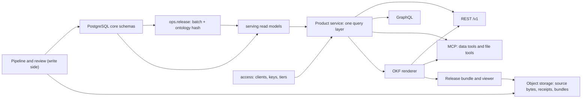

# Production implementation plan

Status: **Phase 0 is implemented in code and rehearsed on a copy of the local database; the local database itself has not been migrated. Phases 1 to 9 are planned.** This document turns the agreed production design into ordered work. SQL, endpoint names, tool names, folder layout and tier values are sketches to be confirmed while building. Sizes are rough estimates for one engineer.

Facts about the current store were measured on the local database on 2026-11-14 (experiment `jev-gpt6-luna-ontology-v1` plus earlier experiments in the same database).

## Contents

1. [Decisions](#1-decisions)
2. [Where the code is today](#2-where-the-code-is-today)
3. [Target architecture](#3-target-architecture)
4. [Rules that every phase must keep](#4-rules-that-every-phase-must-keep)
5. [Phase overview](#5-phase-overview)
6. [Phase 0: Foundations](#phase-0-foundations)
7. [Phase 1: Ontology registry and gate](#phase-1-ontology-registry-and-gate)
8. [Phase 2: Catalog, onboarding and evidence](#phase-2-catalog-onboarding-and-evidence)
9. [Phase 3: Identity, profiles and operations](#phase-3-identity-profiles-and-operations)
10. [Phase 4: Releases, serving views and the OKF tree](#phase-4-releases-serving-views-and-the-okf-tree)
11. [Phase 5: Access, product service and REST](#phase-5-access-product-service-and-rest)
12. [Phase 6: MCP server](#phase-6-mcp-server)
13. [Phase 7: GraphQL](#phase-7-graphql)
14. [Phase 8: Bundles and the graph viewer](#phase-8-bundles-and-the-graph-viewer)
15. [Phase 9: Production infrastructure and cutover](#phase-9-production-infrastructure-and-cutover)
16. [Verification strategy](#16-verification-strategy)
17. [Risks and open decisions](#17-risks-and-open-decisions)

## 1. Decisions

| Area | Decision |
|---|---|
| System of record | PostgreSQL with typed tables in seven schemas, plus a `serving` schema of read models. JSONB only for the long tail. |
| Blobs | Content-addressed bytes move from the local artifact volume to object storage. IDs stay SHA-256. |
| OKF | A rendered output of PostgreSQL, never a source. Delivered three ways: one page on request, a virtual file tree, and a file bundle built once per release. Generated pages are no longer committed for new runs. |
| Ontology | PostgreSQL registry is the source of truth. Each version is exported to LinkML, which generates SHACL, JSON Schema and docs. |
| Open Ontologies | Optional, pinned check at promotion time. Not the store and not required. |
| Interfaces | REST, GraphQL and a remote MCP server, as thin adapters over one product service and one query layer. |
| MCP tools | Two toolsets: data tools (structured JSON) and file tools (`okf_ls`, `okf_read`, `okf_find`, `okf_grep`). |
| Access | API keys stored in the application, one key valid on all three interfaces. Tiers are rows. OAuth for MCP is added later. |
| Licences | The owner confirmed that each source licence allows resale. Attribution still travels with every answer. |
| Build order | Ontology registry, evidence spine, identity, releases and OKF tree, access and REST, MCP, GraphQL, bundles, infrastructure. |

## 2. Where the code is today

| Fact | Detail |
|---|---|
| Tables | 17 tables with one shape: `id, owner_id, kind, payload json, created_at`. No foreign keys. Indexes on `owner_id` and `kind` only. Defined in a loop in [store.py](../src/link_lens/store.py). Phase 0 moves them to the `legacy` schema with `payload jsonb`. |
| Store API | `put`, `get`, `require`, `listing`, `blob`, `read_json`, `event`. About 300 references in 20 modules. `runs` and `batches` are the most used. |
| Observations | 374,335 rows, 703 MB. 23,101 source records, 56 fields. They use 39 of the 107 stored mapping configs, and every one of those 39 has a mapping row. The pipeline writes them one statement at a time and never reads them back from the table; it reads extraction artifacts. `owner_id` is a run ID for the 201,632 rows stored by extraction and a source ID for the 172,703 rows stored by assembly, so an observation's run is found through its `config_hash`. |
| Ontology | 59 concepts in a JSON blob referenced from `ontologies`. Activation and proposals are `ontology_events` rows. |
| Uniqueness checked | `config_hash` is unique across the 107 mappings. A membership is unique per batch and record. A profile is unique per batch and entity. No source record appears in more than one snapshot. Entity IDs are not all UUIDs, so they stay `text`. |
| Tests | Before Phase 0, deterministic tests ran on SQLite through `store.metadata.create_all` and did not exercise Alembic. Since Phase 0 they run on PostgreSQL built by `alembic upgrade head` in [conftest.py](../tests/conftest.py). |
| API | [api.py](../src/link_lens/api.py) is a small FastAPI app mounted beside the LangGraph development server. It is an internal API, not a product API. |
| OKF | [exports.py](../src/link_lens/exports.py) writes a folder of pages and one standalone `viewer.html` with a flat index. |

## 3. Target architecture



| Schema | Tables | Replaces |
|---|---|---|
| `ontology` | `ontology_version`, `concept`, `concept_value`, `concept_requires`, `version_concept`, `proposal`, `disposition`, `concept_decision`, `activation`, `gate_report` | `ontologies`, `ontology_events`, the JSON blob |
| `catalog` | `source`, `snapshot`, `artifact` | `sources`, `snapshots`, `artifacts` |
| `onboarding` | `run`, `mapping`, `mapping_field`, `approval` | `runs`, `mappings`, `approvals` |
| `evidence` | `source_record`, `observation` | `observations` |
| `identity` | `entity`, `entity_identifier`, `membership`, `link`, `profile`, `profile_field`, `profile_address` | `entities`, `memberships`, `links`, `profiles` |
| `ops` | `batch`, `release`, `event`, `model_call`, `model_cache`, `triage_decision`, `evaluation`, `embedding` | `batches`, `events`, `budget_reservations`, `evaluations` |
| `access` | `tier`, `client`, `api_key`, `api_usage` | New |
| `serving` | Read models only (views and per-release tables) | New |
| `legacy` | The 17 current tables, read-only after each cutover | — |

Proposed package layout:

```text
src/link_lens/
  db/            engine, types (sha256), one repository module per schema
  product/       query layer, response models, auth, limits, ASGI app
  interfaces/    rest.py, graphql.py, mcp_server.py
  okf/           render.py, tree.py, bundle.py
  ontology_export.py   registry rows to LinkML, SHACL, JSON Schema
```

## 4. Rules that every phase must keep

These come from the contracts in [AGENTS.md](../AGENTS.md).

- **IDs and hashes do not change.** Ontology digests, mapping `config_hash`, observation IDs, record IDs and `profile_version` keep their current values, so existing approvals stay valid.
- **History is not rewritten.** `outputs/`, `experiments/` and the legacy tables stay as evidence. Backfills copy; they never edit the source rows.
- **Append-only stays append-only.** Observations, approvals, ontology versions, activations and evaluations reject updates in the database.
- **Human and AI activity stay separate.** AI labels, human labels, mapping approvals, ontology promotion and release creation are different records with different kinds. None substitutes for another.
- **Scores stay labelled.** Uncalibrated scores are exposed as rule or model scores, never as probabilities. Identity links stay `proposed_unreviewed` until reviewed.
- **Evidence is never tiered or hidden.** Status, provenance, alternatives, timestamp basis and licence attribution are in every response.
- **No paid reruns for migration.** Every phase is verified with deterministic checks against stored data.
- **Experimental output goes to `outputs/local-run/`.** Submission artifacts are replaced only when a task calls for it.
- **One Alembic migration per step**, each with a working downgrade until the legacy tables are retired.

## 5. Phase overview

| Phase | Outcome | Depends on | Size |
|---|---|---|---|
| 0 | PostgreSQL-based tests, schemas, typed helpers, migration baseline | — | M |
| 1 | Ontology as rows, LinkML export, promotion gate | 0 | M |
| 2 | Typed sources, mappings, approvals, records, observations | 1 | L |
| 3 | Typed entities, links, profiles, usage and evaluations | 2 | L |
| 4 | Releases, serving read models, OKF renderer and virtual tree | 3 | L |
| 5 | Keys, tiers, product service, REST | 4 | L |
| 6 | MCP server with two toolsets | 5 | M |
| 7 | GraphQL (deferred until a client asks) | 5 | M |
| 8 | Release bundles and per-entity viewer | 4 | S |
| 9 | Production infrastructure, cutover, legacy retirement | 5 | L |

Phases 6, 7 and 8 can run in parallel once phase 5 is done. Phase 9 preparation can start alongside phase 2.

Migration approach: `store.py` stays as a facade while each domain moves. Because Link Lens is a batch system, each cutover is: stop the pipeline, migrate, backfill, verify against the baseline, switch reads and writes for that domain, continue. No long dual-write period is needed.

## Phase 0: Foundations

**Goal:** make typed, PostgreSQL-only schemas safe to build and test.

Tasks:

- [x] **Move database tests to PostgreSQL.** Replace the SQLite fixture with a session database created by `alembic upgrade head`, so migrations are tested. The session uses `testcontainers` with the pgvector image, or an existing server named by `LINK_LENS_TEST_DATABASE_URL`, on which it creates and drops its own `linklens_test_*` databases. The server starts when a test first calls the store, so tests that need no database stay free of it.
  - *Changed while building:* tests are not wrapped in a rolled-back transaction. `store.py` commits on its own connection per call, takes the budget advisory lock on a separate autocommit connection, freezes under `REPEATABLE READ` and is called from worker threads, so one shared transaction would change the behaviour under test. Tables are truncated after each test that used the database instead. Repositories added in later phases can take a connection and be tested inside a transaction.
- [x] **Change the compose image** to `pgvector/pgvector:pg17-trixie` and enable `vector` and `pg_trgm` in the first new migration (`0003`).
  - *Changed while building:* the plain `pg17` tag is the Debian bookworm build (glibc 2.36). The local data volume was created by `postgres:17` on Debian trixie (glibc 2.41, collation version 2.41), so the bookworm build would report a collation version mismatch on every text index. The `-trixie` tag has the same glibc and PostgreSQL 17.12.
- [x] **Create the schemas** `ontology`, `catalog`, `onboarding`, `evidence`, `identity`, `ops`, `access`, `serving`, `legacy` (`0004`).
- [x] **Move the 17 tables to `legacy`** with `ALTER TABLE … SET SCHEMA legacy` and point `store.TABLES` at that schema (`0005`). The SQLite branches in `store.py` and `frozen.py` are removed; nothing else changes.
- [x] **Convert `payload` to `jsonb`** in the legacy tables so backfill queries can use JSON operators and indexes (`0006`).
  - *Found while building:* `jsonb` reorders object keys. Hashes use sorted keys and are unaffected, and no stored value changes, but JSON files regenerated from payloads list keys in a different order. See the risks table.
- [x] **Add shared database helpers** in `db/`: a `sha256` domain (`bytea`, 32 bytes) with a SQLAlchemy type that presents hex strings to Python (`db/types.py`); the `forbid_update()` trigger function; a bulk loader using `COPY` into a staging table followed by `INSERT … ON CONFLICT DO NOTHING` (`db/bulk.py`). The domain, `sha256_hex()`, `sha256_from_hex()` and `forbid_update()` are created in `0007`. The engine stays in `store.py` until a repository needs it.
- [x] **Write migrations as explicit SQL** (`op.execute`), not derived from generic metadata. `migrations/env.py` has no metadata and runs one transaction per migration. `alembic upgrade head` on an empty database and a downgrade round trip run in the test suite and as a step in [the CI workflow](../.github/workflows/tests.yml).
- [x] **Record the migration baseline.** [scripts/migration_baseline.py](../scripts/migration_baseline.py) writes `outputs/local-run/migration-baseline.json`: row counts and ID digests per table, kind and owner, counts per experiment and batch, plus digests over ordered ID lists (ontology hashes, config hashes, observation IDs, record IDs, profile versions). It is read-only, works on the old and new layout, refuses to replace an existing baseline without `--force`, and `--check` compares the database with a saved baseline.
- [x] **Define database roles** (`0008`): `linklens_migrator`, `linklens_pipeline` (read and write on core schemas), `linklens_product` (read on `serving`, limited write on `access.api_usage`).
  - *Decided while building:* the roles are `NOLOGIN` groups with no passwords; a deployment creates login roles and grants one of these to each. `linklens_migrator` owns the nine schemas and the legacy tables. Table privileges are default privileges of `linklens_migrator`, so a migration from Phase 1 onward creates its objects after `SET LOCAL ROLE linklens_migrator`. `DELETE` is not granted by default; a table that needs it grants it explicitly. `linklens_pipeline` also reads and writes `legacy` until Phase 3. `linklens_product` has `USAGE` on `access`; its write on `access.api_usage` is granted with that table in Phase 5.

Done when:

- `uv run pytest -q` passes against PostgreSQL with the same test count as before.
- The baseline file exists and a second run produces identical digests.
- The running application works unchanged against `legacy`.

Results on 2026-11-14:

- **Tests.** 123 passed, 4 skipped, 1 failed on PostgreSQL. Before Phase 0 the suite was 105 passed, 4 skipped, 1 failed on SQLite; the 18 new tests cover the migrations, roles, helpers and the baseline. The one failure, `test_triage.py::test_decision_cached_with_receipt_and_experiment_isolation`, also fails on `main`: it expects the experiment `jev-luna-v1`, and the default experiment is now `jev-gpt6-luna-ontology-v1`. It is not a database failure and is left for a separate fix.
- **Baseline.** Written from the local database before migration; a second run reported zero differences. Totals: 374,335 observations, 23,101 source records, 107 mapping config hashes, 2 ontology hashes, 614 profile versions.
- **Application against `legacy`.** Verified on a restored copy of the local database, not on the local database itself. After `alembic upgrade head` the baseline check reported zero differences; all 434,994 rows read identically through the old and new `store.py`; six read-only CLI commands gave identical output; an export of the submission batch produced the same 1,747 files with the same values. A downgrade to `0002` and a second upgrade also left zero differences.
- **Not done:** the local `linklens` database is still at revision `0002` on `postgres:17`. The cutover steps are in the [engineering guide](ENGINEERING.md), section **Database layout, migrations and the baseline**. Until then, code from this branch cannot use that database.

## Phase 1: Ontology registry and gate

**Goal:** the ontology is rows that other tables can reference, and each change passes a recorded gate before promotion.

Schema sketch:

```sql
CREATE TABLE ontology.ontology_version (
  hash              sha256 PRIMARY KEY,           -- existing digest(document)
  parent_hash       sha256 REFERENCES ontology.ontology_version,
  label             text NOT NULL,                -- e.g. experimental-939e8c69596c
  document_artifact sha256 NOT NULL,              -- original JSON, kept for digest checks
  linkml_artifact   sha256,
  created_at        timestamptz NOT NULL DEFAULT now()
);

CREATE TABLE ontology.concept (
  id            bigint GENERATED ALWAYS AS IDENTITY PRIMARY KEY,
  name          text NOT NULL,                    -- entity.legal_name
  content_hash  sha256 NOT NULL,                  -- digest of this definition
  scope         text NOT NULL,
  datatype      text NOT NULL,
  cardinality   text NOT NULL CHECK (cardinality IN ('one', 'many')),
  definition    text NOT NULL,
  minimum       numeric,
  maximum       numeric,
  introduced_in sha256 NOT NULL REFERENCES ontology.ontology_version,
  UNIQUE (name, content_hash)
);

CREATE TABLE ontology.concept_value (
  concept_id bigint REFERENCES ontology.concept, value text, position int,
  PRIMARY KEY (concept_id, value)
);
CREATE TABLE ontology.concept_requires (
  concept_id bigint REFERENCES ontology.concept,
  required_concept_id bigint REFERENCES ontology.concept,
  PRIMARY KEY (concept_id, required_concept_id)
);
CREATE TABLE ontology.version_concept (
  version_hash sha256 REFERENCES ontology.ontology_version,
  concept_id   bigint REFERENCES ontology.concept,
  PRIMARY KEY (version_hash, concept_id)
);

CREATE TABLE ontology.proposal (
  id text PRIMARY KEY, parent_hash sha256 REFERENCES ontology.ontology_version,
  job_run_id text, status text NOT NULL, model text, prompt_version text,
  proposal_artifact sha256, created_at timestamptz NOT NULL
);
CREATE TABLE ontology.disposition (
  proposal_id text REFERENCES ontology.proposal, run_id text, source_field text,
  disposition text NOT NULL, target_concept text, evidence_quote text NOT NULL, reason text NOT NULL,
  PRIMARY KEY (proposal_id, run_id, source_field)
);
CREATE TABLE ontology.concept_decision (
  proposal_id text REFERENCES ontology.proposal, concept_name text,
  acceptable boolean NOT NULL, reason text NOT NULL,
  PRIMARY KEY (proposal_id, concept_name)
);

CREATE TABLE ontology.activation (            -- append-only; current = latest per experiment
  id bigint GENERATED ALWAYS AS IDENTITY PRIMARY KEY,
  experiment_id text NOT NULL, version_hash sha256 NOT NULL REFERENCES ontology.ontology_version,
  status text NOT NULL CHECK (status IN ('experimental', 'promoted')),
  reviewer text, created_at timestamptz NOT NULL,
  CHECK (status <> 'promoted' OR reviewer IS NOT NULL)
);
CREATE TABLE ontology.gate_report (
  version_hash sha256 REFERENCES ontology.ontology_version, check_name text,
  result text NOT NULL CHECK (result IN ('pass', 'fail', 'unknown')),
  detail jsonb NOT NULL, created_at timestamptz NOT NULL,
  PRIMARY KEY (version_hash, check_name, created_at)
);
```

`version_concept` lists a version's members so reads do not walk ancestors. It also allows a later version to drop or replace a concept without changing the model, although the current rule remains additive only.

Tasks:

- [ ] **Migration** for the tables above, with `forbid_update()` on `ontology_version`, `concept`, `concept_value`, `version_concept`, `activation`.
- [ ] **Backfill** the packaged v0.1 ontology, every row in `legacy.ontologies`, and the proposal, evidence, activation and promotion rows from `legacy.ontology_events`. `model_cache` rows move to `ops.model_cache` in phase 3 and stay in `legacy` until then.
- [ ] **Rewrite [ontology.py](../src/link_lens/ontology.py)** over the registry: `resolve()` builds the same document from rows; `register()` inserts version, concepts and members in one transaction; `activate()` appends an activation row; `active_hash()` reads the latest activation. Public signatures do not change.
- [ ] **Keep the digest invariant.** `digest(resolve(hash)) == hash` for every stored version. The original JSON artifact stays as an independent check.
- [ ] **Update [ontology_workflow.py](../src/link_lens/ontology_workflow.py)** to write `proposal`, `disposition` and `concept_decision` rows instead of event payloads.
- [ ] **LinkML export.** `ontology_export.py` maps scope to class, concept to attribute, enum to enum, `many` to `multivalued`, bounds to `minimum_value` and `maximum_value`, definition to `description`. Add `linkml` and `pyshacl` to a separate `ontology` dependency group so the runtime image does not need them.
- [ ] **CLI:** `link-lens ontology export HASH --format linkml|shacl|jsonschema` and `link-lens ontology gate HASH`.
- [ ] **Promotion gate.** `ontology gate` records one `gate_report` row per check:
  1. LinkML export and lint succeed.
  2. The version is additive against its parent.
  3. A sample of stored observations validates against the generated SHACL shapes (after phase 2; `unknown` until then).
  4. Impact report: mappings and observation counts per changed concept (after phase 2; `unknown` until then).
  5. Optional Open Ontologies `plan` on the generated Turtle with existing IRIs locked, at a pinned version.
- [ ] **`ontology promote` requires a gate report** with no `fail`. `unknown` results are shown to the reviewer and recorded with the promotion.
- [ ] **Commit the promoted LinkML file** next to `firmable_ontology.yaml` so a promotion shows up as a reviewable diff.

Done when:

- All existing ontology tests pass, plus new tests for digest parity, additive enforcement in the database, and gate blocking on `fail`.
- `link-lens ontology show` and `ontology diff` give the same output as before for both stored versions.
- Generated LinkML passes `linkml-lint`, and the JSON Schema enum of concept names equals the 59 registered names.

## Phase 2: Catalog, onboarding and evidence

**Goal:** the evidence spine exists with foreign keys: concept, observation, source record, snapshot, source.

Schema sketch:

```sql
CREATE TABLE catalog.artifact (
  sha256 sha256 PRIMARY KEY, uri text NOT NULL, media_type text NOT NULL,
  size bigint NOT NULL, name text, created_at timestamptz NOT NULL
);
CREATE TABLE catalog.source (
  id text PRIMARY KEY, kind text NOT NULL,          -- catalogue | registered
  portal text NOT NULL, slug text, title text, publisher text,
  metadata jsonb NOT NULL, created_at timestamptz NOT NULL
);
CREATE TABLE catalog.snapshot (
  id sha256 PRIMARY KEY, source_id text NOT NULL REFERENCES catalog.source,
  resource_id text, artifact_sha sha256 NOT NULL REFERENCES catalog.artifact, format text NOT NULL,
  licence text, licence_url text,
  observed_at timestamptz, observed_at_basis text NOT NULL,
  documentation jsonb, dataset_notes text, receipt jsonb, inspection jsonb
);

CREATE TABLE onboarding.run (
  id text PRIMARY KEY, kind text NOT NULL, experiment_id text NOT NULL,
  source_id text REFERENCES catalog.source, snapshot_id sha256 REFERENCES catalog.snapshot,
  ontology_hash sha256 REFERENCES ontology.ontology_version,
  status text NOT NULL, model text, prompt_version text, thread_id text,
  supersedes_run_id text REFERENCES onboarding.run,
  model_calls int, python_calls int, input_tokens bigint, output_tokens bigint,
  active_seconds numeric, calculated_cost_usd numeric,
  state jsonb NOT NULL,                              -- validation, critique, artifacts, recovery lineage
  created_at timestamptz NOT NULL, completed_at timestamptz
);
CREATE TABLE onboarding.mapping (
  config_hash sha256 PRIMARY KEY,                    -- unique across all 107 stored mappings
  id text NOT NULL UNIQUE,                           -- existing "<run>:<version>" id
  run_id text NOT NULL REFERENCES onboarding.run, version int NOT NULL,
  ontology_hash sha256 REFERENCES ontology.ontology_version,   -- null = packaged v0.1
  subject_role text NOT NULL, source_kind text NOT NULL, address_role text NOT NULL,
  source_reliability real NOT NULL, config jsonb NOT NULL,
  model text, status text NOT NULL, created_at timestamptz NOT NULL
);
CREATE TABLE onboarding.mapping_field (              -- derived from config, for impact queries
  config_hash sha256 REFERENCES onboarding.mapping, concept_id bigint REFERENCES ontology.concept,
  group_name text NOT NULL DEFAULT '', source_fields text[] NOT NULL,
  PRIMARY KEY (config_hash, concept_id, group_name)
);
CREATE TABLE onboarding.approval (                   -- append-only
  id text PRIMARY KEY, run_id text NOT NULL REFERENCES onboarding.run,
  config_hash sha256 NOT NULL REFERENCES onboarding.mapping,
  decision text NOT NULL, reviewer text NOT NULL, feedback text,
  identity_basis text, decided_at timestamptz NOT NULL
);

CREATE TABLE evidence.source_record (
  source_id text NOT NULL REFERENCES catalog.source,
  id sha256 NOT NULL, snapshot_id sha256 NOT NULL REFERENCES catalog.snapshot,
  sheet text, row_no bigint, locator jsonb NOT NULL,
  PRIMARY KEY (source_id, id)
) PARTITION BY LIST (source_id);

CREATE TABLE evidence.observation (
  source_id text NOT NULL, id sha256 NOT NULL,
  record_id sha256 NOT NULL, concept_id bigint NOT NULL REFERENCES ontology.concept,
  config_hash sha256 NOT NULL REFERENCES onboarding.mapping,
  group_name text, group_id text,
  value text, raw_value jsonb NOT NULL, source_fields text[] NOT NULL,
  field_confidence real, observed_at timestamptz, observed_at_basis text,
  ingested_at timestamptz NOT NULL, derivation_level text,
  PRIMARY KEY (source_id, id),
  FOREIGN KEY (source_id, record_id) REFERENCES evidence.source_record (source_id, id)
) PARTITION BY LIST (source_id);
CREATE INDEX ON evidence.observation (source_id, record_id);
CREATE INDEX ON evidence.observation (concept_id, value);
```

Notes:

- Licence, snapshot and source context are read through `source_record` and `snapshot`. Roles and source reliability are read through `mapping`. They are no longer copied onto each observation. Estimated row size falls from about 1.7 KB to about 0.5 KB (5% sample estimate).
- `observed_at` stays on the observation because a mapping may use a record-level statement timestamp.
- One partition per registered source, plus a default partition. A source can then be loaded, verified and attached, or detached, without touching the others.
- Full source rows are not stored today; only per-field `raw_value`. Adding a `raw jsonb` column to `source_record` is a separate decision.

Tasks:

- [ ] **Migrations** for `catalog`, `onboarding`, `evidence`, with append-only triggers on `snapshot`, `mapping`, `approval`, `source_record`, `observation`.
- [ ] **Backfill** in dependency order: artifacts, sources, snapshots, runs, mappings and `mapping_field`, approvals, source records (distinct records from observation payloads), observations. Use `INSERT … SELECT` from `legacy` with the JSON operators; batch observations per source.
- [ ] **Repositories** in `db/catalog.py`, `db/onboarding.py`, `db/evidence.py`. Re-implement the `store` facade for these tables on top of them, returning the same dict shapes callers expect.
- [ ] **Bulk observation writes.** Replace the per-row `store.put` loop in [pipeline.py](../src/link_lens/pipeline.py) with the `COPY` loader. Extraction and assembly logic do not change.
- [ ] **Blob storage interface.** `store.blob` and `blob_path` go behind an interface with a local filesystem backend (current behaviour) and an S3-compatible backend. `catalog.artifact.uri` records where the bytes are.
- [ ] **Turn on gate checks 3 and 4** from phase 1 now that observations and mappings are typed.
- [ ] **Update [frozen.py](../src/link_lens/frozen.py)** to a second archive format that covers the typed schemas. Keep reading the first format.

Done when:

- Typed counts equal the baseline for every experiment: observations, distinct records, mappings, approvals, runs, snapshots, sources.
- The digest over ordered observation IDs per batch equals the baseline.
- A fixture run of `onboard` then `extract` writes only typed tables, and a second identical run inserts zero rows.
- The impact query returns per-mapping observation counts for a chosen concept:

```sql
SELECT m.id, count(*) AS observations
FROM   ontology.concept c
JOIN   evidence.observation o ON o.concept_id = c.id
JOIN   onboarding.mapping m   ON m.config_hash = o.config_hash
WHERE  c.name = 'registration.business_name_status'
GROUP  BY 1;
```

## Phase 3: Identity, profiles and operations

**Goal:** derived results and operational records are typed, versioned by batch, and queryable.

Schema sketch:

```sql
CREATE TABLE ops.batch (
  id text PRIMARY KEY, kind text NOT NULL,           -- pipeline | enhancement | discovery
  experiment_id text NOT NULL, baseline_batch_id text REFERENCES ops.batch,
  run_ids text[], counts jsonb, policy jsonb, result_artifact sha256, created_at timestamptz NOT NULL
);

CREATE TABLE identity.entity (
  id text PRIMARY KEY, kind text NOT NULL,           -- entity | enhanced_entity
  status text NOT NULL, rule_version text NOT NULL, first_batch_id text REFERENCES ops.batch
);
CREATE TABLE identity.entity_identifier (
  batch_id text REFERENCES ops.batch, entity_id text REFERENCES identity.entity,
  scheme text NOT NULL, value text NOT NULL,         -- abn | acn | nzbn
  PRIMARY KEY (batch_id, entity_id, scheme, value)
);
CREATE INDEX ON identity.entity_identifier (scheme, value);

CREATE TABLE identity.membership (                   -- a record joins at most one entity per batch
  batch_id text REFERENCES ops.batch, source_id text, record_id sha256,
  entity_id text NOT NULL REFERENCES identity.entity, decision text, reason text,
  PRIMARY KEY (batch_id, source_id, record_id)
);
CREATE INDEX ON identity.membership (batch_id, entity_id);

CREATE TABLE identity.link (
  id sha256 PRIMARY KEY, batch_id text REFERENCES ops.batch,
  a_source_id text, a_record_id sha256, b_source_id text, b_record_id sha256,
  rule text NOT NULL, rule_version text NOT NULL,
  score real, score_kind text NOT NULL, threshold real,
  status text NOT NULL,                              -- proposed_unreviewed until reviewed
  evidence jsonb NOT NULL
);

CREATE TABLE identity.profile (
  batch_id text REFERENCES ops.batch, entity_id text REFERENCES identity.entity,
  profile_version sha256 NOT NULL, policy_version text NOT NULL, status text NOT NULL,
  uncertainties jsonb, PRIMARY KEY (batch_id, entity_id)
);
CREATE TABLE identity.profile_field (
  batch_id text, entity_id text, concept_id bigint REFERENCES ontology.concept, position int,
  status text NOT NULL,                              -- selected | unresolved | multi
  value text, observation_source_id text, observation_id sha256,
  decision text, temporal_caveat text, alternatives jsonb,
  PRIMARY KEY (batch_id, entity_id, concept_id, position),
  FOREIGN KEY (batch_id, entity_id) REFERENCES identity.profile,
  FOREIGN KEY (observation_source_id, observation_id) REFERENCES evidence.observation
);
CREATE TABLE identity.profile_address (             -- one source record's address fields kept together
  batch_id text, entity_id text, position int, source_id text, record_id sha256,
  address_role text, fields jsonb NOT NULL,
  PRIMARY KEY (batch_id, entity_id, position),
  FOREIGN KEY (batch_id, entity_id) REFERENCES identity.profile
);

CREATE TABLE ops.event (
  id uuid, run_id text, kind text NOT NULL, at timestamptz NOT NULL, payload jsonb NOT NULL,
  PRIMARY KEY (at, id)
) PARTITION BY RANGE (at);
CREATE TABLE ops.model_call (                        -- every attempt, including failed and retried
  id text PRIMARY KEY, experiment_id text NOT NULL, owner text, stage text NOT NULL, model text NOT NULL,
  status text NOT NULL, input_tokens bigint, output_tokens bigint,   -- null = unknown, never zero
  reservation_usd numeric, charge_usd numeric, rate jsonb, created_at timestamptz NOT NULL
);
CREATE TABLE ops.model_cache (key text PRIMARY KEY, stage text, response_artifact sha256, created_at timestamptz);
CREATE TABLE ops.evaluation (
  id text PRIMARY KEY, kind text NOT NULL,           -- human_label | ai_label | worksheet | ...
  worksheet_id text, item_id text, verdict text, reviewer text, evidence text,
  labelled_at timestamptz, payload jsonb NOT NULL
);
CREATE TABLE ops.embedding (
  key sha256 PRIMARY KEY, model text NOT NULL, embedding vector(1536) NOT NULL, created_at timestamptz NOT NULL
);
```

Tasks:

- [ ] **Migrations** for `identity` and the remaining `ops` tables. Append-only triggers on `membership`, `link`, `profile`, `profile_field`, `profile_address`, `model_call`, `evaluation`.
- [ ] **Backfill** batches, entities and identifiers, memberships, links, profiles (flattening `fields`, `addresses` and alternatives), events, budget reservations into `model_call`, caches, triage decisions, evaluations.
- [ ] **Repositories** in `db/identity.py` and `db/ops.py`. Finish the `store` facade for these tables. After this phase no module reads `legacy` directly.
- [ ] **`current_*` views** per derived table that select the batch named by the active release (phase 4). Until then they select the promoted batch from the submission manifest.
- [ ] **Keep budget locking** as is: the advisory lock stays, reservations now write `ops.model_call`.
- [ ] **Write new embeddings** to `ops.embedding` with an HNSW index. Backfilling cached embeddings is optional.
- [ ] **Make the legacy tables read-only** by revoking writes from the pipeline role.

Done when:

- Counts and digests equal the baseline: entities, memberships, links, profiles and profile versions per batch; events; reservations; evaluations by kind.
- Re-running `assemble` on the promoted batch's inputs reproduces identical `profile_version` values. This is deterministic and makes no model calls.
- `link-lens usage` and the cost reports return the same totals and the same priced-call coverage as before.
- Human labels and AI labels remain separately countable.

## Phase 4: Releases, serving views and the OKF tree

**Goal:** a release is an explicit, human-recorded pointer, and everything a client can see is derived from it.

```sql
CREATE TABLE ops.release (                           -- append-only
  id bigint GENERATED ALWAYS AS IDENTITY PRIMARY KEY,
  batch_id text NOT NULL REFERENCES ops.batch,
  ontology_hash sha256 NOT NULL REFERENCES ontology.ontology_version,
  released_by text NOT NULL, released_at timestamptz NOT NULL DEFAULT now(),
  notes text, bundle_artifact sha256
);
```

Serving read models. Every row carries `release_id`, and the query layer always binds one.

| Read model | Content | Kind |
|---|---|---|
| `serving.release` | Releases with batch and ontology hash | View |
| `serving.entity` | Entities in the release, identifiers, display name | View |
| `serving.profile`, `serving.profile_field`, `serving.profile_address` | Profile values with status, alternatives and the selected observation | View |
| `serving.observation` | Observations from mappings approved in the release's runs, including unlinked records | View |
| `serving.evidence` | Observation joined to record locator, snapshot, source, licence | View |
| `serving.link` | Identity links with rule, score kind and status | View |
| `serving.source`, `serving.concept` | Sources in the release; concepts of the release's ontology | View |
| `serving.okf_page` | One row per page: path, type, title, description, tags, status, entity or observation key | Table per release |
| `serving.okf_line` | Searchable lines per page: frontmatter and `field: value` claims | Table per release, trigram and full-text indexes |
| `serving.okf_index` | Index folders: parent path, entry label, target path, entry count | Table per release |

The three `okf_*` tables are built once when a release is created. A release never changes, so they never need refreshing. They are partitioned by `release_id` and dropped when a release leaves the retention window.

OKF path scheme:

```text
/index.md
/ontology/index.md
/ontology/{scope}/{name}.md
/sources/index.md
/sources/{source_id}.md
/entities/index.md
/entities/by-name/{a}/{ab}/index.md
/entities/by-state/{state}/index.md
/entities/by-type/{entity_type}/index.md
/entities/by-source/{source_id}/index.md
/entities/{id[:2]}/{id}.md           canonical page, path never changes
/evidence/{id[:2]}/{id}.md
```

Tasks:

- [ ] **`link-lens release create --batch-id … --reviewer …`** inserts the release row and builds the `okf_*` tables. It is a human action and is never triggered by a pipeline run. `release list` and `release show` report state.
- [ ] **Serving views** as above, owned by the migrator role, selectable by `linklens_product` only.
- [ ] **Split the renderer out of `exports.py`.** `okf/render.py` holds pure functions: `render_entity`, `render_evidence`, `render_source`, `render_concept`, `render_index`. Use the release time for `generated.at` so output is deterministic.
- [ ] **Change links to the new path scheme** and keep `check_bundle` as the broken-link test.
- [ ] **Index builder.** An index page lists at most 200 entries. A larger folder is split one level deeper (for example `by-name/k/` into `by-name/k/ki/`). Every index page links only one level down.
- [ ] **Virtual tree functions** in `okf/tree.py`, all taking a release and a scope:
  - `ls(path, cursor)` returns entries of a folder, paged.
  - `read(path, offset, limit)` renders one page.
  - `find(path, type, tags, status, cursor)` filters `okf_page`.
  - `grep(pattern, path, cursor)` searches `okf_line` under a path prefix and returns path and line. A path prefix is required.
- [ ] **Keep the file exporter** as a caller of the same renderer, writing to a directory for bundles (phase 8).

Done when:

- For the submission batch, a bundle written through the new renderer has the same documents and the same profile JSON as `outputs/okf`, apart from paths and `generated.at`. Zero broken links.
- `tree.read(path)` returns exactly the bytes of the corresponding bundle file.
- No index page exceeds 200 entries on a synthetic set of 100,000 entities.
- `grep` and `find` use indexes (checked with `EXPLAIN`) and return within an agreed time on that synthetic set.
- Creating a second release does not change any result for the first.

## Phase 5: Access, product service and REST

**Goal:** a separately deployed, read-only product service with keyed access, and the REST interface on top of it.

```sql
CREATE TABLE access.tier (
  id text PRIMARY KEY, monthly_quota bigint, rate_per_minute int NOT NULL,
  interfaces text[] NOT NULL,                        -- rest, mcp, graphql
  toolsets text[] NOT NULL,                          -- data, files
  source_scope text[],                               -- null = all sources
  bundle_downloads boolean NOT NULL DEFAULT false,
  release_lag int NOT NULL DEFAULT 0,                -- 0 = latest, 1 = previous
  history_depth int                                  -- null = all releases
);
CREATE TABLE access.client (
  id uuid PRIMARY KEY, name text NOT NULL, tier_id text NOT NULL REFERENCES access.tier,
  status text NOT NULL, created_at timestamptz NOT NULL
);
CREATE TABLE access.api_key (
  id uuid PRIMARY KEY, client_id uuid NOT NULL REFERENCES access.client,
  prefix text NOT NULL UNIQUE, key_hash sha256 NOT NULL, label text,
  created_at timestamptz NOT NULL, expires_at timestamptz, revoked_at timestamptz, last_used_at timestamptz
);
CREATE TABLE access.api_usage (
  key_id uuid REFERENCES access.api_key, day date, interface text, calls bigint NOT NULL DEFAULT 0,
  PRIMARY KEY (key_id, day, interface)
);
```

Example tiers. Names and numbers are placeholders for the owner to set.

| Dimension | Starter | Professional | Enterprise |
|---|---|---|---|
| Volume | 10,000 calls a month, 60 a minute | 250,000 calls a month, 300 a minute | Per contract |
| Source coverage | Company register | All standard sources | All, plus sources on request |
| Interfaces | REST | REST and MCP | REST, MCP and GraphQL |
| MCP toolsets | None | Data and files | Data and files |
| Bundle downloads | No | No | Every release, licensed scope |
| Freshness | Previous release | Latest release | Latest, with release notices |
| History | Current release only | Last three releases | All releases |

Tasks:

- [ ] **Key handling.** Format `ll_<prefix>_<secret>` with a random secret of at least 32 bytes. Store the prefix and the SHA-256 of the secret; show the key once at creation; compare in constant time. Keys are never logged.
- [ ] **CLI:** `link-lens access tier set`, `client create`, `key create`, `key revoke`, `usage`.
- [ ] **Auth step** in `product/auth.py`: `Authorization: Bearer` to principal (client, tier, scope). Written so a second resolver for OAuth tokens can be added without touching the interfaces.
- [ ] **Limits** in `product/limits.py`: per-minute token bucket per key in process; monthly quota from `api_usage`. Responses use 401, 403 and 429 with `Retry-After`.
- [ ] **Query layer** in `product/queries.py`: `search_entities`, `get_entity`, `get_profile`, `list_observations`, `get_evidence`, `list_links`, `list_sources`, `describe_concepts`, `list_releases`, plus the tree functions. Every function takes the principal and a release, and applies source scope, release lag and history depth.
- [ ] **Response models** in `product/models.py`. Evidence fields are required, not optional: status, provenance, alternatives, score kind, timestamp basis, licence. Concept names are checked against the JSON Schema generated from the release's ontology.
- [ ] **ASGI app** `link_lens.product.app:app`, run with uvicorn as a new compose service `product`, using the `linklens_product` database role. It is not mounted in `langgraph.json`. The existing internal routes stay where they are.
- [ ] **REST interface:**

| Route | Returns |
|---|---|
| `GET /v1/entities?name=&abn=&acn=&state=&type=&cursor=&limit=` | Matching entities |
| `GET /v1/entities/{id}` | Entity, identifiers, `okf_path` |
| `GET /v1/entities/{id}/profile` | Profile fields with evidence; `ETag` is `profile_version` |
| `GET /v1/entities/{id}/observations?concept=&source=` | Source claims |
| `GET /v1/entities/{id}/links` | Identity links and their status |
| `GET /v1/observations/{id}` | One claim with record locator, snapshot, source, licence |
| `GET /v1/sources`, `GET /v1/sources/{id}` | Sources and licences |
| `GET /v1/ontology/concepts?scope=` | Concepts of the release's ontology |
| `GET /v1/releases`, `GET /v1/releases/current` | Releases visible to the key |
| `GET /v1/okf/{path}` | One OKF page as Markdown, or a folder listing |

- [ ] **Conventions:** keyset cursors; `?release=` to address an older release; `X-LinkLens-Release` on every response; `Accept: text/markdown` on entity routes returns the OKF page; errors as problem details JSON; OpenAPI published at `/openapi.json`.

Done when:

- Contract tests cover every route, including scope filtering, release lag, history depth, expired and revoked keys, and both limit types.
- A request with a key from one tier cannot read sources outside its scope through any route.
- The product role cannot read core schemas directly (checked by a test that expects a permission error).
- `GET /v1/entities/{id}/profile` returns the same values, statuses and provenance IDs as the stored profile for a sample of entities.

## Phase 6: MCP server

**Goal:** a remote MCP server on the product service with two toolsets.

| Toolset | Tool | Does |
|---|---|---|
| Data | `search_entities(name, abn, acn, state, type, cursor)` | Finds entities; each result includes `okf_path` |
| Data | `get_profile(entity_id)` | Profile fields with status, alternatives and evidence IDs |
| Data | `list_observations(entity_id, concept, cursor)` | Source claims for an entity |
| Data | `get_evidence(observation_id)` | Record locator, snapshot, source, licence |
| Data | `describe_concepts(scope)` | Ontology concepts and definitions |
| Files | `okf_ls(path, cursor)` | Lists a folder or index |
| Files | `okf_read(path, offset, limit)` | Returns one page as OKF Markdown |
| Files | `okf_find(path, type, tags, status, cursor)` | Filters pages by frontmatter |
| Files | `okf_grep(pattern, path, cursor)` | Matches text under a folder; returns path and line |

Tasks:

- [ ] **Read the documentation for the installed MCP SDK version first.** Mount the server on the product app at `/mcp` using its HTTP transport.
- [ ] **Reuse the auth step.** The same bearer key applies. The tier's `toolsets` decides which tools are listed. Offer `/mcp/data` and `/mcp/files` as narrower mounts for clients that want one style.
- [ ] **Each tool is one call into the query layer.** No tool runs commands, writes data or accepts SQL.
- [ ] **Bound every result:** page sizes, a line limit on `okf_read`, a match limit on `okf_grep`, and a clear continuation cursor.
- [ ] **Return both text and structured content** where the SDK supports it. Data tools return JSON; file tools return Markdown.
- [ ] **Cross-link the styles.** Data results carry `okf_path`; page frontmatter carries the entity or observation ID.
- [ ] **Write tool descriptions for agents:** when to use each tool, what the limits are, and what the status values mean.
- [ ] **Agent evaluation.** A small script runs about ten fixed tasks (find a company by ABN, cite the source of its legal name, list its licences, explain an unresolved field) once with each toolset and records success and tool calls.
- [ ] **Leave a seam for OAuth** as a second credential resolver. Not built in this phase.

Done when:

- A client configured with only a URL and a key can list tools and complete the evaluation tasks with either toolset.
- Usage from MCP calls appears in `access.api_usage` under the `mcp` interface.
- A key whose tier lacks a toolset does not see its tools.

## Phase 7: GraphQL

**Goal:** a typed graph over the same query layer for nested evidence queries.

**Status: deferred.** Build this phase only when a client asks for GraphQL. All three interfaces share one query layer, so adding it later costs about the same as adding it now.

**Library choice:** Strawberry, because it mounts on the same FastAPI app and shares the key check, tier limits and query layer. Ariadne is the alternative if a schema-first contract is wanted. Auto-generated engines such as Hasura or PostGraphile were rejected because the release, scope and evidence rules would then be enforced in two places.

Tasks:

- [ ] **Add Strawberry** and mount `/graphql` on the product app, behind the same auth step and limits.
- [ ] **Types:** `Entity`, `Identifier`, `Profile`, `ProfileField`, `AddressBundle`, `Observation`, `SourceRecord`, `Snapshot`, `Source`, `Link`, `Concept`, `Release`.
- [ ] **Queries:** `entity(id, abn, acn)`, `entities(filter, first, after)`, `observation(id)`, `sources`, `concepts(scope)`, `releases`. No mutations.
- [ ] **Resolvers call the query layer** through batched loaders so a nested query does not issue one SQL statement per row.
- [ ] **Limits:** maximum depth, a cost estimate per query, a maximum page size, and a request timeout. Count each request against the tier.
- [ ] **Publish the schema** as SDL in the repository and fail CI when the generated schema drifts from it.

Done when:

- One query returns an entity's profile, each field's selected observation, and that observation's source and licence, with a bounded number of SQL statements.
- Over-deep and over-cost queries are rejected with a clear error.
- Values match the REST responses for the same entities.

## Phase 8: Bundles and the graph viewer

**Goal:** real files for demos and for clients who want them, without a manual export step.

Tasks:

- [ ] **Bundle job.** `link-lens release bundle RELEASE --scope demo|client:<id>` writes a folder through the shared renderer, runs `check_bundle`, generates `viewer.html` with the vendored generator, and stores a compressed archive with a manifest hash in object storage. Release creation queues the configured bundles.
- [ ] **Demo scope** is a named, bounded list of entities chosen by the owner. A whole-dataset bundle is produced only on request.
- [ ] **`GET /v1/bundles/{release}`** returns a short-lived download link for keys whose tier allows bundles, limited to the client's source scope.
- [ ] **`GET /v1/entities/{id}/viewer`** builds a small folder for one entity, its evidence and its sources, runs the unchanged generator, and returns the HTML. Cache by `profile_version`.
- [ ] **Stop committing generated OKF for new runs.** The submitted `outputs/okf` stays in git as historical evidence. Keep a small fixture bundle for tests.
- [ ] **Preserve the vendored OKF attribution** and licence headers.

Done when:

- Creating a release produces the demo bundle with no manual command, and the bundle's page bytes equal `okf_read` for the same paths.
- The per-entity viewer opens for a sample of entities and shows the same evidence edges as the full viewer.

## Phase 9: Production infrastructure and cutover

**Goal:** run the system as a service and retire the legacy tables.

Tasks:

- [ ] **Managed PostgreSQL** with `vector` and `pg_trgm`, point-in-time recovery, and a read replica for the product service.
- [ ] **Object storage** for artifacts and bundles, using the backend added in phase 2. Migrate existing blobs by SHA-256 and verify each hash after copy.
- [ ] **Agent runtime.** The LangGraph development server is for local development. Choose the licensed platform or a self-hosted graph with a PostgreSQL checkpointer, then re-test the review interrupt and resume flow and remove the compatibility guard in `runtime_compat.py` if it is no longer needed.
- [ ] **Reviewer sign-in.** Mapping approvals, ontology promotion and release creation record an authenticated user instead of a configured name.
- [ ] **Secrets and configuration.** New settings documented in `.env.example` with placeholders only.
- [ ] **Observability.** Structured logs with request ID and key prefix, never the key; metrics per interface and tier; alerts on error rate and latency.
- [ ] **Rate limiting across instances.** Move the per-minute bucket to a shared store before running more than one product instance.
- [ ] **CI.** Tests on PostgreSQL, migration up and down on an empty database, lint, OpenAPI and GraphQL schema drift checks, generated ontology artifact drift check.
- [ ] **Sandbox.** The sandbox controller keeps its current isolation rules. A production multi-tenant sandbox is out of scope here and needs its own design.
- [ ] **Cutover.** Restore a copy of the data, run all migrations and backfills, compare with the baseline, then switch.
- [ ] **Retire `legacy`.** After an agreed period, archive it with `freeze`, verify the archive, and drop the schema in a final migration.
- [ ] **Documentation.** Update the owning documents: storage and architecture in [README.md](../README.md), operations and recovery in [ENGINEERING.md](ENGINEERING.md), results status in [outputs/README.md](../outputs/README.md). Keep historical numbers and screenshots as they are.

Done when:

- A restore from backup into an empty environment serves the same release with the same profile versions.
- The product service runs on the replica with the read-only role.
- No code path reads or writes `legacy`.

## 16. Verification strategy

| Check | Applies to | Method |
|---|---|---|
| Baseline counts | Every backfill | Compare typed counts per experiment and batch with `migration-baseline.json` |
| ID digests | Ontology, mappings, observations, records, profiles | Digest over ordered IDs equals the baseline |
| Ontology digest | Phase 1 | `digest(resolve(hash)) == hash` for every version |
| Deterministic replay | Phase 3 | Re-assembling the promoted batch reproduces every `profile_version` |
| Idempotency | Phases 2, 3 | A second identical write inserts zero rows |
| Append-only | All core schemas | Tests expect an error on `UPDATE` and on `DELETE` by the pipeline role |
| Parity of outputs | Phase 4 | New renderer output matches the submitted OKF content; zero broken links |
| Interface parity | Phases 5 to 7 | REST, GraphQL and MCP return the same values for the same entities |
| Scope and limits | Phase 5 onward | Tests for source scope, release lag, history depth, quota and rate limits |
| Permissions | Phase 5 onward | The product role cannot select from core schemas |
| Cost totals | Phase 3 | Usage reports match previous totals and priced-call coverage |

No verification step needs a model call or a new human review.

## 17. Risks and open decisions

| Topic | Risk or question | Proposed handling |
|---|---|---|
| Tests need PostgreSQL | Deterministic tests no longer run without a database | Use a container started by the test session; keep pure logic tests database-free |
| `jsonb` key order | Files regenerated from legacy payloads list the same values with keys in a different order, so a regenerated `outputs/` shows key-order diffs and new file hashes. OKF pages come from artifacts and are unaffected. | Keep the submitted files as they are. Compare regenerated JSON by value, or write exports with sorted keys if byte-stable output is wanted. |
| Backend migrates on start | The compose backend runs `alembic upgrade head` when it starts, so starting it on new code migrates the database it points at | Back up before starting a backend that carries new migrations; consider a separate migration step before Phase 9 |
| Roles on managed PostgreSQL | Migration `0008` creates roles and changes owners, which the local superuser may do. A managed service's admin user is not a superuser and needs membership in `linklens_migrator` first. | Settle in Phase 9 with the chosen provider |
| Source coverage tiers and profiles | A profile combines several sources. A client limited to some sources could still see values selected from others. | Decide between selling profiles whole or filtering fields and provenance by scope. Start with whole profiles, and apply scope to observations, evidence and bundles. |
| Hash storage | `bytea` halves key size but is less readable in ad hoc SQL | Use the `sha256` domain with hex views and helper functions; revisit if it slows development |
| Observation partitioning | Sources refreshed many times will grow one partition | Sub-partition by snapshot when a source has more than a few refreshes |
| `okf_grep` at scale | Free regex over all pages would be slow | Require a path prefix, back it with trigram indexes on `okf_line`, cap matches |
| Index design | Nested by-name indexes for millions of entities need tuning | Test on synthetic data in phase 4 before fixing the path scheme |
| Rate limiting in process | Not correct across several instances | Acceptable for one instance; shared store is a phase 9 task |
| MCP and OAuth | Some MCP clients accept only OAuth for remote servers | Keys first, as decided; the auth step is written for a second resolver |
| MCP SDK and Strawberry versions | Both libraries change often | Pin versions; read the current documentation before coding |
| Agent runtime licence | The development server is not for production | Decide in phase 9 before any production deployment |
| Which experiments to migrate | Backfill covers everything in the database today | Confirm whether earlier experiments are migrated or left as frozen archives |
| Tier values and prices | Placeholders only | Owner sets them; they are rows and can change without code |
| Open Ontologies | Single main author and fast churn | Optional gate check only, pinned version, result may be `unknown` |
| Full source rows | Not stored today | Decide separately whether to retain raw rows in `source_record` |
